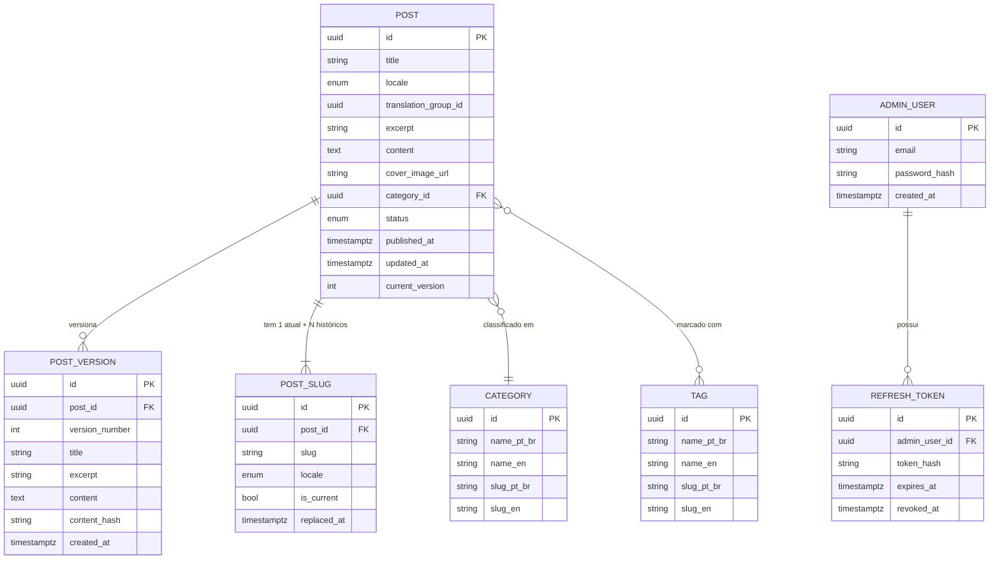
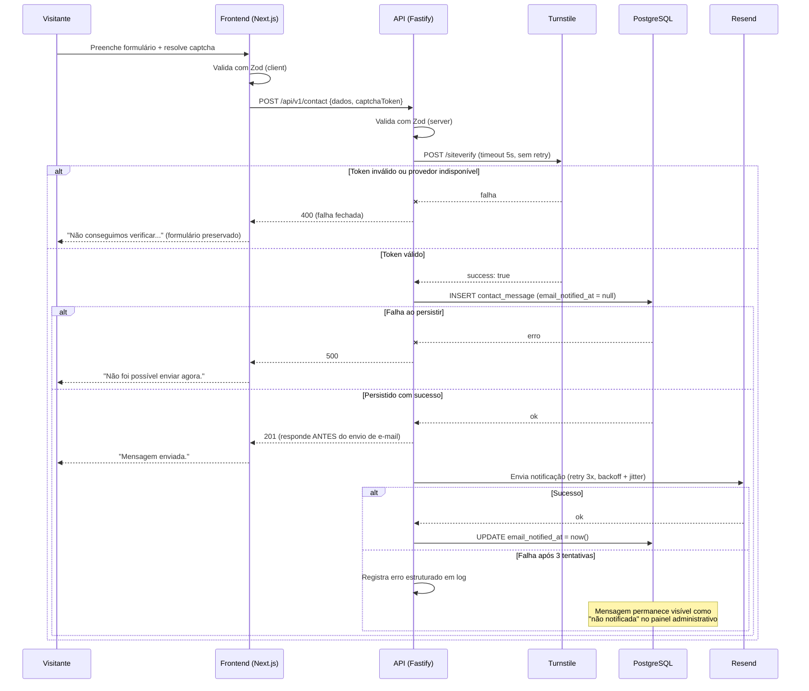
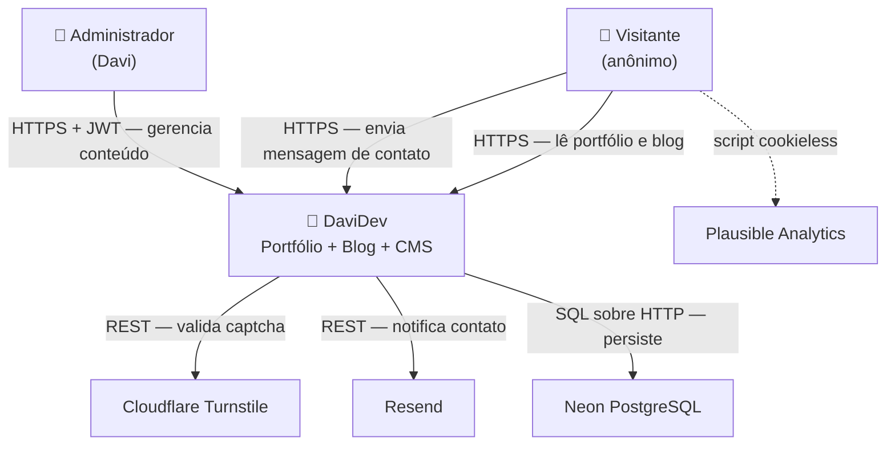
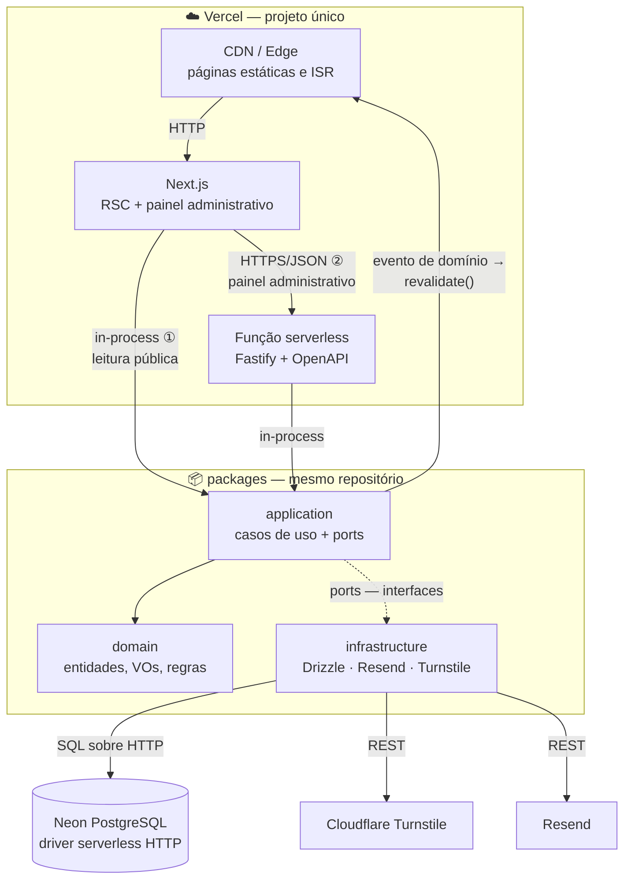
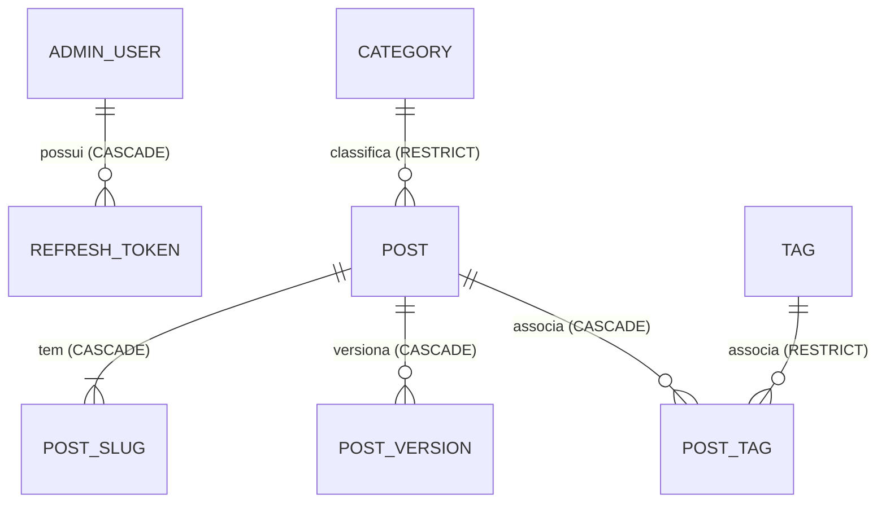
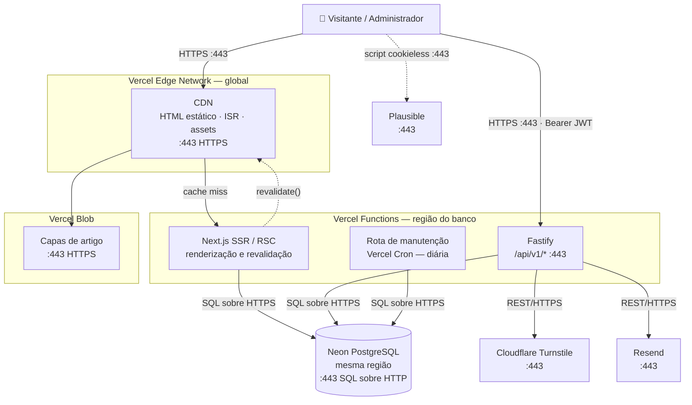

# Documento de Arquitetura — DaviDev

> **Projeto:** DaviDev — Portfólio profissional com blog e CMS
> **Domínio:** davidev.net.br
> **Autor / Arquiteto:** Davi Chaves
> **Data de início:** 2026-09-09
> **Status:** Em elaboração — processo de 23 etapas
>
> Este documento é **auto-contido**: destina-se a dar a um Coding Agent em sessão nova tudo o que é necessário para implementar o sistema, sem depender de outro documento.
>
> Cada seção separa **`## Decisões`** (o que foi escolhido e por quê) de **`## Especificação`** (o detalhe prescritivo e acionável).

---

# Product Overview

## Propósito do sistema

O DaviDev é um portfólio profissional público com blog técnico próprio e painel administrativo (CMS), construído como produto de software completo: frontend Next.js, backend REST em Fastify sob arquitetura hexagonal e persistência em PostgreSQL.

O sistema é, simultaneamente, produto e evidência. Além de apresentar trajetória, habilidades, conhecimentos, experiências e projetos, ele expõe publicamente o processo de engenharia que o originou (PRD, arquitetura, especificações, implementação assistida por IA), transformando método em artefato verificável.

## Perfis de usuário

| Papel | Autenticação | O que faz no sistema |
|---|---|---|
| **Visitante anônimo** | Nenhuma | Lê o portfólio e o blog; filtra artigos por categoria e tag; alterna idioma (pt-BR/en) e tema (claro/escuro); envia mensagem pelo formulário de contato |
| **Administrador** | JWT (Access + Refresh Token) | CRUD de posts, categorias e tags; editor Markdown com preview; publica, despublica, envia à lixeira e exclui definitivamente; consulta mensagens de contato |

Existem **apenas dois papéis**. Não há RBAC, não há hierarquia de permissões e não há múltiplos administradores — exclusão explícita do PRD, Seção 8.

## Stakeholders

| Pessoa | Papel | Decide |
|---|---|---|
| Davi Chaves | Autor, arquiteto, implementador, revisor e operador | Tudo |

Não há cliente, Product Owner, aprovador externo nem par revisor (PRD, Questão #19). **Consequência arquitetural:** nenhuma decisão depende de terceiros — o que acelera —, mas também não há quem barre uma decisão ruim. Isso eleva a importância dos ADRs com rationale explícito, que passam a ser o único mecanismo de contestação disponível ao próprio autor no futuro.

## Escopo

**Dentro do escopo desta iniciativa:**
- Área pública: Home, Sobre mim, Habilidades, Conhecimentos, Experiências, Projetos (listagem e detalhe), Contato, Como foi construído
- Blog público: listagem com filtros por categoria e tag, leitura de artigo por slug, SEO e compartilhamento
- Painel administrativo: autenticação, CRUD de posts, editor Markdown com preview fiel, gestão de categorias e tags, lixeira
- Versionamento de artigos e sinalização pública de atualização
- Internacionalização pt-BR / en
- Tema claro e escuro
- API REST documentada em OpenAPI/Swagger
- Formulário de contato com persistência e notificação por e-mail
- **Página de Política de Privacidade** — requisito adicionado na Etapa 4 (NFR), não previsto no PRD. Exigência de conformidade LGPD/GDPR decorrente da coleta de dados pessoais no formulário de contato somada ao público internacional

**Explicitamente fora do escopo** (PRD, Seção 8):
- RBAC, múltiplos usuários e papéis
- Telas de comparação (diff) e restauração de versões — o modelo de dados suporta, a interface não entra
- CMS para projetos, experiências, habilidades e conhecimentos (conteúdo estático nesta iteração)
- Comentários nos artigos
- Newsletter e captura de e-mail
- Busca full-text no blog
- Tradução obrigatória de todos os artigos
- Idiomas além de pt-BR e en
- Analytics de produto avançado (funil, heatmap, gravação de sessão)
- Upload rico de mídia no editor (galeria, crop, otimização)

## Natureza do sistema

Público, **não-SaaS**, single-tenant, um único administrador. Não substitui nenhum sistema existente — substitui artefatos (currículo em PDF, perfil do LinkedIn, conteúdo em plataformas de terceiros). Não há dados legados a migrar.

## Links úteis

| Recurso | Localização |
|---|---|
| PRD (fonte de requisitos de produto) | `prd.md` — v0.3 |
| Documento de referência original | `davidev_portfolio_referencia_prd_arquitetura.pdf` |
| Repositório | ⚠️ Pendente — ver `to-be-determined.md` |
| Domínio de produção | `davidev.net.br` |

---

# Business Goals

## Objetivos de negócio que a arquitetura precisa sustentar

O objetivo do produto não é receita direta, e sim **qualidade e velocidade das oportunidades profissionais** (contratação CLT/PJ e freelance, no mercado nacional e internacional). A arquitetura sustenta isso ao tornar o próprio sistema uma evidência técnica verificável.

## Metas que impõem restrição técnica

| Meta (PRD, Seção 6) | Restrição técnica derivada |
|---|---|
| Custo de publicação ≤ 10 min, **sem deploy** | O conteúdo do blog **não pode** ser MDX versionado no repositório. Precisa ser dado em banco, com revalidação sob demanda a partir do CMS |
| Core Web Vitals "Good" (LCP < 2,5s) | A leitura pública não pode depender de round-trip a um banco que hiberna. Impõe renderização estática/incremental (ISR) para o blog |
| Taxa de aprofundamento qualificado: 30% | Instrumentação de eventos e metas customizadas no Plausible desde o lançamento, não depois |
| Cobertura de testes ≥ 80% em domínio e casos de uso | Domínio e casos de uso sem dependência de Fastify, Drizzle ou HTTP. A arquitetura hexagonal é requisito verificável, não preferência estética |
| WCAG AA nos **dois** temas | Tokens de cor validados por contraste em light e dark; auditoria de acessibilidade cobre os dois estados |
| i18n pt-BR + en | Locale é dimensão de dados (artigo) e de rota, não camada de tradução aplicada no fim |
| Cadência de ≥ 1 artigo/mês | Atrito baixo no CMS; preview fiel obrigatório (mesmo componente de renderização da página pública) |
| Rate limiting efetivo em deploy serverless | Contador em store compartilhado; estado em memória é inválido por construção |
| "60 dias sem avanço visível dispara reavaliação de escopo" | **Simplicidade é requisito de primeira ordem.** Toda complexidade adicional é risco de abandono, e abandono público é o pior desfecho possível do projeto |

## Horizonte de vida esperado

**3+ anos**, sem data de desligamento prevista. É ativo de carreira, com evolução contínua e incremental.

> **Restrição arquitetural derivada do horizonte de vida:** o sistema precisa **sobreviver a períodos longos sem manutenção**. Um portfólio pessoal fica meses intocado. Isso desqualifica dependências em beta, serviços cujo free tier expira ou muda de política, e bibliotecas de nicho sem manutenção ativa. Favorece stack mainstream, com LTS longo e superfície de atualização pequena. Critério aplicado a todas as escolhas a partir da Etapa 8.

---

# Team & Operations Profile

## Composição e capacidade

| Item | Valor |
|---|---|
| Desenvolvedores hoje | **1** (Davi Chaves), tempo parcial |
| Capacidade | **10 a 15 horas por semana** |
| Projeção em 12 meses | **1** — não há previsão de crescimento do time |
| Partes terceirizadas | Nenhuma |
| DevOps / SRE dedicado | **Não existe** — o desenvolvedor absorve a responsabilidade |
| Rotação de on-call | **Não existe** |
| Processo de resposta a incidente | **Não existe** |

## Responsabilidade por camada

Uma única pessoa responde por frontend, backend, banco de dados, infraestrutura e segurança.

**Consequência de segurança:** não há segregação de funções possível. Nenhum controle pode depender de revisão por outra pessoa. Onde normalmente haveria revisão humana de par, o substituto declarado é a revisão automatizada (`/code-review`, `security-review`) — substituto parcial, e registrado como tal.

## Experiência com a stack

**Alta confiança em todas as tecnologias do projeto** — confirmado pelo desenvolvedor: TypeScript, Node.js, Next.js, Fastify, Drizzle, Zod, Orval, Tailwind e shadcn/ui, além de arquitetura e modelagem.

**Consequência:** a curva de aprendizado **não** é fator de risco e não restringe as escolhas de biblioteca. O gargalo do projeto é **tempo de agenda**, não competência técnica — e, conforme o PRD, o caminho crítico é a produção de conteúdo, não o código.

## Modelo de operação

O desenvolvedor opera o sistema em produção, sem plantão e sem processo formal de incidente.

**Consequência para a Etapa 4 (NFRs):** **não existe SLA.** A disponibilidade é *best-effort*. Qualquer requisito de disponibilidade com garantia formal seria incoerente com um time de uma pessoa sem on-call, e deve ser rejeitado por contradição.

## Impacto na arquitetura — opções eliminadas por este perfil

| Opção descartada | Motivo |
|---|---|
| Microserviços | Um desenvolvedor, sem SRE. Custo operacional inviável e sem benefício no domínio |
| Event-driven / mensageria (Kafka, RabbitMQ, SQS) | Infraestrutura que exige operação e monitoramento contínuos, inexistentes aqui |
| Kubernetes ou orquestração própria | Idem. Apenas PaaS gerenciado é sustentável |
| Deploy multi-região | Sem equipe para operar failover; sem requisito de negócio que justifique |
| CQRS / Event Sourcing | Complexidade sem demanda. O versionamento de artigos se resolve com tabela de histórico |
| Redis como componente obrigatório | Provedor adicional para operar. Só entra se o PostgreSQL comprovadamente não atender (ver Etapa 11) |
| Cache distribuído dedicado | Idem |

## Tensão registrada — cerimônia arquitetural vs. tamanho do problema

**A arquitetura hexagonal, para um CMS de blog com um único administrador, é over-engineering pelos critérios convencionais.** A solução proporcional ao problema seria Next.js com Route Handlers e Drizzle acessado diretamente.

**A justificativa não é técnica, é de produto:** o PRD estabelece a testabilidade do domínio sem banco e sem HTTP como uma das evidências que o portfólio precisa apresentar, com meta de cobertura ≥ 80% (PRD §5 e §6). A arquitetura *é* parte do artefato demonstrado.

Decisão consciente, com custo assumido: mais arquivos, mais indireção e mais cerimônia por funcionalidade entregue. Com alta confiança na stack e 10–15h semanais, o custo é absorvível. Formalizado como ADR na Etapa 8 e registrado em *Technical Debt Accepted*.

## Calibração de esforço

🔶 **Estimativa do arquiteto** (não é dado medido; revisar ao fim da Fase 1): as 9 fases do roadmap do PRD somam algo entre **280 e 400 horas**, o que a 12,5h/semana resulta em **6 a 8 meses** até a Fase 9. A Fase 2 é a mais longa, e majoritariamente conteúdo, não código.

**Consequência arquitetural:** em um horizonte de 6 a 8 meses, a barreira de "60 dias sem avanço visível" (PRD §6) é atravessada várias vezes. Cada fase precisa terminar em algo publicável e no ar — o que confirma a decisão de publicar o domínio ao fim da Fase 2, e favorece um artefato de deploy único e simples sobre qualquer topologia distribuída.

---

# Requisitos Funcionais

> As user stories e os critérios de aceite estão no **PRD, Seção 7** e não são reescritos aqui. Esta seção registra o que a implementação precisa e o PRD não cobre: capacidades, fluxos, campos, validações, fluxos de exceção e permissões.

## Decisões

Seis decisões estruturais tomadas nesta etapa, confirmadas pelo autor:

| # | Decisão | Rationale |
|---|---|---|
| RF-D1 | **Slug é único por locale**, não globalmente | Permite que as versões pt-BR e en de um mesmo artigo usem o mesmo slug sem colisão artificial, e mantém as URLs independentes por idioma |
| RF-D2 | **Categoria e Tag são entidades únicas com rótulos traduzidos** (`nome_pt_br` + `nome_en` na mesma linha), não linhas duplicadas por idioma | Filtrar por "Arquitetura" em pt-BR e "Architecture" em en deve resolver no mesmo balde conceitual. Duplicar por locale fragmentaria o filtro e dobraria a manutenção |
| RF-D3 | **Artigos traduzidos se vinculam por `translation_group_id`** | Alimenta o `hreflang` recíproco e o aviso "disponível apenas em português" (PRD, Story 21) sem exigir hierarquia entre original e tradução |
| RF-D4 | **`status` é um único campo com três valores** (`rascunho`, `publicado`, `lixeira`) | Coerente com a exclusão física decidida no PRD (Questão #6): não existe `deleted_at` residual a filtrar em cada consulta |
| RF-D5 | **A mensagem de contato não armazena IP nem user-agent** | São dados pessoais sob LGPD/GDPR e o público é internacional. Persistir exigiria base legal, retenção e direito ao esquecimento por um dado sem uso. O rate limiting usa IP de forma efêmera, sem persistir |
| RF-D6 | **O preview não persiste estado** | Renderiza o formulário atual com o mesmo componente da página pública. Sem rascunho no servidor, sem rota dedicada de preview, sem divergência possível |

## Especificação — Capacidades

| ID | Capacidade | Ator | Referência no PRD |
|---|---|---|---|
| C-01 | Navegar páginas institucionais | Visitante | S1–S5, S7 |
| C-16 | Consultar a Política de Privacidade | Visitante | — (Etapa 4) |
| C-02 | Listar artigos com filtro por categoria e tag | Visitante | S8 |
| C-03 | Ler artigo por slug | Visitante | S9 |
| C-04 | Enviar mensagem de contato | Visitante | S6 |
| C-05 | Alternar idioma e tema | Visitante | S21, S22 |
| C-06 | Autenticar (login / refresh / logout) | Admin | S11, S12 |
| C-07 | Listar posts no painel | Admin | S14 |
| C-08 | Criar post | Admin | S15 |
| C-09 | Editar post, inclusive publicado | Admin | S16 |
| C-10 | Publicar / despublicar | Admin | S15, S16 |
| C-11 | Lixeira: enviar, restaurar, excluir definitivamente | Admin | S17 |
| C-12 | Gerenciar categorias | Admin | S18 |
| C-13 | Gerenciar tags | Admin | S18 |
| C-14 | Pré-visualizar artigo | Admin | S15 |
| C-15 | Consultar mensagens de contato | Admin | S6 |

### Fluxos principais das capacidades não triviais

**C-03 — Ler artigo por slug**
1. Requisição chega em `/{locale}/blog/{slug}`
2. Sistema busca post com `slug` + `locale` + `status = publicado`
3. Se não encontrado, consulta o histórico de slugs → se houver correspondência, responde **301** para o slug atual
4. Se ainda não encontrado, verifica se existe artigo do mesmo `translation_group_id` no outro locale → página explicativa com link
5. Caso contrário, **404** tratado
6. Renderiza Markdown sanitizado, metadados SEO, `hreflang` recíproco e datas (publicação; atualização apenas se divergente)

**C-04 — Enviar mensagem de contato**
1. Visitante preenche o formulário e resolve o captcha
2. Validação client-side (Zod) e submissão
3. Servidor valida o token de captcha junto ao provedor
4. Servidor valida os campos com o mesmo schema Zod
5. **Persiste a mensagem** — se falhar, a operação falha e o usuário é avisado
6. **Envia notificação por e-mail** — se falhar, a operação permanece bem-sucedida e a falha é registrada
7. Retorna sucesso

**C-11 — Lixeira e exclusão definitiva**
1. "Excluir" na listagem altera `status` para `lixeira` → sai do site público imediatamente
2. Visão de Lixeira lista os posts nesse estado
3. "Restaurar" devolve o post ao estado anterior (`rascunho` ou `publicado`); se o slug foi tomado nesse intervalo, retorna 409 e exige novo slug
4. "Excluir definitivamente" exige confirmação declarando a irreversibilidade
5. Remove fisicamente o registro, suas `post_version` e seu histórico de slugs (cascata)

## Especificação — Campos e Validações

### Post

| Campo | Tipo | Obrigatório | Regra de validação |
|---|---|---|---|
| `title` | string | Sim | 1–160 caracteres |
| `slug` | string | Sim | 1–160; `^[a-z0-9]+(-[a-z0-9]+)*$`; único por `locale`; gerado a partir do título, editável |
| `locale` | enum | Sim | `pt-BR` \| `en` |
| `excerpt` | string | Sim | 1–320 caracteres; alerta não-bloqueante na UI acima de 160 (limite prático de corte em SERP) |
| `content` | text | Sim | Markdown; mínimo 1 caractere; sem limite superior rígido |
| `cover_image_url` | url | Não | URL absoluta; **nullable** — exige fallback definido no card da listagem e no Open Graph |
| `category_id` | uuid | Sim | FK para categoria existente |
| `tags` | uuid[] | Não | 0 a 10 tags ⚠️ Pendente — ver `to-be-determined.md` (P-002) |
| `status` | enum | Sim | `rascunho` \| `publicado` \| `lixeira`; default `rascunho` |
| `published_at` | timestamptz | Não | Preenchido na **primeira** publicação; nunca sobrescrito em republicações |
| `updated_at` | timestamptz | Sim | Automático a cada gravação |
| `current_version` | int | Sim | Inicia em 1; incrementa conforme regra de versionamento (PRD, Story 19) |
| `translation_group_id` | uuid | Sim | Gerado no primeiro artigo do grupo; compartilhado pela tradução |

**Regra de publicação (BR candidata para a Etapa 5):** a transição para `publicado` exige `title`, `slug`, `excerpt`, `content` e `category_id` preenchidos. O estado `rascunho` aceita campos incompletos — exigir formulário completo para salvar rascunho tornaria o CMS hostil e violaria a meta de atrito baixo.

### Mensagem de contato

| Campo | Tipo | Obrigatório | Regra de validação |
|---|---|---|---|
| `name` | string | Sim | 2–120 caracteres |
| `email` | string | Sim | Formato de e-mail; ≤ 254 caracteres |
| `subject` | string | Não | ≤ 160 caracteres |
| `message` | text | Sim | 10–5000 caracteres |
| `captcha_token` | string | Sim | Validado no servidor; **nunca persistido** |
| `locale` | enum | Sim | Idioma em que o visitante escreveu — define o idioma da resposta |
| `email_notified_at` | timestamptz | Não | **Nullable.** Preenchido quando a notificação por e-mail é enviada com sucesso. `null` significa "pendente de notificação" e é exibido como tal no painel (ver Etapa 7 — substitui a Dead Letter Queue) |
| `created_at` | timestamptz | Sim | Automático |

### Categoria e Tag

| Campo | Tipo | Obrigatório | Regra de validação |
|---|---|---|---|
| `nome_pt_br` | string | Sim | Categoria 2–60; Tag 2–40; único |
| `nome_en` | string | Sim | Idem |
| `slug_pt_br` | string | Sim | Padrão de slug; único |
| `slug_en` | string | Sim | Padrão de slug; único |

## Especificação — Fluxos de Exceção

| Capacidade | Exceção | Comportamento esperado |
|---|---|---|
| C-03 | Slug inexistente ou post não publicado | 404 tratado, com caminho de volta à listagem |
| C-03 | Slug antigo após renomeação | **301** para o slug atual |
| C-03 | Artigo existe apenas no outro idioma | Página explicativa com link para a versão existente — **nunca** 404 |
| C-02 | Nenhum artigo publicado (estado inicial) | Estado vazio tratado com conteúdo, não lista em branco |
| C-04 | Captcha inválido ou expirado | 400; formulário preservado; mensagem clara |
| C-04 | Falha ao persistir a mensagem | Submissão **falha**; usuário avisado |
| C-04 | Falha apenas no envio de e-mail | Submissão **bem-sucedida**; falha registrada em log. Nenhuma mensagem pode ser perdida por indisponibilidade do provedor de e-mail |
| C-06 | Credencial inválida | 401 genérico, sem revelar existência do usuário |
| C-06 | Rate limit excedido | 429 com header `Retry-After` |
| C-08 / C-09 | Slug duplicado no mesmo locale | 409 nomeando o conflito |
| C-09 | Refresh Token expira durante a edição | Renovação transparente; em caso de falha, **o conteúdo em edição não pode ser perdido** |
| C-10 | Publicação com campo obrigatório ausente | 422 com erros por campo |
| C-11 | Restaurar post cujo slug foi assumido por outro | 409; exige novo slug antes de restaurar |
| C-12 / C-13 | Excluir categoria ou tag em uso | 409 informando quantos posts dependem |

## Especificação — Matriz de Permissões

| Capacidade | Visitante anônimo | Administrador |
|---|---|---|
| C-01 Navegar páginas institucionais | ✅ | ✅ |
| C-02 Listar artigos | ✅ (apenas `publicado`) | ✅ |
| C-03 Ler artigo | ✅ (apenas `publicado`) | ✅ |
| C-04 Enviar contato | ✅ (captcha + rate limit) | ✅ |
| C-05 Alternar idioma e tema | ✅ | ✅ |
| C-06 Login | ✅ (rate limit) | ✅ |
| C-06 Refresh / Logout | ❌ | ✅ |
| C-07 a C-15 | ❌ **401** | ✅ |

**Regra transversal:** nenhum conteúdo com `status` diferente de `publicado` é acessível sem autenticação, inclusive por URL direta, por API ou por sitemap.

---

# Non Functional Requirements

> Todo requisito abaixo foi cruzado com o **Team & Operations Profile** (Etapa 2). Onde o perfil do time elimina uma garantia, isso é declarado explicitamente em vez de assumido.

## Volume, concorrência e throughput

🔶 **Premissas do arquiteto** — não há baseline, pois o produto não existe. Recalibrar após 30 dias de dados do Plausible.

| Métrica | Estimativa inicial | Pico esperado |
|---|---|---|
| Visitas por mês | Dezenas a poucas centenas | — |
| Usuários simultâneos | Unidades | Dezenas, ao compartilhar em rede social |
| Escritas por mês (posts) | 1 a 4 | — |
| Mensagens de contato por mês | Unidades | — |

**Consequência arquitetural:** o sistema é essencialmente *read-only* com volume desprezível. Nenhuma decisão de escala neste projeto é sobre carga — todas são sobre **custo e simplicidade**. Isso justifica descartar cache distribuído, réplicas de leitura e auto-scaling (ver Etapa 16).

## Disponibilidade e SLA

**Não existe SLA.** Um desenvolvedor, sem plantão e sem processo de incidente (Etapa 2) não sustenta compromisso formal de disponibilidade, e declarar um seria contradição.

| Item | Definição |
|---|---|
| Alvo de acompanhamento (não garantia) | ~99% mensal, monitorado como sinal |
| Janela de operação | 24×7 não assistido |
| Janela de manutenção | Não declarada |
| Penalidades contratuais | Nenhuma — não há contrato |

**Requisito derivado, este sim obrigatório:** a área pública **não pode ficar indisponível junto com o backend**. Com a API fora do ar, o portfólio e os artigos já renderizados devem continuar servindo. Esse requisito determina a estratégia de renderização definida na Etapa 8.

## Orçamento de performance

| Operação | Alvo | Origem |
|---|---|---|
| LCP — páginas públicas | < 2,5s | Métrica de guarda do PRD §6 |
| TTFB — páginas públicas (cache quente) | < 200ms | Derivado do alvo de LCP |
| INP | < 200ms | Core Web Vitals "Good" |
| CLS | < 0,1 | Core Web Vitals "Good" |
| API administrativa — leitura (p95) | < 500ms | Proposto pelo arquiteto |
| API administrativa — escrita (p95) | < 1s | Proposto pelo arquiteto |
| Submissão do formulário de contato (p95) | < 2s | Inclui validação de captcha e eventual cold start |
| Cold start da função serverless (p95) | < 1s | A validar na Fase 1 |

## Regiões geográficas e latência

Origem única, sem multi-região. CDN global à frente do conteúdo público estático.

- **Público principal:** Brasil.
- **Público secundário:** internacional (EUA e Europa) — decisão confirmada no PRD, Questão #14.
- **Latência fora do Brasil:** resolvida integralmente pela CDN, uma vez que o conteúdo público é estático. Não justifica réplica regional de banco nem deploy multi-região.

## Armazenamento e retenção

| Item | Definição |
|---|---|
| Volume estimado (texto e metadados) | **< 1 GB em 3 anos** |
| Imagens | Depende da estratégia definida na Etapa 12 |
| Retenção de posts e versões | Indefinida |
| Retenção de mensagens de contato | ⚠️ Pendente — ver `to-be-determined.md` (P-003), decisão na Etapa 11 |

## Backup e Recovery

| Item | Definição |
|---|---|
| **RPO** — perda máxima aceitável de dados | **24 horas** |
| **RTO** — tempo máximo até a restauração | **24 horas**, *best-effort* |
| Mecanismo primário | Recurso nativo de backup do provedor de banco |
| Mecanismo secundário | **Export periódico independente do provedor** |

**Rationale do RPO/RTO:** a frequência de escrita é de poucos posts por mês. Perder até 24 horas de edição é irritante, não catastrófico. Não há plantão para sustentar RTO menor.

**Rationale do export independente:** ⚠️ a janela de *point-in-time recovery* do provedor varia por plano e por política, e não é assumida aqui como um número (ver P-004). Um portfólio pode ficar meses sem manutenção; depender exclusivamente da política de retenção do provedor significa descobrir seu limite exatamente no pior momento. O export independente remove essa dependência.

## Regulatório e Compliance

**LGPD** (Brasil) e **GDPR** (público internacional confirmado) se aplicam, porque o formulário de contato coleta dado pessoal (nome, e-mail, conteúdo da mensagem).

| Fator | Situação |
|---|---|
| Analytics | Plausible é *cookieless* e não rastreia indivíduos → **nenhum banner de consentimento é necessário** |
| Captcha | Reforça a recomendação de **Cloudflare Turnstile**: o reCAPTCHA injeta cookies do Google e reintroduziria a exigência de banner |
| Dados coletados | Apenas os do formulário de contato. Nenhum IP ou user-agent persistido (decisão RF-D5) |
| **Política de Privacidade** | **Requisito novo, aceito nesta etapa** — página estática (C-16), com link no rodapé e no formulário de contato. Deve declarar finalidade, base legal, prazo de retenção e canal de exclusão |

## Acessibilidade

**WCAG 2.1 nível AA**, verificado nos **dois temas** (claro e escuro).

**Não é exigência legal** para um portfólio pessoal no Brasil — é autoimposta pelo PRD e tem valor demonstrativo próprio: acessibilidade quebrada em um portfólio de engenheiro é evidência negativa sobre o autor.

## Compatibilidade

| Item | Definição |
|---|---|
| Navegadores | *Evergreen*, duas últimas versões: Chrome, Firefox, Safari, Edge |
| Sem suporte | Internet Explorer, navegadores legados |
| Dispositivos | Mobile-first a partir de **320px** de largura |
| Aplicativo nativo | Não |

## Internacionalização

| Item | Definição |
|---|---|
| Idiomas | **pt-BR** (padrão) e **en** |
| Multi-moeda | Não aplicável |
| Layout RTL | Não aplicável |
| Datas e números | Formatados por locale |
| Timezone | Armazenado em **UTC**; exibido no fuso do visitante |

## Verificação de contradições (Etapa 2 × Etapa 4)

Cruzamento executado. **Nenhuma contradição encontrada:**

- ✅ Não há SLA agressivo sem redundância — não há SLA.
- ✅ Não há requisito multi-região com time de uma pessoa — origem única, CDN resolve a latência.
- ✅ O volume esperado não justifica nenhum componente de escala — e nenhum foi incluído.
- ✅ RTO de 24h é compatível com ausência de plantão.

---

# Glossário / Linguagem Ubíqua

## Convenção de idioma no código

**Decisão confirmada:** **código e schema em inglês**; **interface e mensagens em pt-BR e en**.

| Camada | Idioma |
|---|---|
| Nomes de entidades, campos, tabelas, colunas, rotas, arquivos | **Inglês** (`Post`, `Category`, `publishedAt`, `slug_history`) |
| Mensagens de erro e textos de interface | **pt-BR e en** |
| Comentários e documentação interna | pt-BR |

**Rationale:** o repositório é artefato público do portfólio. Mistura de idiomas dentro do código (`PostagemRepository`, `criarPost`, `deletedEm`) é ruído imediatamente visível para o avaliador técnico que o PRD define como persona primária. **Proibido misturar idiomas dentro de um mesmo identificador.**

## Termos canônicos

| Termo canônico | Definição precisa | Sinônimos proibidos |
|---|---|---|
| **Post** | Artigo do blog, expresso em **um** idioma. Duas traduções são dois Posts | `Article`, `Postagem`, `Notícia`, `Page`, `Matéria` |
| **Rascunho** (`rascunho`) | Post ainda não publicado; invisível ao público | `Draft` misturado a termos pt, `Pendente` |
| **Publicado** (`publicado`) | Post visível publicamente | `Ativo`, `Online`, `Live` |
| **Lixeira** (`lixeira`) | Post retirado do ar, reversível, aguardando decisão | `Deletado`, `Arquivado`, `Inativo`, `Excluído` |
| **Versão** | Snapshot do conteúdo textual, criado após alteração posterior à publicação | `Revisão`, `Histórico`, `Backup` |
| **Grupo de tradução** | Vínculo entre as versões pt-BR e en de um mesmo artigo. **Não há hierarquia** entre elas | `Post pai`, `Post original`, `Post filho`, `Tradução de` |
| **Excluir definitivamente** | Remoção física e irreversível do banco, a partir da lixeira | `Deletar`, `Apagar`, `Remover`, `Purgar` |
| **Enviar para a lixeira** | Transição reversível de status, distinta da exclusão | `Excluir` sem qualificador |
| **Histórico de slug** | Registro de slugs anteriores de um post, usado para redirecionamento 301 | `Alias`, `Redirect`, `URL antiga` |

## Siglas padronizadas

| Sigla | Significado |
|---|---|
| ISR | Incremental Static Regeneration |
| VO | Value Object |
| AR | Aggregate Root |
| BR-nnn | Business Rule (regra de negócio numerada) |
| ADR-nnn | Architecture Decision Record |

---

# Domain Model

## Decisões

### Bounded Contexts — um único contexto, três módulos

**Decisão:** o sistema tem **um único bounded context — Conteúdo Editorial** — organizado em três módulos internos.

**Rationale:** declarar contextos separados para um blog com um administrador seria a mesma cerimônia vazia rejeitada na Etapa 2. Não há times distintos, não há modelos conflitantes do mesmo conceito e não há fronteira de deploy entre eles. Módulos internos entregam o isolamento necessário sem o custo de integração entre contextos.

| Módulo | Classificação DDD | Responsabilidade |
|---|---|---|
| **Editorial** | Core domain | Post, versão, categoria, tag, histórico de slug |
| **Acesso** | Supporting | Admin, refresh token, ciclo de sessão |
| **Contato** | Generic | Mensagem de contato |

### Estratégia de consistência

**Consistência transacional** dentro do banco, para tudo. Não há consistência eventual entre módulos porque não há nada distribuído.

A única operação com semântica de *best-effort* é a **revalidação ISR** disparada por evento de domínio: ela ocorre após o commit e, se falhar, pode ser reexecutada sem corromper estado. O mesmo vale para a notificação por e-mail do módulo Contato (BR-012).

### Agregados e suas fronteiras

| Agregado (raiz) | Entidades contidas | Referencia por identidade |
|---|---|---|
| **Post** | `PostVersion`, `PostSlug` | `Category`, `Tag` |
| **Category** | — | — |
| **Tag** | — | — |
| **AdminUser** | `RefreshToken` | — |
| **ContactMessage** | — | — |

**Rationale da fronteira do Post:** versões e histórico de slug não têm existência nem sentido fora do post que os originou, e são removidos junto na exclusão definitiva — pertencem ao agregado.

**Rationale de Category e Tag como agregados próprios:** têm ciclo de vida independente e são compartilhados por muitos posts. O Post os referencia **por identidade**, nunca por composição — o que tem consequência prática direta: excluir uma categoria não pode cascatear em posts (BR-009).

## Especificação

### Diagrama de entidades



> O schema físico detalhado — tipos SQL, constraints nomeadas, índices e migrations — está na Etapa 9 (**Database Strategy**). Este diagrama expressa o modelo de domínio, não o DDL.
>
> **Nota sobre o slug:** do ponto de vista funcional e de API, o Post **tem** um slug (ver *Requisitos Funcionais*). Fisicamente, todos os slugs — atual e históricos — vivem na tabela `post_slug`, o que permite que uma única constraint garanta as regras BR-003, BR-004, BR-008 e BR-013. Ver o rationale completo na Etapa 9.

### Value Objects

| VO | Invariante | Uso |
|---|---|---|
| `Slug` | `^[a-z0-9]+(-[a-z0-9]+)*$`, 1–160 caracteres; imutável | Post, Category, Tag |
| `Locale` | `pt-BR` \| `en` | Post, ContactMessage, rotas |
| `Email` | Formato válido, ≤ 254 caracteres; normalizado em minúsculas | AdminUser, ContactMessage |
| `MarkdownContent` | Conteúdo textual + **hash de conteúdo** | Post, PostVersion |

**Nota sobre `MarkdownContent`:** o hash é o que torna a BR-005 implementável sem heurística. Gravar sem alterar nada não gera versão duplicada porque o hash não muda — a comparação é sobre o valor, não sobre a ação de salvar.

### Enums

| Enum | Valores | Descrição |
|---|---|---|
| `PostStatus` | `rascunho` | Não publicado; invisível ao público; aceita campos incompletos |
| | `publicado` | Visível publicamente; exige campos obrigatórios (BR-001) |
| | `lixeira` | Retirado do ar, reversível; aguarda restauração ou exclusão definitiva |
| `Locale` | `pt-BR` | Idioma padrão |
| | `en` | Idioma secundário |

### Eventos de domínio

| Evento | Disparado quando | Consumidores |
|---|---|---|
| `PostPublished` | Post transiciona para `publicado` | Revalidação ISR da rota do artigo, da listagem e do sitemap |
| `PostContentUpdated` | Conteúdo textual altera após publicação | Criação de `PostVersion` + revalidação ISR da rota |
| `PostUnpublished` | Post publicado volta a `rascunho` | Revalidação da listagem; rota do artigo passa a 404 |
| `PostMovedToTrash` | Post transiciona para `lixeira` | Idem `PostUnpublished` |
| `PostRestored` | Post sai da lixeira | Revalidação conforme o status restaurado |
| `PostPermanentlyDeleted` | Exclusão física | Revalidação; rota passa a 404 permanente, **sem** redirect |
| `PostSlugChanged` | Slug de post publicado é alterado | Marca o `post_slug` anterior como `is_current = false` e insere o novo + revalidação das duas rotas |
| `ContactMessageReceived` | Mensagem persistida com sucesso | Notificação por e-mail (*best-effort*, BR-012); em caso de sucesso, preenche `email_notified_at` |

> **Papel arquitetural dos eventos:** eles são o mecanismo que cumpre a meta de negócio "publicar em ≤ 10 minutos, sem deploy" (Business Goals). O evento de domínio dispara a revalidação ISR, ligando o CMS à renderização estática. Não são ornamento de DDD — sem eles, ou o blog seria dinâmico (violando o orçamento de LCP) ou a publicação exigiria deploy (violando a meta de atrito).

---

# Business Rules

| ID | Regra | Escopo | Severidade |
|---|---|---|---|
| **BR-001** | A transição para `publicado` exige `title`, `slug`, `excerpt`, `content` e `category_id` preenchidos | Post | ERROR |
| **BR-002** | `published_at` é definido na primeira publicação e é **imutável** em republicações posteriores | Post | ERROR |
| **BR-003** | `slug` é único por `locale` | Post | ERROR |
| **BR-004** | Alterar o slug de um post publicado preserva o slug anterior em `post_slug` (`is_current = false`) e passa a responder 301 | Post | ERROR |
| **BR-005** | Nova `PostVersion` é criada **somente** quando o conteúdo textual (título, resumo ou corpo) muda, e **somente** após a primeira publicação. Alterações apenas de metadados (categoria, tags, capa, slug, status, data) atualizam `updated_at` sem versionar | Post | — |
| **BR-006** | Post com `status` diferente de `publicado` é inacessível publicamente — por URL direta, por API pública, por listagem e por sitemap | Post | ERROR |
| **BR-007** | Exclusão definitiva só é possível a partir da `lixeira`, e cascateia em `post_version`, `post_slug` e `post_tag` | Post | ERROR |
| **BR-008** | Restaurar da lixeira é bloqueado se o slug foi assumido por outro post no intervalo | Post | ERROR |
| **BR-009** | Categoria ou tag associada a pelo menos um post não pode ser excluída | Category / Tag | ERROR |
| **BR-010** | Um post admite no máximo **10** tags ⚠️ Pendente — ver `to-be-determined.md` (P-002) | Post | ERROR |
| **BR-011** | Um `translation_group_id` admite **no máximo um** post por `locale` | Post | ERROR |
| **BR-012** | O envio de contato exige captcha válido. A falha na notificação por e-mail **não** invalida a submissão já persistida | ContactMessage | ERROR (captcha) / WARNING (e-mail) |
| **BR-013** | Um slug já utilizado por qualquer post **nunca** é reaproveitado por outro post no mesmo locale | Post | ERROR |

## Mensagens exatas ao usuário

**Regras do painel administrativo — apenas pt-BR** (o painel não é traduzido, ver PRD Story 21):

| ID | Mensagem |
|---|---|
| BR-001 | "Para publicar, preencha: {campos faltantes}." |
| BR-002 | *(sem mensagem — comportamento interno, o campo simplesmente não é sobrescrito)* |
| BR-003 | "Já existe um artigo em {idioma} com o slug \"{slug}\". Escolha outro." |
| BR-004 | "O endereço deste artigo vai mudar. O endereço antigo continuará funcionando e redirecionará para o novo." |
| BR-007 | "Excluir definitivamente remove o artigo, todo o seu histórico de versões e os redirecionamentos do endereço antigo. **Esta ação não pode ser desfeita.** Se você só quer tirar o artigo do ar, use \"Despublicar\"." |
| BR-008 | "Não é possível restaurar: o slug \"{slug}\" já está sendo usado por outro artigo. Defina um novo slug antes de restaurar." |
| BR-009 | "Não é possível excluir: {n} artigo(s) usam esta {categoria\|tag}." |
| BR-010 | "Um artigo pode ter no máximo {n} tags." |
| BR-011 | "Já existe uma versão em {idioma} deste artigo." |
| BR-013 | "Este slug já foi usado por outro artigo e não pode ser reaproveitado." |

**Regras que atingem o visitante — pt-BR e en:**

| ID | pt-BR | en |
|---|---|---|
| BR-012 (captcha) | "Não conseguimos verificar que você não é um robô. Tente novamente." | "We couldn't verify that you're not a robot. Please try again." |
| BR-012 (persistência falhou) | "Não foi possível enviar sua mensagem agora. Tente novamente em instantes." | "We couldn't send your message right now. Please try again shortly." |
| BR-012 (sucesso) | "Mensagem enviada. Retorno em breve." | "Message sent. I'll get back to you soon." |
| Rate limit (429) | "Muitas tentativas. Aguarde {n} segundos e tente novamente." | "Too many attempts. Please wait {n} seconds and try again." |
| Artigo só no outro idioma | "Este artigo está disponível apenas em inglês." | "This article is only available in Portuguese." |

---

# Current State & Migration Strategy

## Greenfield — não aplicável

**Não há sistema existente.** Sem banco legado, sem integração herdada, sem usuário em produção, sem contrato ou SLA vinculado a um sistema atual.

Consequências diretas:

| Item | Situação |
|---|---|
| Padrão de migração (Strangler Fig, Branch by Abstraction, Parallel Run, Big Bang) | **Inaplicável** — não há legado a substituir |
| Migração de dados (cutover, dual-write, ETL) | **Inaplicável** — não há dados a migrar |
| Operação em paralelo | **Inaplicável** |
| Plano de rollback de migração | **Inaplicável.** O rollback relevante é o de deploy, tratado na Etapa 13 |
| URLs legadas a redirecionar | **Nenhuma** — o domínio `davidev.net.br` nasce com este sistema |

## Origem do conteúdo — não é migração

A carga inicial de conteúdo vem de três fontes, todas por **reescrita manual**:

| Fonte | Material | Natureza |
|---|---|---|
| LinkedIn | Trajetória, experiências, habilidades | Matéria-prima declarativa — exige transformação (PRD, Seção 9) |
| GitHub | Projetos e detalhe técnico | Matéria-prima técnica — exige acréscimo de problema de negócio e resultado |
| **Notion (anotações privadas)** | Base de conteúdo para artigos do blog | Matéria-prima privada e não indexada |

Isso é **seeding de conteúdo novo**, não migração: não há ETL, dual-write nem cutover. Entra no backlog da Etapa 23 como tarefa de conteúdo.

## Conteúdo duplicado e SEO — verificado, não aplicável

Foi avaliado o risco de o blog competir com versões do mesmo texto hospedadas em plataformas de terceiros (LinkedIn Articles, Medium, Dev.to), cenário em que o domínio de maior autoridade tende a prevalecer nos buscadores.

**Confirmado pelo autor: não existe nenhum artigo publicado em plataformas de terceiros.** As anotações do Notion são privadas e não indexadas.

**Conclusão:** nenhuma estratégia de `rel=canonical` cruzado, despublicação ou coordenação de republicação é necessária. O blog nasce integralmente com conteúdo inédito no próprio domínio.

**Efeito colateral positivo, a carregar para a Etapa 20 (Riscos):** a existência de uma base de anotações no Notion reduz o risco de conteúdo apontado no PRD como o mais provável do projeto — a matéria-prima dos primeiros artigos já existe, ainda que em forma bruta.

---

# External Integrations Map

O sistema possui **três** integrações externas. Não há gateway de pagamento, provedor de identidade federada, webhook (recebido ou enviado), integração por arquivo (SFTP, EDI, CSV) nem banco compartilhado.

**A API do GitHub não é integração deste sistema** — a carga de projetos é manual (PRD, Questão #25). O Neon/PostgreSQL é dependência de infraestrutura e está na Etapa 12.

| Integração | Tipo | Síncrona | Dono do contrato | Bloqueia |
|---|---|---|---|---|
| Cloudflare Turnstile | REST | Sim | Terceiro | C-04 (contato) |
| Resend (e-mail transacional) | REST | Não — *best-effort* | Terceiro | Nada |
| Plausible Analytics | Script client-side | Não — *fire-and-forget* | Terceiro | Nada |

> ⚠️ **SLA dos provedores:** nenhum dos três opera sob SLA contratado neste projeto. A verificação das condições reais do plano contratado é item da Etapa 21 (Custo) — ver `to-be-determined.md` (P-005).

## 1. Cloudflare Turnstile — captcha

| Item | Definição |
|---|---|
| **Tipo** | REST, síncrona |
| **Autenticação** | *Secret key* em variável de ambiente (nunca no bundle do frontend) |
| **Endpoint** | `POST https://challenges.cloudflare.com/turnstile/v0/siteverify` |
| **Timeout** | **5 segundos** |
| **Retry** | **Nenhum** |
| **Circuit breaker** | Não adotado (ver justificativa ao final desta seção) |
| **Comportamento em falha** | **Falha fechada** — submissão rejeitada |
| **Idempotência** | Não aplicável — o token é de **uso único** |
| **Sandbox** | Chaves de teste públicas disponibilizadas pelo provedor |

**Rationale de "retry: nenhum":** tokens do Turnstile são de uso único. Reenviar o mesmo token produz falha de validação, não recuperação — o retry aqui seria um defeito disfarçado de resiliência.

**Rationale de "falha fechada":** falhar aberto converteria uma indisponibilidade do provedor em janela livre para spam, e o formulário grava no banco. A consequência assumida é que Turnstile indisponível implica formulário de contato indisponível — aceitável porque os canais diretos (e-mail e LinkedIn) permanecem visíveis na mesma página.

**Contrato esperado:** requisição `{ secret, response, remoteip? }`; resposta `{ success: boolean, "error-codes": string[] }`. Apenas `success === true` libera a submissão.

## 2. Resend — e-mail transacional

| Item | Definição |
|---|---|
| **Tipo** | REST, assíncrona em relação à resposta ao usuário |
| **Autenticação** | API Key em variável de ambiente |
| **Timeout** | **10 segundos** |
| **Retry** | **3 tentativas**, backoff exponencial (1s, 2s, 4s) com *jitter* |
| **Dead Letter Queue** | **Não** — substituída pelo campo `email_notified_at` (ver abaixo) |
| **Comportamento em falha** | Registra erro em log; a submissão permanece **bem-sucedida** (BR-012) |
| **Dono do contrato** | Terceiro |
| **Sandbox** | Domínio de teste do provedor |

### Substituição da DLQ pelo banco — decisão confirmada

Uma Dead Letter Queue exigiria infraestrutura de fila para operar e monitorar, eliminada pelo perfil de time da Etapa 2.

**Mecanismo adotado:** a mensagem é persistida **antes** de qualquer tentativa de envio, com `email_notified_at = null`. O envio bem-sucedido preenche o campo. O painel administrativo exibe as mensagens **não notificadas**.

**Resultado:** o banco é a fila de retentativa e o painel é o mecanismo de recuperação, sem infraestrutura adicional. É isso que torna a BR-012 verdadeira na prática — nenhuma mensagem se perde por indisponibilidade do provedor de e-mail.

### Dependência de DNS

O envio a partir de `davidev.net.br` exige registros **SPF e DKIM** configurados no domínio, além da verificação de domínio junto ao provedor. Sem isso, a notificação é classificada como spam — inclusive na caixa do próprio destinatário. Item de infraestrutura na Etapa 12.

### Fora de escopo

**E-mail de confirmação para o visitante.** Dobraria o volume, adicionaria risco de entregabilidade e abriria vetor de abuso (uso do domínio para enviar e-mail a terceiros arbitrários).

## 3. Plausible Analytics

| Item | Definição |
|---|---|
| **Tipo** | Script client-side, *fire-and-forget* |
| **Autenticação** | Nenhuma no cliente; `data-domain` público |
| **Timeout / Retry / Circuit breaker** | Não aplicável |
| **Comportamento em falha** | Dado não coletado; **zero** impacto no usuário |
| **Privacidade** | *Cookieless*, sem identificação individual — dispensa banner de consentimento (Etapa 4) |

> ⚠️ **Ressalva sobre a confiabilidade do dado, com efeito sobre a métrica primária do PRD:** bloqueadores de anúncio e navegadores com proteção antirrastreamento bloqueiam o Plausible. A audiência deste site é composta por desenvolvedores e avaliadores técnicos — a população com maior taxa de bloqueio existente. A métrica primária do PRD ("30% de aprofundamento qualificado") será medida sobre dado **subcontado por construção**, e a subcontagem não é uniforme entre segmentos.
>
> **Recomendação:** tratar o alvo de 30% como **relativo ao baseline efetivamente medido**, nunca como valor absoluto — coerente com o que a própria autoavaliação do PRD já recomendava (medir 30 dias sem meta, estabelecer o baseline real, e só então fixar o alvo).

## Estratégia de resiliência — resumo

| Padrão | Adotado? | Onde / Justificativa |
|---|---|---|
| Timeout | ✅ | Turnstile 5s; Resend 10s |
| Retry com backoff exponencial + jitter | ✅ | Resend (3×: 1s, 2s, 4s) |
| Retry | ❌ | Turnstile — token de uso único |
| Dead Letter Queue | ❌ | Substituída por `email_notified_at` + visão no painel |
| Degradação graciosa | ✅ | Falha de e-mail não afeta a submissão; falha do Plausible não afeta a página |
| Falha fechada | ✅ | Turnstile — deliberado, por segurança |
| Chave de idempotência | ❌ | Nenhuma operação externa é reexecutável de forma segura |
| **Circuit breaker** | ❌ | **Deliberadamente ausente** |

**Rationale da ausência de circuit breaker:** o padrão protege contra saturação de recursos por chamadas em cascata sob carga. Com volume na ordem de unidades de requisições por mês (Etapa 4) e três integrações independentes entre si, ele adicionaria **estado compartilhado** — que o deploy serverless não possui — para resolver um problema inexistente neste contexto. Timeout, retry limitado e falha explícita cobrem o caso real.

## Fluxo crítico — submissão do formulário de contato



**Ponto de projeto:** o `201` retorna **antes** do envio do e-mail. O visitante não aguarda o provedor externo, e a notificação torna-se efeito colateral recuperável em vez de caminho crítico.

---

# Architecture

## Decisões

### Estilo de decomposição — Monolito Modular

**Escolhido:** Monolito Modular, com fronteiras de módulo enforçadas por ferramenta, entregue como **deploy serverless único** na Vercel.

| Alternativa | Veredito e motivo do descarte |
|---|---|
| **Monolito Modular** | ✅ **Escolhido.** Um deploy, fronteiras verificáveis, complexidade operacional mínima |
| Monolito simples (sem fronteiras) | Descartado: sem fronteira enforçada, o domínio vaza para os adapters e a meta de cobertura ≥ 80% (Etapa 4) torna-se inalcançável |
| Microserviços | **Eliminado pelo perfil de time (Etapa 2)**: 1 desenvolvedor, sem SRE, sem on-call. Operação distribuída exige capacidade inexistente |
| Serverless "puro" (funções independentes por endpoint) | Descartado: fragmentaria o domínio em funções sem raiz comum — exatamente o oposto da arquitetura hexagonal exigida como evidência |
| SOA | Sem contexto corporativo ou legado que o justifique |

> **Nota de vocabulário:** *serverless* aqui é **modelo de execução**, não de decomposição. O código é um monolito modular; a Vercel apenas o executa como função.

### Organização interna — Hexagonal (Ports & Adapters)

**Escolhida**, confirmando a decisão registrada no PDF §17 e o custo assumido na Etapa 2.

| Alternativa | Veredito |
|---|---|
| **Hexagonal** | ✅ Escolhida. Nomenclatura já registrada como decisão de produto; isola o domínio de framework, HTTP e banco |
| Clean Architecture | Equivalente na prática para este porte. Descartada apenas por consistência com a decisão registrada |
| Onion | Idem |
| Layered / N-Tier | Descartada: não garante a inversão de dependência que sustenta a testabilidade exigida |
| Vertical Slice | Descartada: fragmentaria o domínio que o projeto pretende exibir como coeso |

**Custo assumido:** mais arquivos e mais indireção por funcionalidade entregue. Justificativa registrada na Etapa 2 e formalizada em `ADR-002`.

### Modelo de comunicação

| Aspecto | Decisão |
|---|---|
| Estilo | **Síncrono** em todas as superfícies |
| Eventos | **Eventos de domínio in-process**, publicados após o commit, sem message broker |
| CQRS | ❌ Não adotado — não há assimetria de carga entre leitura e escrita que o justifique |
| Saga | ❌ Não aplicável — não há transação distribuída |
| BFF | ❌ Não adotado — há um único tipo de cliente |

### Decisão estruturante — dois *driving adapters*

**Decisão confirmada:** o sistema expõe o mesmo núcleo de casos de uso por **dois adapters primários distintos**, escolhidos por necessidade de cada superfície.

| Superfície | Driving adapter | Rationale |
|---|---|---|
| Páginas públicas e blog (leitura) | **In-process** — React Server Components invocam o caso de uso diretamente | Renderização estática/ISR, sem hop de rede, imune a cold start da API |
| Painel administrativo | **HTTP/REST** — Fastify + JWT | Cliente interativo e autenticado; exige API real |
| Formulário de contato | **HTTP/REST** | Escrita de visitante anônimo, com captcha e rate limiting |

**Alternativa avaliada e descartada — Next.js consumindo a própria API por HTTP:**
- Introduz hop de rede e invocação de função para gerar as próprias páginas estáticas
- É explicitamente desaconselhada pela documentação do Next.js para Server Components
- **Viola um NFR já aprovado** (Etapa 4): "a área pública não pode ficar indisponível junto com o backend". Com a API fora do ar, a revalidação falharia e um deploy poderia regenerar páginas quebradas

**Risco introduzido pela decisão e seu controle:** dois caminhos até o dado criam risco de **divergência de regra** — o caminho in-process poderia esquecer o filtro de `status = publicado` e vazar rascunhos. O risco é neutralizado porque a **BR-006 reside no caso de uso, não no adapter**: ambos invocam `ListPublishedPosts`, e o filtro não é responsabilidade de nenhum dos dois. Reforçado por teste de arquitetura que proíbe qualquer adapter de acessar o repositório de posts diretamente.

**Consequência declarada:** a superfície do Fastify **encolhe** em relação ao que o PDF original sugeria — ele deixa de servir o site público e atende apenas painel e contato. Permanece justificado por três motivos: o painel exige API real; o OpenAPI alimenta a geração de client com Orval; e a API documentada é evidência técnica declarada no PRD.

## Especificação

### Diagrama de contexto



### Diagrama de containers



**① e ② são os dois driving adapters.** O mesmo caso de uso atende ambos os caminhos.

### Estrutura de pastas e módulos

```
davidev/
├── apps/
│   └── web/                        # Next.js — frontend e host da função da API
│       ├── app/
│       │   ├── [locale]/           # rotas públicas (pt-BR | en)
│       │   │   ├── page.tsx        # Home
│       │   │   ├── sobre/
│       │   │   ├── habilidades/
│       │   │   ├── conhecimentos/
│       │   │   ├── experiencias/
│       │   │   ├── projetos/
│       │   │   ├── blog/
│       │   │   ├── contato/
│       │   │   ├── como-foi-construido/
│       │   │   └── privacidade/    # C-16 (Etapa 4)
│       │   ├── admin/              # painel — client-side, consome REST
│       │   └── api/[...path]/      # adapter que delega ao Fastify
│       ├── components/
│       └── lib/
│           └── composition-root.ts # única origem de instâncias de infraestrutura
├── packages/
│   ├── domain/                     # entidades, VOs, regras. ZERO dependências externas
│   ├── application/                # casos de uso + ports (interfaces)
│   ├── infrastructure/             # adapters: Drizzle, Resend, Turnstile
│   ├── http/                       # Fastify: rotas, schemas Zod, geração de OpenAPI
│   └── api-client/                 # cliente gerado pelo Orval — nunca editado à mão
├── dependency-cruiser.config.js
└── package.json                    # pnpm workspaces
```

### Regras de dependência

```
domain  ←  application  ←  { http, infrastructure }
                        ↖
                          apps/web
```

| # | Regra | Onde é enforçada |
|---|---|---|
| DEP-1 | `domain` não importa nenhum outro pacote do projeto nem qualquer framework | **dependency-cruiser** em CI |
| DEP-2 | `application` importa somente `domain` | dependency-cruiser |
| DEP-3 | `infrastructure` e `http` podem importar `application` e `domain` | dependency-cruiser |
| DEP-4 | `apps/web` **nunca** importa `infrastructure` diretamente — apenas via `composition-root.ts` | dependency-cruiser |
| DEP-5 | Nenhum pacote importa `apps/web` | dependency-cruiser |
| DEP-6 | Nenhum adapter acessa repositório de dados sem passar por um caso de uso | Teste de arquitetura + dependency-cruiser |
| DEP-7 | `api-client` é gerado; edição manual é rejeitada | Verificação de diff no CI |

> **Por que ferramenta e não disciplina:** o projeto não tem um segundo desenvolvedor para revisar (Etapa 2). O `dependency-cruiser` no CI é o único mecanismo capaz de impedir a erosão das fronteiras, e uma violação **quebra o build**. A regra DEP-6 é a que protege a BR-006 contra vazamento de rascunhos pelo caminho in-process.

---

# Architecture Decisions (ADR)

### ADR-001 — Monolito Modular em deploy serverless único

- **Status:** Aceita
- **Data:** 2026-09-09
- **Decisores:** Davi Chaves (arquiteto e único stakeholder)

**Contexto**

O sistema é um portfólio com blog e CMS, operado por um único desenvolvedor com 10–15h semanais, sem SRE e sem processo de incidente (Etapa 2). O volume esperado é de dezenas a poucas centenas de visitas mensais (Etapa 4). O PRD estabelece que a arquitetura é parte da evidência técnica exibida, e fixa meta de cobertura ≥ 80% em domínio e casos de uso. A decisão de hospedagem (PRD, Questão #1) determinou execução como função serverless na Vercel, provedor único.

**Decisão**

Adotamos um **monolito modular** com três módulos internos (Editorial, Acesso, Contato), entregue como artefato único e executado como função serverless.

**Alternativas consideradas**

- **Microserviços** — descartada porque o perfil de time (1 dev, sem SRE, sem on-call) não sustenta operação distribuída, e o domínio não apresenta nenhuma fronteira que justifique deploys independentes.
- **Monolito simples sem fronteiras internas** — descartada porque, sem fronteira enforçada, o domínio vaza para os adapters e a meta de cobertura de 80% em domínio isolado torna-se inatingível.
- **Funções serverless independentes por endpoint** — descartada porque fragmentaria o domínio em unidades sem raiz comum, contradizendo a arquitetura hexagonal que o projeto pretende demonstrar.

**Consequências**

- *Positivas:* um único artefato de build, deploy e rollback; complexidade operacional compatível com o time; refatoração entre módulos sem coordenação de contrato.
- *Negativas:* não há isolamento de falha entre módulos — um defeito no módulo Contato derruba a mesma função que serve o admin. Escalar módulos independentemente é impossível sem refatoração.
- *A observar:* se algum módulo passar a ter perfil de carga radicalmente distinto, ou se um segundo desenvolvedor entrar com responsabilidade isolada, a decisão deve ser revisitada. Nenhum dos dois é previsto.

---

### ADR-002 — Arquitetura Hexagonal com custo assumido

- **Status:** Aceita
- **Data:** 2026-09-09
- **Decisores:** Davi Chaves

**Contexto**

Pelos critérios convencionais de proporcionalidade, um CMS de blog com um único administrador **não** justifica Ports & Adapters — a solução proporcional seria Next.js com Route Handlers e acesso direto ao banco. Entretanto, o PRD (§5 e §6) estabelece a testabilidade do domínio sem banco e sem HTTP como **evidência técnica que o produto precisa apresentar**, com meta verificável de cobertura ≥ 80%. O desenvolvedor declarou alta confiança em toda a stack (Etapa 2), o que reduz o custo de adoção.

**Decisão**

Adotamos **Arquitetura Hexagonal (Ports & Adapters)**, mantendo domínio e casos de uso independentes de framework, HTTP e banco de dados.

**Alternativas consideradas**

- **Clean Architecture / Onion** — praticamente equivalentes neste porte; descartadas apenas por consistência com a nomenclatura já registrada como decisão de produto no PDF §17.
- **Layered / N-Tier** — descartada porque não garante inversão de dependência: o domínio continuaria conhecendo a camada de dados, inviabilizando o teste sem banco.
- **Vertical Slice** — descartada porque fragmentaria o modelo de domínio que o projeto pretende exibir como artefato coeso.
- **Acesso direto ao banco a partir das rotas** — a opção proporcional ao problema; descartada porque elimina exatamente a evidência que motiva o projeto.

**Consequências**

- *Positivas:* domínio testável sem infraestrutura; adapters substituíveis (o que viabilizou o ADR-003); a arquitetura torna-se artefato demonstrável.
- *Negativas:* **mais arquivos e mais indireção por funcionalidade entregue.** O custo é real e foi aceito conscientemente — registrado também em *Technical Debt Accepted*.
- *A observar:* se a cerimônia começar a atrasar entregas a ponto de ameaçar o limite de 60 dias sem avanço visível (PRD §6), o escopo do CMS deve ser reduzido antes da arquitetura ser abandonada.

---

### ADR-003 — Dois driving adapters: HTTP e in-process

- **Status:** Aceita
- **Data:** 2026-09-09
- **Decisores:** Davi Chaves

**Contexto**

As páginas públicas precisam ser estáticas ou incrementalmente regeneradas para atender ao orçamento de LCP < 2,5s (Etapa 4). Para gerá-las, o Next.js precisa acessar os dados dos artigos. A Etapa 4 estabeleceu ainda um requisito explícito: **a área pública não pode ficar indisponível junto com o backend**. O sistema é um repositório, um deploy e um provedor — frontend e API não são sistemas separados.

**Decisão**

O núcleo de casos de uso é exposto por **dois adapters primários**: **in-process** para a leitura pública (React Server Components) e **HTTP/REST** para o painel administrativo e o formulário de contato.

**Alternativas consideradas**

- **Next.js consumindo a própria API por HTTP** — descartada por três motivos concretos: introduz hop de rede e invocação de função para gerar as próprias páginas estáticas; é explicitamente desaconselhada pela documentação do Next.js para Server Components; e viola o NFR de disponibilidade independente já aprovado, pois a revalidação passaria a depender da API estar no ar.
- **Abandonar o Fastify e usar apenas Route Handlers do Next.js** — a alternativa mais simples de todas; descartada no PRD porque elimina a geração de OpenAPI via `@fastify/swagger`, que alimenta o Orval e constitui evidência técnica declarada.

**Consequências**

- *Positivas:* leitura pública sem hop de rede e imune a cold start; site público sobrevive à indisponibilidade da API; o padrão Ports & Adapters é exercido como projetado.
- *Negativas:* **dois caminhos até o dado**, com risco de divergência de regra — mitigado por manter a BR-006 no caso de uso e pela regra DEP-6. A superfície do Fastify **encolhe** em relação ao previsto no PDF. Separar frontend e backend no futuro passa a exigir extração do composition root.
- *A observar:* qualquer regra de visibilidade de conteúdo que venha a ser implementada em adapter, e não em caso de uso, reintroduz o risco de vazamento de rascunho. O teste de arquitetura da DEP-6 é o sinal de alarme.

---

### ADR-004 — Monorepo com pnpm workspaces

- **Status:** Aceita
- **Data:** 2026-09-09
- **Decisores:** Davi Chaves

**Contexto**

A arquitetura hexagonal exige separação física entre domínio, aplicação, infraestrutura e adapters. O ADR-003 faz com que `apps/web` consuma diretamente a camada de aplicação. O client HTTP é gerado por Orval a partir do OpenAPI produzido pelo pacote `http`. Tudo isso é implantado como um único projeto na Vercel.

**Decisão**

Organizamos o código em um **monorepo com pnpm workspaces**, com `apps/web` e cinco pacotes (`domain`, `application`, `infrastructure`, `http`, `api-client`).

**Alternativas consideradas**

- **Repositório único sem workspaces, com pastas** — descartada porque as fronteiras entre camadas ficariam apenas convencionais, sem limite de import verificável por ferramenta.
- **Múltiplos repositórios** — descartada porque exigiria versionamento e publicação de pacotes internos para um time de uma pessoa, com custo desproporcional.
- **Turborepo / Nx** — descartados por ora: adicionam camada de orquestração e cache cujo benefício aparece em builds grandes e times múltiplos, inexistentes aqui. Podem ser adotados depois sem quebrar a estrutura.

**Consequências**

- *Positivas:* fronteiras físicas verificáveis por `dependency-cruiser`; tipos compartilhados sem publicação; refatoração atômica entre camadas.
- *Negativas:* configuração inicial mais elaborada que a de um app único; o deploy na Vercel exige configuração de monorepo; builds podem ficar mais lentos sem cache incremental.
- *A observar:* se o tempo de build passar a incomodar, Turborepo é a adição natural — e não requer mudança estrutural.

---

### ADR-005 — Eventos de domínio in-process para revalidação ISR, sem message broker

- **Status:** Aceita
- **Data:** 2026-09-09
- **Decisores:** Davi Chaves

**Contexto**

A meta de negócio exige publicar em ≤ 10 minutos **sem deploy** (Business Goals), enquanto o orçamento de performance exige páginas públicas estáticas. Conciliar as duas coisas requer que uma alteração no CMS dispare a regeneração da página correspondente. O perfil de time (Etapa 2) eliminou qualquer infraestrutura de mensageria.

**Decisão**

Os casos de uso publicam **eventos de domínio in-process** após o commit; os handlers disparam a revalidação ISR das rotas afetadas.

**Alternativas consideradas**

- **Message broker (SQS, RabbitMQ, Redis Streams)** — descartada porque adicionaria infraestrutura para operar e monitorar, o que a Etapa 2 eliminou, para resolver um problema de acoplamento que não existe em processo único.
- **Revalidação por tempo (TTL fixo)** — descartada porque ou o TTL é curto (e o banco é consultado sem necessidade, contra o objetivo de resiliência) ou é longo (e viola a meta de publicação em ≤ 10 minutos).
- **Revalidação manual pelo administrador** — descartada por transferir ao operador uma responsabilidade que o sistema pode assumir, aumentando o atrito de publicação que o CMS existe para reduzir.

**Consequências**

- *Positivas:* publicação reflete no site em segundos, sem deploy; nenhuma infraestrutura adicional; os eventos documentam explicitamente os efeitos colaterais de cada operação.
- *Negativas:* a entrega do evento é *best-effort* — se a revalidação falhar, a página fica desatualizada até o próximo gatilho, **sem retentativa automática**. Não há rastro persistido dos eventos publicados.
- *A observar:* se páginas desatualizadas passarem a ocorrer, a correção é adicionar retentativa ou uma revalidação de segurança por tempo — não um broker.

---

# Technology Stack

| Camada | Tecnologia | Rationale |
|---|---|---|
| **Frontend** | Next.js (App Router, RSC, ISR) + TypeScript | Decisão registrada no PDF §17; ISR é o mecanismo que concilia LCP e publicação sem deploy |
| **Estilização** | Tailwind CSS | Decisão registrada; suporte natural a tema claro/escuro por tokens |
| **Componentes UI** | shadcn/ui | Decisão registrada; código no repositório, sem dependência de runtime de terceiros |
| **Backend** | Node.js + Fastify (como função serverless) | Decisão registrada; `@fastify/swagger` é pré-requisito da geração de client |
| **API** | REST + OpenAPI/Swagger | Decisão registrada; a documentação é evidência técnica declarada |
| **Validação** | Zod | Mesmo schema no cliente e no servidor |
| **Geração de client** | Orval (a partir do OpenAPI) | Decisão registrada; `api-client` nunca é editado à mão (DEP-7) |
| **ORM** | Drizzle ORM | Decisão registrada; tipagem forte e SQL previsível |
| **Banco** | PostgreSQL no Neon, via **driver serverless/HTTP** | Decisão registrada; o driver HTTP é exigência do deploy serverless (Etapa 7 / PRD Questão #21) |
| **Autenticação** | JWT — Access + Refresh Token | Decisão registrada |
| **Hospedagem** | Vercel — projeto único | PRD, Questão #1 |
| **Captcha** | Cloudflare Turnstile | Etapa 7 — sem cookies, preserva a dispensa de banner de consentimento |
| **E-mail** | Resend | Etapa 7 |
| **Analytics** | Plausible | PRD, Questão #11 — *cookieless* |
| **Monorepo** | pnpm workspaces | ADR-004 |
| **Regras de arquitetura** | dependency-cruiser | Enforcement das regras DEP-1 a DEP-7 |
| **Lint / Format** | ESLint + Prettier, com `eslint-plugin-simple-import-sort`, `prettier-plugin-tailwindcss`, `eslint-config-prettier` | Decisão registrada no PDF §9 |

> ⚠️ **Versões exatas:** este documento **não fixa números de versão**, que devem ser pinados na inicialização do projeto (Fase 1) e registrados então — inclusive a versão de Node.js do runtime. Ver `to-be-determined.md` (P-006). O critério de escolha é o estabelecido nos Business Goals: **stack mainstream com LTS longo**, porque o sistema precisa sobreviver a períodos longos sem manutenção.

---

# Database Strategy

## Decisões

| Questão | Decisão | Rationale |
|---|---|---|
| SQL ou NoSQL | **PostgreSQL** | Dados relacionais com integridade referencial forte. As regras BR-003, BR-009, BR-011 e BR-013 são naturalmente expressas como constraints — o que, num projeto sem revisor humano, vale mais que qualquer verificação em código |
| Múltiplos bancos | **Não** — um único banco | Não há carga nem domínio que justifique separação |
| Multi-tenancy | **Não aplicável** | Sistema single-tenant, um administrador |
| Particionamento / sharding | **Não** | Volume estimado < 1 GB em 3 anos (Etapa 4) |
| Réplicas de leitura | **Não** | A leitura pública sequer toca o banco em tempo de requisição (ISR, ADR-003) |
| Soft delete | **Não adotado** | `status = lixeira` é o estado reversível; a exclusão definitiva é física (PRD, Questão #6). Nenhuma coluna `deleted_at` existe no schema |
| Colunas `created_by` / `updated_by` | **Omitidas** | Existe exatamente um administrador — a coluna teria sempre o mesmo valor. Seria ruído, não auditoria. **Gatilho para revisitar:** entrada de um segundo usuário administrativo |
| Arquivamento de registros antigos | **Não necessário** | Volume irrelevante; posts e versões têm retenção indefinida |
| Geração de identificadores | **UUID v7**, gerado na camada de domínio | Ordenado no tempo (melhor localidade de índice que v4) e, sobretudo, permite que o agregado nasça com identidade **antes** da persistência — requisito prático da arquitetura hexagonal |
| Timestamps | `timestamptz`, sempre em **UTC** | Etapa 4; exibição no fuso do visitante é responsabilidade do frontend |

### Decisão estruturante — tabela `post_slug` única

**Problema:** a BR-013 determina que um slug **nunca** seja reaproveitado — nem por outro post, nem após ser trocado. Se o slug atual residisse em `post.slug` e os antigos em uma tabela de histórico separada, garantir a unicidade entre as duas exigiria *trigger* ou verificação em código de aplicação: frágil, e sem revisor humano para detectar a falha.

**Decisão:** **todos** os slugs — atual e históricos — residem em uma única tabela `post_slug`, discriminados pela coluna `is_current`.

**Efeito:** quatro regras de negócio deixam de depender de código correto e passam a ser garantidas por constraint:

| Regra | Como passa a ser garantida |
|---|---|
| BR-003 — slug único por locale | `UNIQUE (slug, locale)` |
| BR-013 — slug nunca reaproveitado | A mesma constraint: o registro histórico continua ocupando o valor |
| BR-004 — redirecionamento 301 | Consulta por `slug` com `is_current = false` resolve o post de destino |
| BR-008 — restauração com slug ocupado | A constraint rejeita a operação, que a aplicação traduz em 409 |

**Custo aceito:** a tabela `post` deixa de ter coluna `slug`, e toda leitura por slug faz join. No volume deste sistema o custo é irrelevante. A alternativa — manter `post.slug` como cache do valor atual — reintroduziria risco de divergência entre duas fontes de verdade.

## Especificação — Schema Detalhado

### `admin_user`

| Coluna | Tipo | Nulo | Default | Chave |
|---|---|---|---|---|
| `id` | `uuid` | Não | — | PK |
| `email` | `varchar(254)` | Não | — | UNIQUE |
| `password_hash` | `text` | Não | — | — |
| `created_at` | `timestamptz` | Não | `now()` | — |
| `updated_at` | `timestamptz` | Não | `now()` | — |

- `pk_admin_user` PRIMARY KEY (`id`)
- `uq_admin_user_email` UNIQUE (`email`)
- **Nunca** armazena senha em texto puro (PDF §12).

### `refresh_token`

| Coluna | Tipo | Nulo | Default | Chave |
|---|---|---|---|---|
| `id` | `uuid` | Não | — | PK |
| `admin_user_id` | `uuid` | Não | — | FK → `admin_user.id` |
| `token_hash` | `text` | Não | — | UNIQUE |
| `expires_at` | `timestamptz` | Não | — | — |
| `revoked_at` | `timestamptz` | **Sim** | `null` | — |
| `created_at` | `timestamptz` | Não | `now()` | — |

- `fk_refresh_token_admin_user` FOREIGN KEY (`admin_user_id`) REFERENCES `admin_user`(`id`) **ON DELETE CASCADE**
- `uq_refresh_token_hash` UNIQUE (`token_hash`)
- `idx_refresh_token_expires_at` (`expires_at`) — para limpeza
- **Somente o hash do token é persistido.** O token em si nunca é gravado (Etapa 11).

### `category`

| Coluna | Tipo | Nulo | Default | Chave |
|---|---|---|---|---|
| `id` | `uuid` | Não | — | PK |
| `name_pt_br` | `varchar(60)` | Não | — | UNIQUE |
| `name_en` | `varchar(60)` | Não | — | UNIQUE |
| `slug_pt_br` | `varchar(60)` | Não | — | UNIQUE |
| `slug_en` | `varchar(60)` | Não | — | UNIQUE |
| `created_at` | `timestamptz` | Não | `now()` | — |
| `updated_at` | `timestamptz` | Não | `now()` | — |

- `ck_category_slug_pt_br` CHECK (`slug_pt_br ~ '^[a-z0-9]+(-[a-z0-9]+)*$'`) — idem para `slug_en`
- Entidade **única com rótulos traduzidos** (decisão RF-D2), não duplicada por locale.

### `tag`

Estrutura idêntica a `category`, com `varchar(40)` nos nomes e nos slugs, e as mesmas constraints (prefixo `tag`).

### `post`

| Coluna | Tipo | Nulo | Default | Chave |
|---|---|---|---|---|
| `id` | `uuid` | Não | — | PK |
| `locale` | `post_locale` (enum) | Não | — | — |
| `translation_group_id` | `uuid` | Não | — | — |
| `title` | `varchar(160)` | Não | — | — |
| `excerpt` | `varchar(320)` | Não | — | — |
| `content` | `text` | Não | — | — |
| `content_hash` | `char(64)` | Não | — | — |
| `cover_image_url` | `text` | **Sim** | `null` | — |
| `category_id` | `uuid` | Não | — | FK → `category.id` |
| `status` | `post_status` (enum) | Não | `'rascunho'` | — |
| `published_at` | `timestamptz` | **Sim** | `null` | — |
| `current_version` | `integer` | Não | `1` | — |
| `created_at` | `timestamptz` | Não | `now()` | — |
| `updated_at` | `timestamptz` | Não | `now()` | — |

- `pk_post` PRIMARY KEY (`id`)
- `fk_post_category` FOREIGN KEY (`category_id`) REFERENCES `category`(`id`) **ON DELETE RESTRICT** → sustenta a BR-009
- `uq_post_translation_locale` UNIQUE (`translation_group_id`, `locale`) → sustenta a **BR-011**
- `ck_post_published_requires_fields` CHECK (`status <> 'publicado' OR (title <> '' AND excerpt <> '' AND content <> '')`) → reforça a **BR-001** no banco
- `ck_post_published_at` CHECK (`status <> 'publicado' OR published_at IS NOT NULL`)
- `idx_post_public_listing` (`status`, `locale`, `published_at` DESC) → **a query mais quente do sistema**
- `idx_post_category` (`category_id`)
- `idx_post_translation_group` (`translation_group_id`)

**Enums:**
```sql
CREATE TYPE post_status AS ENUM ('rascunho', 'publicado', 'lixeira');
CREATE TYPE post_locale AS ENUM ('pt-BR', 'en');
```

### `post_slug`

| Coluna | Tipo | Nulo | Default | Chave |
|---|---|---|---|---|
| `id` | `uuid` | Não | — | PK |
| `post_id` | `uuid` | Não | — | FK → `post.id` |
| `locale` | `post_locale` | Não | — | — |
| `slug` | `varchar(160)` | Não | — | — |
| `is_current` | `boolean` | Não | `true` | — |
| `created_at` | `timestamptz` | Não | `now()` | — |
| `replaced_at` | `timestamptz` | **Sim** | `null` | — |

- `fk_post_slug_post` FOREIGN KEY (`post_id`) REFERENCES `post`(`id`) **ON DELETE CASCADE**
- `uq_post_slug_locale` UNIQUE (`slug`, `locale`) → **BR-003 + BR-013**
- `uq_post_slug_current` UNIQUE (`post_id`, `locale`) **WHERE** `is_current` → garante exatamente um slug atual por post e locale
- `ck_post_slug_format` CHECK (`slug ~ '^[a-z0-9]+(-[a-z0-9]+)*$'`)
- `ck_post_slug_replaced` CHECK (`is_current = true AND replaced_at IS NULL OR is_current = false AND replaced_at IS NOT NULL`)

### `post_tag`

| Coluna | Tipo | Nulo | Chave |
|---|---|---|---|
| `post_id` | `uuid` | Não | PK, FK → `post.id` |
| `tag_id` | `uuid` | Não | PK, FK → `tag.id` |

- `pk_post_tag` PRIMARY KEY (`post_id`, `tag_id`)
- `fk_post_tag_post` … **ON DELETE CASCADE**
- `fk_post_tag_tag` … **ON DELETE RESTRICT** → sustenta a BR-009
- `idx_post_tag_tag` (`tag_id`) — para o filtro público por tag
- **BR-010** (máximo de 10 tags) é validada na camada de aplicação: `COUNT` por post não é expressável como CHECK simples ⚠️ P-002

### `post_version`

| Coluna | Tipo | Nulo | Default | Chave |
|---|---|---|---|---|
| `id` | `uuid` | Não | — | PK |
| `post_id` | `uuid` | Não | — | FK → `post.id` |
| `version_number` | `integer` | Não | — | — |
| `title` | `varchar(160)` | Não | — | — |
| `excerpt` | `varchar(320)` | Não | — | — |
| `content` | `text` | Não | — | — |
| `content_hash` | `char(64)` | Não | — | — |
| `created_at` | `timestamptz` | Não | `now()` | — |

- `fk_post_version_post` FOREIGN KEY (`post_id`) REFERENCES `post`(`id`) **ON DELETE CASCADE**
- `uq_post_version_number` UNIQUE (`post_id`, `version_number`)
- Guarda **apenas conteúdo textual** — coerente com a BR-005: metadados não versionam.
- O `content_hash` é o mecanismo que impede versão duplicada quando nada mudou.

### `contact_message`

| Coluna | Tipo | Nulo | Default | Chave |
|---|---|---|---|---|
| `id` | `uuid` | Não | — | PK |
| `name` | `varchar(120)` | Não | — | — |
| `email` | `varchar(254)` | Não | — | — |
| `subject` | `varchar(160)` | **Sim** | `null` | — |
| `message` | `text` | Não | — | — |
| `locale` | `post_locale` | Não | — | — |
| `email_notified_at` | `timestamptz` | **Sim** | `null` | — |
| `created_at` | `timestamptz` | Não | `now()` | — |

- `ck_contact_message_length` CHECK (`char_length(message) BETWEEN 10 AND 5000`)
- `idx_contact_message_created` (`created_at` DESC)
- `idx_contact_message_pending` (`created_at`) **WHERE** `email_notified_at IS NULL` → índice parcial que serve a visão "não notificadas" (Etapa 7)
- **Não existem colunas de IP ou user-agent** — decisão RF-D5, por LGPD/GDPR.
- ⚠️ Retenção pendente — ver `to-be-determined.md` (P-003), decisão na Etapa 11.

### `rate_limit_counter`

| Coluna | Tipo | Nulo | Chave |
|---|---|---|---|
| `key` | `varchar(200)` | Não | PK |
| `window_start` | `timestamptz` | Não | PK |
| `hits` | `integer` | Não | — |

- `pk_rate_limit_counter` PRIMARY KEY (`key`, `window_start`)
- Algoritmo de **janela fixa**, com `INSERT ... ON CONFLICT DO UPDATE SET hits = hits + 1` — incremento atômico, correto entre instâncias serverless concorrentes.
- A `key` combina escopo e identificador (ex.: `login:<hash-do-ip>`, `contact:<hash-do-ip>`). **O IP é hasheado, nunca armazenado em claro** — coerente com RF-D5.
- Janelas expiradas são removidas na própria escrita; **não há job agendado**.

> **Esta tabela resolve a Questão #23 do PRD.** O store compartilhado de rate limiting é uma tabela do PostgreSQL, sem Redis e sem provedor adicional — coerente com a eliminação de infraestrutura feita na Etapa 2.

### Diagrama ER físico



`contact_message` e `rate_limit_counter` não possuem relacionamento — são tabelas isoladas por projeto.

## Especificação — Migrations & Seed

### Migrations

| Item | Definição |
|---|---|
| Ferramenta | **Drizzle Kit** |
| Convenção de nome | `NNNN_descricao_em_snake_case.sql` (ex.: `0001_create_post_and_slug.sql`) |
| Versionamento | Sequencial, imutável após aplicação em produção |
| Política | **Forward-only — sem down-migrations** |

**Rationale da política forward-only:** em um projeto de um único desenvolvedor, a migration reversa quase nunca é exercitada, e uma reversão não testada oferece falsa sensação de segurança no exato momento em que a segurança importa. A rede de proteção real é o **export independente** definido na Etapa 4, combinado ao PITR do provedor. Correções de schema são feitas por nova migration de avanço.

### Seed obrigatório

| Item | Origem | Observação |
|---|---|---|
| `admin_user` | Variáveis de ambiente (`ADMIN_EMAIL`, `ADMIN_PASSWORD`) | O hash é gerado **no provisionamento**; a senha em texto puro nunca é persistida nem registrada em log (PDF §12) |
| Categorias e tags | **Nenhuma** | Nascem do uso real. Semear taxonomia antes de existir conteúdo produz categorias vazias e mal escolhidas |
| Posts de exemplo | **Nenhum** | O ambiente de produção nasce vazio; o estado vazio é tratado por requisito (C-02) |

---

# API Standards

> Esta seção resolve as Questões **#3** (contrato completo da API) e **#4** (política de tokens) do PRD.

## Decisões — Convenções

| Item | Decisão | Rationale |
|---|---|---|
| Protocolo | **REST + JSON** | Decisão registrada no PDF §11; adequado a CRUD de conteúdo |
| Versionamento | **URI** — `/api/v1` | Explícito, cacheável, visível em log. Header seria invisível na navegação e no Swagger |
| Paginação | **Offset** — `?page` + `?pageSize` | Cursor é superior em escala; a escala aqui são dezenas de artigos. Offset permite navegação por número de página, é trivial de depurar e dispensa cursor opaco. **Cursor seria over-engineering** |
| Filtros | `?locale`, `?category`, `?tag`, `?status` (admin), `?q` (admin) | — |
| Ordenação | `?sort=campo:asc\|desc` | Default: `publishedAt:desc` |
| Autenticação | **JWT** — Access Token (Bearer) + Refresh Token (cookie) | Decisão registrada no PDF §12 |
| Rate limiting | **Por IP hasheado**, por prefixo de rota | Não há usuários múltiplos nem planos. Store: `rate_limit_counter` (Etapa 9) |
| Documentação | **OpenAPI 3** via `@fastify/swagger`; Swagger UI pública em `/api/docs` | A documentação da API é evidência técnica declarada no PRD |
| Idempotência | **Não implementada** | Nenhuma operação é financeira ou irreversível por reexecução |
| APIs de parceiro | **Não existem** | Superfície pública é somente leitura |

### Desvio 1 — prefixo `/admin` na superfície autenticada

**O PDF §11 registrou** `PUT /api/v1/posts/:id` e `DELETE /api/v1/posts/:id`. **Adotamos** `/api/v1/admin/posts/{id}`.

**Rationale:** separar fisicamente a leitura pública da escrita administrativa permite aplicar autenticação e rate limiting **por prefixo de rota**, e não rota a rota. Um endpoint novo criado sem middleware explícito nasce protegido por padrão, em vez de nascer aberto. Num projeto sem revisor humano (Etapa 2), a diferença entre "esquecer e vazar" e "esquecer e receber 401" é decisiva.

### Desvio 2 — transições de estado como ações, não como `PUT status`

**Adotamos** `POST /admin/posts/{id}/publish`, `/unpublish`, `/trash`, `/restore`, em vez de um `PUT` com `{ "status": "publicado" }`.

**Rationale:** cada transição carrega regra de negócio própria — BR-001 valida campos obrigatórios, BR-002 congela `published_at`, BR-008 verifica disponibilidade do slug. Expor `status` como campo livremente editável convidaria a implementar essas regras no adapter HTTP, exatamente o que a regra DEP-6 proíbe. Ações nomeadas mapeiam 1:1 para casos de uso.

### Desvio 3 — endpoints públicos de leitura mantidos, sem consumo interno

Pela ADR-003, o site público lê o domínio **in-process**. Logo, `GET /api/v1/posts` não é consumido por nenhuma parte do próprio produto.

**Decisão: expor mesmo assim.** Rationale declarado sem eufemismo: **é evidência, não necessidade.** O PDF §11 os registrou, a página do Swagger integra o que o portfólio demonstra, e o custo marginal é baixo — o caso de uso já existe, restando rota, schema e rate limit. Eles também habilitam consumidores futuros (feed, integrações) sem novo desenho.

**Consequência aceita:** é superfície pública que o produto não exercita em uso normal, e portanto só é validada por testes de contrato — que passam a ser obrigatórios para essas rotas (Etapa 17).

### Ciclo de vida do token — resolve a Questão #4 do PRD

| Token | Armazenamento | Validade | Rotação |
|---|---|---|---|
| **Access Token** | **Memória do cliente** — nunca `localStorage` nem `sessionStorage` | **15 minutos** | Reemitido a cada refresh |
| **Refresh Token** | Cookie **`httpOnly`, `Secure`, `SameSite=Strict`, `Path=/api/v1/auth`** | **7 dias** | **Rotacionado a cada uso**; o anterior é revogado |

**Rationale:**
- `localStorage` é legível por qualquer script — um XSS extrairia o token. Memória volátil limita a janela ao tempo de vida da aba.
- `httpOnly` torna o Refresh Token ilegível por JavaScript, mesmo sob XSS.
- **`SameSite=Strict` só é viável porque a origem é única** (ADR-003 / PRD Questão #1). Com o backend em domínio separado, seria necessário `SameSite=None`, enfraquecendo a proteção contra CSRF.
- A rotação a cada uso limita o dano de um refresh token vazado: o uso pelo atacante invalida o token da vítima, tornando o incidente detectável.
- `revoked_at` em `refresh_token` (Etapa 9) é o que torna o logout efetivo do lado servidor — exigência do deploy serverless, onde não há estado em memória (Etapa 8).

## Especificação — Schemas compartilhados

```jsonc
// PaginationMeta
{ "page": 1, "pageSize": 10, "total": 42, "totalPages": 5 }

// ErrorResponse — formato único em toda a API
{
  "code": "PUBLISH_REQUIREMENTS_NOT_MET",
  "message": "Para publicar, preencha: resumo, categoria.",
  "details": { "missingFields": ["excerpt", "categoryId"] },
  "traceId": "01J8ZK9Q2M4N6P8R0S2T4V6X8Z"
}

// PostSummary — usado nas listagens
{
  "id": "uuid", "title": "string", "slug": "string", "locale": "pt-BR",
  "excerpt": "string", "coverImageUrl": "string|null",
  "category": { "id": "uuid", "name": "string", "slug": "string" },
  "tags": [{ "id": "uuid", "name": "string", "slug": "string" }],
  "publishedAt": "2026-09-09T12:00:00Z",
  "updatedAt": "2026-09-10T08:00:00Z",
  "hasTranslation": true
}

// PostDetail — PostSummary + conteúdo
{ "...PostSummary": "...", "content": "string (Markdown)",
  "currentVersion": 3, "translationGroupId": "uuid",
  "translation": { "locale": "en", "slug": "string" } // ou null
}
```

**Nota sobre `category.name` e `tag.name`:** a API entrega o rótulo **já resolvido para o locale da requisição**, não os dois campos (`name_pt_br` / `name_en`). A tradução do rótulo é responsabilidade do adapter, não do cliente.

## Especificação — Códigos de erro

| `code` | HTTP | Regra | Quando |
|---|---|---|---|
| `VALIDATION_ERROR` | 400 | — | Falha de schema Zod; `details` traz erro por campo |
| `CAPTCHA_FAILED` | 400 | BR-012 | Token de captcha inválido ou provedor indisponível |
| `UNAUTHORIZED` | 401 | — | Token ausente, inválido ou expirado |
| `INVALID_CREDENTIALS` | 401 | — | Login inválido — **mensagem genérica**, sem revelar se o e-mail existe |
| `NOT_FOUND` | 404 | BR-006 | Recurso inexistente ou não publicado, para requisição não autenticada |
| `SLUG_CONFLICT` | 409 | BR-003, BR-013 | Slug já utilizado, inclusive por registro histórico |
| `SLUG_TAKEN_ON_RESTORE` | 409 | BR-008 | Restauração bloqueada por slug ocupado |
| `RESOURCE_IN_USE` | 409 | BR-009 | Categoria ou tag associada a posts; `details.postCount` |
| `TRANSLATION_EXISTS` | 409 | BR-011 | Já existe post do mesmo grupo naquele locale |
| `PUBLISH_REQUIREMENTS_NOT_MET` | 422 | BR-001 | `details.missingFields` |
| `TOO_MANY_TAGS` | 422 | BR-010 | Excede o limite de tags |
| `INVALID_STATE_TRANSITION` | 422 | — | Ex.: excluir definitivamente post que não está na lixeira (BR-007) |
| `RATE_LIMITED` | 429 | — | Header `Retry-After` obrigatório |
| `INTERNAL_ERROR` | 500 | — | **Nunca** expõe stack trace nem detalhe de infraestrutura; retorna `traceId` |

## Especificação — Contratos por endpoint

### Superfície pública

**`GET /api/v1/health`** — sem auth · 60/min
`200 → { status: "ok", version: "string", timestamp }`. Não consulta o banco — verificação de dependências fica em `/health/ready` (Etapa 14).

**`GET /api/v1/posts`** — sem auth · 100/min
Query: `locale` (enum, **obrigatório**), `page` (int ≥1, default 1), `pageSize` (int 1–50, default 10), `category` (slug), `tag` (slug), `sort` (default `publishedAt:desc`).
`200 → { data: PostSummary[], meta: PaginationMeta }` · `400 VALIDATION_ERROR`
**Retorna exclusivamente posts com `status = publicado`** (BR-006). O parâmetro `status` não existe nesta rota.

**`GET /api/v1/posts/{locale}/{slug}`** — sem auth · 100/min
`200 → PostDetail` · `301` quando o slug corresponde a registro histórico (`Location` com o slug atual, BR-004) · `404 NOT_FOUND`.
Quando existe tradução no outro locale, `translation` vem preenchido — é o que alimenta o `hreflang` e o aviso de indisponibilidade de idioma.

**`GET /api/v1/categories`** · **`GET /api/v1/tags`** — sem auth · 100/min
Query: `locale` (obrigatório). `200 → { data: [{ id, name, slug, postCount }] }`. `postCount` considera apenas posts publicados.

**`POST /api/v1/contact`** — sem auth · **3/hora por IP**
Body: `{ name (2–120), email (≤254), subject? (≤160), message (10–5000), locale, captchaToken }`
`201 → { id, createdAt }` — **retornado antes do envio do e-mail** (Etapa 7) · `400 VALIDATION_ERROR` \| `CAPTCHA_FAILED` · `429 RATE_LIMITED` · `500` se a persistência falhar.

### Autenticação

**`POST /api/v1/auth/login`** — sem auth · **5 / 15 min por IP**
Body: `{ email, password }` · `200 → { accessToken, expiresIn: 900 }` + `Set-Cookie: refreshToken=...; HttpOnly; Secure; SameSite=Strict; Path=/api/v1/auth; Max-Age=604800`
`401 INVALID_CREDENTIALS` — **idêntico** para e-mail inexistente e senha errada · `429 RATE_LIMITED`.

**`POST /api/v1/auth/refresh`** — cookie · 30/min
Sem body. `200 → { accessToken, expiresIn: 900 }` + novo cookie (rotação; o anterior recebe `revoked_at`) · `401 UNAUTHORIZED` se ausente, expirado ou já revogado.

**`POST /api/v1/auth/logout`** — cookie · 30/min
`204` · Revoga o refresh token no banco **e** limpa o cookie. A revogação persistida é o que torna o logout efetivo em deploy serverless.

### Superfície administrativa — `Authorization: Bearer` obrigatório · 60/min

| Método · Rota | Body / Query | Respostas |
|---|---|---|
| `GET /admin/posts` | `page`, `pageSize`, `status`, `locale`, `q` | `200 { data: PostSummary[], meta }` — inclui rascunhos; **exclui** `lixeira` |
| `GET /admin/posts/trash` | `page`, `pageSize` | `200` — apenas `status = lixeira` |
| `POST /admin/posts` | `{ title, slug?, locale, excerpt, content, coverImageUrl?, categoryId, tagIds[], translationGroupId? }` | `201 PostDetail` · `409 SLUG_CONFLICT` \| `TRANSLATION_EXISTS` · `422 TOO_MANY_TAGS` |
| `GET /admin/posts/{id}` | — | `200 PostDetail` · `404` |
| `PUT /admin/posts/{id}` | mesmos campos de criação | `200 PostDetail` · `409 SLUG_CONFLICT` · `422`. **`status` não é aceito no body** (Desvio 2) |
| `POST /admin/posts/{id}/publish` | — | `200 { id, status, publishedAt, currentVersion, slug }` · `409 SLUG_CONFLICT` · `422 PUBLISH_REQUIREMENTS_NOT_MET` |
| `POST /admin/posts/{id}/unpublish` | — | `200` · `422 INVALID_STATE_TRANSITION` |
| `POST /admin/posts/{id}/trash` | — | `200` |
| `POST /admin/posts/{id}/restore` | — | `200` · `409 SLUG_TAKEN_ON_RESTORE` (BR-008) |
| `DELETE /admin/posts/{id}` | — | `204` — **exclusão física em cascata** · `422 INVALID_STATE_TRANSITION` se não estiver na lixeira (BR-007) |
| `GET /admin/posts/{id}/versions` | `page`, `pageSize` | `200 { data: [{ versionNumber, title, excerpt, createdAt }], meta }` — **sem `content`**, para não trafegar histórico completo desnecessariamente |
| `GET /admin/categories` · `/tags` | — | `200` com `name_pt_br` e `name_en` **separados** (ao contrário da rota pública) |
| `POST` · `PUT` · `DELETE` `/admin/categories/{id}` · `/tags/{id}` | `{ namePtBr, nameEn, slugPtBr, slugEn }` | `201`/`200`/`204` · `409 RESOURCE_IN_USE` na exclusão (BR-009) |
| `GET /admin/contact-messages` | `page`, `pageSize`, `pending` (bool) | `200 { data: [...], meta }`. `pending=true` usa o índice parcial e lista as **não notificadas** (Etapa 7) |

### Convenção de status codes

| Código | Uso neste sistema |
|---|---|
| `200` | Leitura bem-sucedida e **toda transição de estado** — que retorna o estado resultante, para o painel refletir sem nova requisição |
| `201` | Criação de post, categoria, tag e mensagem de contato — com o recurso no corpo |
| `204` | Apenas `logout` e exclusões definitivas — as únicas operações sem estado a retornar |
| `301` | Slug histórico (BR-004) |
| `400` · `401` · `404` · `409` · `422` · `429` · `500` | Conforme a tabela de códigos de erro acima |

**Regra transversal:** requisição não autenticada a recurso não publicado retorna **`404`, nunca `403`** — responder 403 confirmaria a existência do recurso, vazando a informação de que há um rascunho naquele endereço.

---

# Frontend Architecture

## Decisões

### Estratégia de renderização por superfície

| Superfície | Estratégia | Rationale |
|---|---|---|
| Páginas institucionais (Home, Sobre, Habilidades, Conhecimentos, Experiências, Projetos, Como foi construído, Privacidade) | **Estático (SSG)** | Conteúdo vem de dados tipados no repositório (Etapa 18); muda com o deploy |
| Listagem e leitura do blog | **ISR** | Concilia orçamento de LCP com publicação sem deploy (ADR-005) |
| Formulário de contato | Estático + ilha interativa | Só a submissão é dinâmica |
| Painel administrativo | **CSR** (client-side) | Aplicação interativa e autenticada; não se beneficia de SSR e não deve ser indexada |

### Gerenciamento de estado — nenhuma biblioteca global

**Decisão:** não adotar Redux, Zustand, Jotai ou equivalente.

**Rationale:** as páginas públicas são Server Components — não possuem estado de cliente a compartilhar. O painel administrativo tem apenas **estado de servidor** (posts, categorias, tags), que é responsabilidade do cliente HTTP, não de store global. Estado global aqui seria uma camada sem conteúdo.

| Tipo de estado | Solução |
|---|---|
| Estado de servidor (admin) | **TanStack Query**, via hooks gerados pelo Orval a partir do OpenAPI |
| Estado de formulário | **react-hook-form** + resolver Zod |
| Tema e idioma | `next-themes` e `next-intl`, com persistência em cookie |
| Estado efêmero de UI (modal aberto, aba ativa) | `useState` local |

### Data fetching — os dois caminhos da ADR-003

| Superfície | Caminho |
|---|---|
| Público (leitura) | **In-process** — o Server Component invoca o caso de uso diretamente |
| Painel | **HTTP** — `api-client` gerado pelo Orval, consumido via TanStack Query |

O `api-client` **nunca é editado à mão** (DEP-7).

## Especificação

### Tabela de rotas

| Path | Renderização | Guard | Lazy |
|---|---|---|---|
| `/` · `/en` | SSG | — | — |
| `/sobre` · `/en/about` | SSG | — | — |
| `/habilidades` · `/en/skills` | SSG | — | — |
| `/conhecimentos` · `/en/knowledge` | SSG | — | — |
| `/experiencias` · `/en/experiences` | SSG | — | — |
| `/projetos` · `/en/projects` | SSG | — | — |
| `/projetos/[slug]` · `/en/projects/[slug]` | SSG | — | — |
| `/blog` · `/en/blog` | **ISR** | — | — |
| `/blog/[slug]` · `/en/blog/[slug]` | **ISR** | — | — |
| `/contato` · `/en/contact` | SSG + ilha | — | Captcha sob demanda |
| `/como-foi-construido` · `/en/how-it-was-built` | SSG | — | — |
| `/privacidade` · `/en/privacy` | SSG | — | — |
| `/admin/login` | CSR | Redireciona se já autenticado | ✅ |
| `/admin` | CSR | **Sessão obrigatória** | ✅ |
| `/admin/posts` · `/admin/posts/new` · `/admin/posts/[id]` | CSR | Sessão | ✅ + editor |
| `/admin/posts/trash` | CSR | Sessão | ✅ |
| `/admin/categories` · `/admin/tags` | CSR | Sessão | ✅ |
| `/admin/messages` | CSR | Sessão | ✅ |

### Route guards

| Regra | Implementação |
|---|---|
| Rotas `/admin/*` exigem sessão válida | Verificação no cliente + **401 na API** — a barreira real é o servidor, nunca o roteador |
| Sem sessão em `/admin/*` | Redireciona para `/admin/login`, preservando o destino |
| `/admin/*` fora dos buscadores | `noindex` + exclusão do sitemap |

> **O guard de rota é conveniência de UX, não controle de segurança.** A autorização efetiva está no prefixo `/api/v1/admin/*` (Etapa 11).

### Lazy loading

| Módulo | Motivo |
|---|---|
| Todo o `/admin` | O visitante público jamais deve baixá-lo (Etapa 15) |
| Editor Markdown e preview | Maior dependência do sistema; carregado só na tela de edição |
| Widget de captcha | Carregado na interação com o formulário |

### Estados de tela — obrigatórios em toda tela com dados

| Estado | Regra |
|---|---|
| **Loading** | Skeleton com a forma do conteúdo real — nunca spinner centralizado em página inteira |
| **Empty** | Texto explicativo + ação sugerida. Exigido no blog sem artigos (C-02) e na lixeira vazia |
| **Error** | Mensagem em pt-BR/en + ação de retentativa; `traceId` apenas em erro 500 |
| **Success** | Confirmação visível; em formulários, sem descartar o que foi digitado |

### Formulários

| Item | Regra |
|---|---|
| Validação | **Zod — o mesmo schema do servidor**, sem duplicação de regra |
| Momento | No `blur` do campo e na submissão; nunca a cada tecla |
| Erros | Por campo, adjacentes ao campo, associados por `aria-describedby` |
| Submissão | Botão desabilitado durante o envio, com indicação de progresso |
| **Preservação de dados** | **Erro nunca descarta o conteúdo digitado** — crítico no editor de artigo (Story 15) |
| Editor de artigo | Aviso ao sair com alterações não salvas |

### Responsividade

Breakpoints padrão do Tailwind, com abordagem **mobile-first a partir de 320px** (Etapa 4).

| Faixa | Comportamento |
|---|---|
| < 640px | Coluna única; navegação em menu; blocos de código com rolagem horizontal própria |
| 640–1024px | Duas colunas onde fizer sentido |
| > 1024px | Layout pleno; largura de leitura limitada para conforto em artigo longo |
| Editor (Split View) | **Split lado a lado apenas em ≥ 1024px**; abaixo disso, alterna entre Editor e Preview |

### Temas

| Item | Definição |
|---|---|
| Implementação | **Tokens CSS** (custom properties), alternados por atributo no elemento raiz |
| Biblioteca | `next-themes` — claro, escuro e "seguir o sistema" |
| Persistência | Cookie, para que o servidor conheça o tema na primeira renderização |
| **Ausência de flash** | Script inline **antes da hidratação** aplica o tema — requisito de aceite da Story 22 |
| Contraste | **WCAG AA nos dois temas**, verificado por axe-core no CI (Etapa 17) |
| Realce de código | Tema Shiki correspondente para claro e escuro |

### Notificações e feedback

| Tipo | Uso | Duração |
|---|---|---|
| **Toast** | Confirmação de ação no painel (publicado, salvo, excluído) | ~4s; erro permanece até ser dispensado |
| **Banner inline** | Aviso persistente (artigo indisponível no idioma; mensagens não notificadas) | Permanente |
| **Diálogo de confirmação** | Ações irreversíveis — **exclusão definitiva** (BR-007) e alteração de slug publicado (BR-004) | Até decisão |
| **Skeleton** | Carregamento de dados | Até resolver |
| **Barra de progresso** | Upload de imagem de capa | Até concluir |

O diálogo de exclusão definitiva exibe a mensagem completa da BR-007, incluindo a orientação de usar "Despublicar" quando a intenção for apenas retirar do ar.

### Componentes reutilizáveis

Biblioteca base **shadcn/ui** (código no repositório, sem dependência de runtime de terceiros).

**Componente crítico:** o renderizador de Markdown é **um único componente**, compartilhado entre a página pública do artigo e o preview do editor. Essa unicidade é o que sustenta o critério de aceite da Story 15 ("o que se vê é o que se publica") e garante que a sanitização da Etapa 11 valha nos dois lugares.

---

# Security

> Esta seção resolve a Questão **#7** do PRD (estratégia de renderização e sanitização do Markdown).

## Decisões

### Autenticação e sessão

Definidas na Etapa 10 (*API Standards — Ciclo de vida do token*): JWT com Access Token de 15 min em memória e Refresh Token de 7 dias em cookie `httpOnly`/`Secure`/`SameSite=Strict`, rotacionado a cada uso e revogável no banco.

### Autorização — sem RBAC, por decisão

Existem **dois** papéis: visitante anônimo e administrador. A autorização é **binária e aplicada por prefixo de rota** (`/api/v1/admin/*` exige Bearer válido).

**RBAC, ABAC e policy-based foram descartados:** modelar papéis, permissões e políticas para um sistema com um único usuário autenticado seria estrutura sem conteúdo. A matriz papel × capacidade está nos *Requisitos Funcionais*. **Gatilho para revisitar:** entrada de um segundo usuário administrativo.

### Hash de senha — Argon2id, com ressalva de empacotamento

**Escolhido:** **Argon2id**, algoritmo recomendado pela OWASP, via `@node-rs/argon2` (binários pré-compilados, compatíveis com empacotamento serverless).

⚠️ **Ressalva prática:** os pacotes `argon2` e `bcrypt` clássicos são módulos nativos compilados por `node-gyp` e frequentemente causam atrito no bundle da Vercel. Caso o empacotamento se mostre problemático, o fallback é **`crypto.scrypt`, nativo do Node.js** — também aceito pela OWASP e com **zero dependências externas**. Não é escolha inferior: é troca de conveniência por robustez de build.

> Os parâmetros de custo (memória, iterações, paralelismo) devem seguir a recomendação vigente da OWASP **no momento da implementação** — este documento não fixa os números, que são revisados periodicamente pela própria OWASP.

### Sanitização de Markdown — HTML bruto é proibido, não filtrado

**Decisão:** o pipeline de renderização **rejeita HTML bruto** dentro do Markdown, em vez de tentar higienizá-lo.

**Pipeline:**
```
remark-parse → remark-gfm → remark-rehype (allowDangerousHtml: false)
             → rehype-sanitize (schema allowlist) → Shiki → rehype-stringify
```

**Rationale de proibir em vez de filtrar:** um artigo técnico precisa de código, tabela, lista, citação, link e imagem — todos nativos do Markdown. Não precisa de `<div>`, `<script>` ou `<iframe>`. Permitir HTML bruto abriria superfície de XSS por um benefício que o único autor não utilizará. Se um dia um embed for necessário, entra como **sintaxe própria controlada**, nunca como HTML livre.

**Rationale de Shiki sobre highlight.js:** o realce de sintaxe ocorre em *build time*, sem JavaScript enviado ao cliente — ganho direto no orçamento de LCP da Etapa 4.

> **Por que sanitizar se o autor é único?** Porque a ameaça relevante não é o autor: **se a conta administrativa for comprometida, o vetor seguinte é injetar script em artigo publicado**, atingindo todos os visitantes e transformando um incidente de conta em um incidente de audiência. Defesa em profundidade, ao custo de uma configuração.

### Gestão de segredos

| Item | Decisão |
|---|---|
| Armazenamento | Variáveis de ambiente da Vercel, segregadas por ambiente |
| Vault dedicado | **Não** — a Etapa 2 eliminou infraestrutura operável; um cofre para ~8 segredos e um operador é cerimônia |
| Rotação | **Manual e documentada** em runbook (Etapa 19) |
| Consequência da rotação do segredo JWT | Invalida todas as sessões — aceitável, há um usuário |
| Segredos no bundle | Apenas variáveis `NEXT_PUBLIC_*` alcançam o cliente; verificação automatizada no CI |

### Criptografia

| Camada | Decisão |
|---|---|
| Em trânsito | **TLS obrigatório** em todas as superfícies, com HSTS |
| Em repouso | Criptografia nativa do provedor de banco |
| Senhas | Argon2id (irreversível, não é criptografia) |
| Refresh tokens | **Somente o hash é persistido** — o token em claro nunca toca o banco |
| IP para rate limiting | **Hasheado com salt**, nunca em claro |

### Cadeia de dependências — controle crítico neste projeto

**Renovate** com auto-merge de *patches* e *minors* condicionado à aprovação do CI, mais `pnpm audit` **bloqueante** no pipeline.

**Rationale específico:** a Etapa 1 estabeleceu que o sistema precisa **sobreviver a períodos longos sem manutenção**. Sem atualização automatizada, um retorno após seis meses encontra dezenas de vulnerabilidades acumuladas e um caminho de upgrade inviável. O Renovate converte isso em um fluxo contínuo de mudanças pequenas e verificadas. Este é, para o perfil deste projeto, o controle de segurança de maior retorno.

### Registro de ações administrativas — visibilidade operacional, **não** trilha de auditoria

*(Formulação corrigida na Etapa 14, após verificação de consistência — ver a nota naquela seção.)*

As ações administrativas são registradas em **log estruturado** (Etapa 14). **Não existe tabela de auditoria e não existe trilha de auditoria durável.**

**A correção de nomenclatura importa:** a retenção dos logs da plataforma é curta. Chamar isso de "audit log" seria enganoso — um registro que desaparece em dias não cumpre função de auditoria. O que o sistema oferece é **visibilidade operacional recente**: qual ação, sobre qual recurso, quando, dentro da janela de retenção.

**Rationale de ser suficiente:** há **um** administrador, nenhuma exigência regulatória de trilha de auditoria e nenhuma disputa possível sobre autoria — a resposta seria invariavelmente "foi o Davi". **Gatilho para revisitar:** entrada de um segundo usuário administrativo, momento em que "quem fez" passa a ser pergunta legítima e uma tabela de auditoria passa a se justificar.

## Especificação

### Modelo de ameaças por superfície

| Superfície | Ameaça | Controle |
|---|---|---|
| `POST /auth/login` | Força bruta; enumeração de usuário | Rate limit 5/15min por IP hasheado; resposta **idêntica** para e-mail inexistente e senha incorreta |
| `POST /contact` | Spam automatizado; injeção | Turnstile (falha fechada) + 3/hora + validação Zod + consultas parametrizadas |
| Renderização de artigo | **XSS armazenado** | HTML bruto proibido + allowlist + CSP com nonce |
| Painel administrativo | XSS → roubo de sessão | CSP com nonce + Access Token em memória + Refresh Token `httpOnly` |
| API pública | Enumeração de rascunhos | **404 e nunca 403** para recurso não publicado (Etapa 10) |
| Banco de dados | SQL Injection | Drizzle parametriza por construção; **uso de `sql.raw` proibido** e verificado por dependency-cruiser |
| Bundle do frontend | Vazamento de segredo | Convenção `NEXT_PUBLIC_*` + verificação no CI |
| Rota de manutenção (cron) | Invocação não autorizada | Segredo do Vercel Cron validado no handler |

### Controles OWASP Top 10

| Risco | Controle adotado |
|---|---|
| A01 Broken Access Control | Autorização por prefixo de rota; 404 em vez de 403; BR-006 aplicada no caso de uso, não no adapter |
| A02 Cryptographic Failures | TLS + HSTS; Argon2id; apenas hash de refresh token; IP hasheado |
| A03 Injection | Drizzle parametrizado; `sql.raw` proibido; Zod em toda entrada |
| A04 Insecure Design | Falha fechada no captcha; rate limit com store compartilhado; regras de negócio como constraints de banco |
| A05 Security Misconfiguration | CSP estrita; headers de segurança; segredos por ambiente; Swagger expõe contrato, nunca credencial |
| A06 Vulnerable Components | Renovate + `pnpm audit` bloqueante |
| A07 Auth Failures | Rate limit no login; erro genérico; rotação de refresh token; revogação persistida |
| A08 Data Integrity Failures | `pnpm-lock.yaml` versionado; CI valida integridade; `api-client` gerado e verificado por diff (DEP-7) |
| A09 Logging Failures | Log estruturado com `traceId`; ações administrativas registradas (Etapa 14) |
| A10 SSRF | Nenhuma requisição a URL fornecida por usuário. `cover_image_url` é **exibida**, nunca requisitada pelo servidor |

### Headers de segurança

| Header | Valor |
|---|---|
| `Content-Security-Policy` | Baseada em **nonce**; sem `unsafe-inline`, sem `unsafe-eval`; allowlist mínima para o script do Plausible |
| `Strict-Transport-Security` | `max-age` longo, com `includeSubDomains` |
| `X-Content-Type-Options` | `nosniff` |
| `X-Frame-Options` | `DENY` |
| `Referrer-Policy` | `strict-origin-when-cross-origin` |
| `Permissions-Policy` | Recursos de dispositivo desabilitados (câmera, microfone, geolocalização) |

### Proteção contra força bruta e abuso

| Rota | Limite | Janela | Chave |
|---|---|---|---|
| `POST /auth/login` | 5 | 15 min | `login:<hash(ip)>` |
| `POST /contact` | 3 | 1 hora | `contact:<hash(ip)>` |
| `/auth/refresh` · `/logout` | 30 | 1 min | `auth:<hash(ip)>` |
| Rotas públicas de leitura | 100 | 1 min | `public:<hash(ip)>` |
| `/api/v1/admin/*` | 60 | 1 min | `admin:<hash(ip)>` |

Store: tabela `rate_limit_counter` (Etapa 9), com incremento atômico — **correto entre instâncias serverless concorrentes**, ao contrário de qualquer contador em memória.

### Princípio do menor privilégio

| Camada | Aplicação |
|---|---|
| Banco | Usuário da aplicação sem permissão de DDL em produção; migrations executadas com credencial distinta |
| API | Escrita exclusivamente sob `/admin/*` autenticado |
| Frontend | Nenhum segredo no bundle |
| Provedores externos | Chaves com escopo mínimo (Resend: apenas envio; Turnstile: apenas verificação) |

---

# Data Privacy Strategy

> Esta seção resolve a pendência **P-003** (política de retenção das mensagens de contato).

## Inventário de dados pessoais

| Categoria | Onde reside | Base legal | Retenção |
|---|---|---|---|
| Nome, e-mail, assunto e conteúdo da mensagem | `contact_message` | **Consentimento** ao submeter voluntariamente o formulário — LGPD art. 7º, I; GDPR art. 6(1)(a) e (b), diligências pré-contratuais a pedido do titular | **24 meses** a partir do recebimento |
| E-mail e hash de senha do administrador | `admin_user` | Execução do próprio serviço | Enquanto o sistema existir |
| Endereço IP **hasheado com salt** | `rate_limit_counter` | **Legítimo interesse** — segurança e prevenção a abuso (LGPD art. 7º, IX; GDPR art. 6(1)(f)) | Minutos — expira com a janela de rate limit |
| Métricas de navegação | Plausible (externo) | Dado **agregado**, sem identificação individual — *cookieless* | Política do provedor |

**Não são coletados:** IP em claro, user-agent, cookies de rastreamento, identificadores de dispositivo, dados de terceiros.

## Retenção de 24 meses — rationale

Um contato profissional pode permanecer relevante ao longo de um ciclo de contratação ou de um projeto. Além de dois anos, torna-se dado morto que gera apenas risco e obrigação, sem utilidade. O prazo é declarado publicamente na Política de Privacidade (C-16).

## Mecanismo de expurgo — rota única de manutenção

A Etapa 2 eliminou infraestrutura operável, o que descarta agendadores dedicados. A solução adotada é o **Vercel Cron**, nativo da plataforma e sem provedor adicional.

**Uma única rota de manutenção, execução diária:**

| # | Tarefa | Origem do requisito |
|---|---|---|
| 1 | Expurgar `contact_message` com mais de 24 meses | Esta seção |
| 2 | Remover `refresh_token` expirado ou revogado | Etapa 9 |
| 3 | Limpar janelas antigas de `rate_limit_counter` | Etapa 9 |

A rota é protegida pelo segredo do Vercel Cron, validado no handler, e não é acessível externamente. Um cron, três tarefas de higiene, zero infraestrutura adicional.

## Direitos do titular

| Direito | Implementação |
|---|---|
| Acesso e portabilidade | **Manual** — solicitação por e-mail declarado na Política de Privacidade; exportação executada pelo administrador |
| Exclusão (direito ao esquecimento) | **Manual** — exclusão física do registro em `contact_message` |
| Retificação | Manual |
| Revogação de consentimento | Equivale à solicitação de exclusão |

**Rationale do processo manual:** o volume esperado é de unidades de mensagens por mês, com um único operador. Construir automação de atendimento a titular para uma eventual solicitação por ano seria desproporcional. O compromisso assumido é de **prazo e canal declarados**, não de automação.

## Acesso interno a dados pessoais

Apenas o administrador (Davi), autenticado no painel. Não há equipe, terceiros com acesso, nem exportação para ferramentas externas. O Plausible não recebe dado pessoal.

## Anonimização e pseudonimização

| Dado | Técnica |
|---|---|
| IP para rate limiting | **Hash com salt** — nunca armazenado em claro; expira em minutos |
| Analytics | Agregação no próprio provedor, sem identificador individual |

---

# Infrastructure

> Esta seção resolve a Questão **#5** do PRD (estratégia de armazenamento de imagens).

## Decisões

### Provedor e modelo de execução

**Vercel, projeto único**, em modelo **PaaS serverless** (PRD, Questão #1; ADR-001).

| Alternativa | Veredito |
|---|---|
| **PaaS serverless (Vercel)** | ✅ Escolhida — zero operação de servidor, escala automática, um provedor |
| Docker em container gerenciado | Descartada: exige build de imagem, registry e configuração de runtime, sem benefício neste porte |
| Kubernetes | **Eliminado na Etapa 2** — exige maturidade operacional inexistente |
| VPS | Descartada: transfere ao desenvolvedor patch de SO, TLS e monitoração de host, sem plantão para sustentá-los |

### Armazenamento de imagens — estratégia híbrida por frequência de mudança

**Decisão:** duas estratégias distintas, separadas pelo critério de **com que frequência a imagem muda**.

| Tipo de imagem | Destino | Rationale |
|---|---|---|
| **Capa de artigo** | **Vercel Blob**, com upload pelo CMS | Muda a cada publicação. Armazenar no repositório exigiria commit e deploy para publicar um artigo, violando frontalmente a meta de negócio de "publicar em ≤ 10 minutos, sem deploy" |
| **Estáticos do portfólio** — foto profissional, imagens de projeto, imagem OG padrão | **Repositório**, em `/public` | Mudam raramente, são versionados junto ao código, têm custo zero e dispensam provedor. Alterá-los junto com um deploy é natural, porque acompanham mudança de conteúdo estático |

**Alternativas descartadas:**
- **Cloudflare R2** — resolve bem e tem egresso gratuito, mas adiciona **um provedor a mais para operar**, critério eliminatório desde a Etapa 2.
- **Cloudinary / imgix** — oferecem transformação avançada que este projeto não usa, ao custo de mais um provedor e mais uma chave.
- **Tudo no repositório** — descartada por violar a meta de publicação sem deploy.
- **Tudo no Blob** — descartada por transferir para um serviço pago ativos que o Git versiona de graça e que se beneficiam de estar sob controle de versão.

⚠️ **Ressalva de custo:** a otimização de imagem do `next/image` é tarifada por transformação na Vercel. No volume esperado é irrelevante, mas o item entra na Etapa 21 (Custo).

### Estratégia de ambientes

| Ambiente | Frontend / API | Banco de dados |
|---|---|---|
| **Local** | `next dev` | Branch `dev` do Neon |
| **Preview** (por pull request) | Deploy automático da Vercel | Branch `dev` do Neon |
| **Produção** | `davidev.net.br` | Branch `main` do Neon |

**Decisão: duas branches de banco, não uma por pull request.** O Neon suporta branch efêmera por PR, o que isola completamente cada preview — mas exige automação de criação e destruição no pipeline e consome cota do plano. Com um desenvolvedor e poucos PRs simultâneos, duas branches atendem. Branch por PR fica registrada em *Future Improvements*.

⚠️ **Consequência assumida:** preview e ambiente local compartilham a mesma branch de banco. Um teste destrutivo local afeta o preview. Aceitável porque nenhum dos dois contém dado real, e produção permanece isolada.

### Componentes deliberadamente ausentes

| Componente | Motivo da ausência |
|---|---|
| Load balancer / reverse proxy próprio | Função da plataforma; não há instâncias a balancear |
| Message queue / event bus | ADR-005 — eventos de domínio in-process |
| Redis / cache distribuído | Eliminado na Etapa 2. O cache do sistema é CDN + ISR |
| **VPC, subnets, regras de firewall** | **Não aplicável em PaaS** — não há rede própria a segmentar. Registrado explicitamente para que a ausência não seja lida como omissão |
| Container registry | Não há container |
| Bastion / VPN de acesso | Acesso ao banco por credencial e TLS, sem rede privada a atravessar |

## Especificação

### DNS

| Registro | Tipo | Aponta para | Finalidade |
|---|---|---|---|
| `davidev.net.br` | A / ALIAS | Vercel | Site e API — **origem única** |
| `www.davidev.net.br` | CNAME | Vercel | Redirecionamento para o apex |
| SPF | TXT | Resend | **Obrigatório** — sem ele a notificação de contato é classificada como spam |
| DKIM | CNAME / TXT | Resend | **Obrigatório** — assinatura das mensagens |
| DMARC | TXT | — | Política de alinhamento. Iniciar em `p=none` e endurecer após observar os relatórios |

**Não existe subdomínio de API.** A decisão de origem única (ADR-003) o tornou desnecessário — e foi justamente ela que viabilizou o `SameSite=Strict` do Refresh Token (Etapa 10).

### CDN e cache

| Camada | Mecanismo |
|---|---|
| HTML de páginas públicas | CDN da Vercel, servindo saída estática e ISR |
| Assets estáticos | CDN, com cache imutável por hash de build |
| Imagens de capa | Vercel Blob, servido via CDN |
| Invalidação | `revalidate()` disparado por evento de domínio (ADR-005) |
| Cache de aplicação | **Nenhum** — cache em memória é inútil em serverless, onde cada invocação pode ocorrer em outra instância |

### Configuração de execução

Não há instância a dimensionar. Os parâmetros efetivamente configuráveis:

| Item | Definição |
|---|---|
| Memória da função | Padrão da plataforma; elevar apenas mediante evidência de necessidade |
| `maxDuration` — rotas de API | Curto (poucos segundos) — nenhuma operação é longa |
| `maxDuration` — rota de manutenção (cron) | Maior, por percorrer três tabelas de higiene |
| **Região da função** | **A mesma região do banco Neon** |
| Escala | Automática, gerenciada pela plataforma |

> **A escolha de região é a decisão de infraestrutura de maior impacto em latência neste sistema.** O público principal é o Brasil, mas o determinante é a **proximidade entre função e banco**: função e Neon em continentes distintos somariam latência a cada consulta. O conteúdo público é servido pela CDN independentemente da região da função, o que torna a proximidade com o banco o critério dominante.

### Rotas de infraestrutura

| Rota | Gatilho | Proteção |
|---|---|---|
| `/api/v1/health` | Externo | Pública, sem consulta a banco |
| `/api/v1/health/ready` | Externo | Verifica dependências (Etapa 14) |
| Rota de manutenção | **Vercel Cron**, diário | Segredo do Cron validado no handler |

### Diagrama de topologia de deployment



---

# DevOps

## Decisões

### Estratégia de branching — trunk-based com PR obrigatório

`main` corresponde a produção. Branches de feature curtas, com **pull request obrigatório**, mesmo não havendo revisor humano.

**Rationale (duplo):**
1. **Operacional:** o PR é o que dispara o *preview deploy* e os gates do CI. Sem PR, não existe ponto onde barrar código quebrado antes de produção.
2. **De produto:** o histórico de pull requests **é parte do artefato**. A página "Como foi construído" (Story 7 do PRD) tem material concreto se as decisões estiverem rastreáveis em PRs, e não diluídas em commits diretos na `main`.

Git Flow foi descartado: `develop`, `release/*` e `hotfix/*` existem para coordenar times e janelas de release, nenhum dos quais existe aqui.

### Estratégia de deploy — atômico, com rollback por realias

A plataforma executa *blue/green* nativamente: cada deploy é imutável e a promoção é troca de alias.

| Item | Definição |
|---|---|
| Gatilho | Merge em `main`, condicionado ao CI verde |
| Modelo | Deploy imutável + troca de alias (equivalente a blue/green) |
| Rollback | Repromoção do deploy anterior — **segundos** |
| Canary / Rolling | Indisponíveis de forma simples na plataforma e sem benefício no volume esperado |

### ⚠️ Regra crítica — migrations compatíveis com a versão anterior (expand / contract)

**Contexto do conflito:** a Etapa 9 estabeleceu migrations **forward-only**, e esta etapa estabelece **rollback de código instantâneo**. Tomadas isoladamente, essas duas decisões colidem: **reverter o código não reverte o banco.** Se um deploy aplicou migration que remove ou renomeia coluna, a versão anterior volta e falha na primeira consulta.

**Decisão — regra permanente:**

> **Toda migration deve ser compatível com a versão de código imediatamente anterior.**
>
> - **Expand:** adicionar coluna *nullable*, nova tabela, novo índice. O código anterior ignora e continua operando.
> - **Contract:** remover ou renomear coluna, ou tornar coluna obrigatória, **somente em deploy posterior**, após a versão que dependia do estado antigo já ter saído de produção.
> - Renomear coluna é sempre **duas migrations**: adicionar a nova e escrever nas duas; remover a antiga depois.

**Sem esta regra, o rollback instantâneo é ilusório:** o botão existe, mas acioná-lo derruba o sistema. Esta regra restringe como toda alteração de schema pode ser escrita daqui em diante.

### Infrastructure as Code — não adotada

**Decisão: sem Terraform, Pulumi, CDK ou Bicep.**

**Rationale:** a superfície de infraestrutura é um domínio, um cron e cerca de oito variáveis de ambiente. Uma ferramenta de IaC adicionaria arquivo de estado a gerenciar e um provider a manter atualizado — o que contraria diretamente a restrição da Etapa 1 de **sobreviver a períodos longos sem manutenção**. Um `plan` que quebra após seis meses de abandono seria custo sem contrapartida.

**O que fica versionado no repositório, em lugar disso:**

| Configuração | Onde reside |
|---|---|
| Cron, headers de segurança, redirects, região da função | `vercel.json` |
| Schema do banco | Migrations do Drizzle |
| Regras de arquitetura | `dependency-cruiser.config.js` |
| Versão de Node, lint, formatação | `package.json` e configs versionadas |
| Variáveis de ambiente e registros de DNS | Painel dos provedores — **documentados em runbook** (Etapa 19) |

### Cadência de release e versionamento

| Item | Definição |
|---|---|
| Cadência | Contínua — cada merge em `main` vai a produção |
| Versionamento | **Sem SemVer.** Releases identificados pelo **SHA curto do commit** |
| Exposição da versão | `GET /api/v1/health` retorna o SHA do build |
| Versão de API | `/v1` na URI — dimensão independente do versionamento de release |

**Rationale da ausência de SemVer:** versionamento semântico comunica quebra de contrato a consumidores externos, que este sistema não possui. Tag e changelog seriam cerimônia sem leitor.

### Aprovação de deploy em produção

Davi — única pessoa do projeto. **O gate efetivo não é humano, é o CI:** dez stages verdes, ou não há merge.

## Especificação

### Pipeline de CI — dez gates, todos bloqueantes

| # | Stage | O que valida |
|---|---|---|
| 1 | Install (`pnpm install --frozen-lockfile`) | Integridade do lockfile |
| 2 | Lint + verificação de formatação | ESLint e Prettier, com os plugins do PDF §9 |
| 3 | Typecheck (`tsc --noEmit`) | Tipagem em todo o monorepo |
| 4 | **dependency-cruiser** | Regras DEP-1 a DEP-7 — **impede a erosão da arquitetura hexagonal** |
| 5 | Testes de domínio e aplicação | **Cobertura ≥ 80%** (meta do PRD §6) |
| 6 | Testes de integração | Contra **Postgres efêmero via Testcontainers**, isolado por execução (ver Etapa 17 — corrige a formulação inicial desta etapa) |
| 7 | Build | Frontend e função |
| 8 | `pnpm audit` | Vulnerabilidades *high* e *critical* |
| 9 | **Diff do `api-client`** | Regenera a partir do OpenAPI e compara — garante DEP-7 |
| 10 | Verificação de segredos | Nenhum valor sensível sob prefixo `NEXT_PUBLIC_*` |

> Os stages **4** e **9** substituem, por ferramenta, exatamente o que um revisor humano detectaria — e a Etapa 2 estabeleceu que esse revisor não existe.

**Verificações contra o preview deploy** — fora do caminho do PR, para mantê-lo rápido, e validando o artefato efetivamente publicado em vez de uma aproximação local:

| Verificação | Bloqueia promoção? |
|---|---|
| Testes E2E (Playwright) | ✅ |
| **Lighthouse CI — performance** (LCP < 2,5s, CLS < 0,1) | ✅ |
| **Auditoria de acessibilidade — axe-core, nos dois temas** | ✅ violações críticas |
| Smoke contra Neon real (driver HTTP) | ✅ |

### Pipeline de CD

| Ambiente | Gatilho | Aprovação |
|---|---|---|
| Preview | Abertura ou atualização de PR | Automática |
| Produção | Merge em `main` | Automática, condicionada ao CI verde |

**Promoção entre ambientes:** não há promoção de artefato — produção é construída a partir de `main`. Preview e produção compartilham o mesmo pipeline de build, diferindo apenas em variáveis de ambiente e branch de banco.

### Procedimento de rollback

| Cenário | Procedimento | Tempo alvo |
|---|---|---|
| Defeito de código, sem migration | Repromover o deploy anterior no painel da Vercel | **Minutos** |
| Defeito de código, com migration aplicada | Repromover o deploy anterior — **seguro por construção**, graças à regra expand/contract | Minutos |
| Migration incorreta | **Nova migration de avanço** corrigindo — nunca reversão | Depende da correção |
| Corrupção ou perda de dados | Restauração via PITR do provedor ou export independente (Etapa 4) | RTO de 24h, *best-effort* |

Detalhamento passo a passo no runbook de rollback (Etapa 19).

### Injeção de segredos

| Contexto | Mecanismo |
|---|---|
| Build e runtime na Vercel | Variáveis de ambiente da plataforma, segregadas por ambiente |
| Testes de integração no CI | Nenhum segredo de nuvem — o Postgres é efêmero e local ao runner (Testcontainers) |
| Deploy | Integração Git da Vercel — **nenhum token de deploy no CI** |
| Rota de manutenção | Segredo do Vercel Cron, validado no handler |

**Nenhum segredo é escrito em log, em artefato de build ou em mensagem de erro** (Etapa 11).

### Feature flags — não adotadas

Não há release coordenado, público segmentado nem rollout gradual que as justifique. Uma flag neste contexto seria um `if` com nome sofisticado, somando caminho de código e dívida de remoção.

**Alternativa adotada:** trabalho incompleto permanece em branch e não é mesclado. Se no futuro surgir necessidade de ocultar funcionalidade pronta, a saída é uma variável de ambiente booleana simples, com remoção obrigatória no deploy seguinte.

---

# Observability

> **Premissa que orienta toda esta seção:** não existe on-call (Etapa 2). A observabilidade aqui não serve para acionar alguém em plantão — serve para impedir que uma falha permaneça meses despercebida.

## Decisões

### O modo de falha que esta seção endereça

O modo de falha mais custoso deste sistema **não é o site sair do ar**. É o **formulário de contato quebrar silenciosamente**: um recrutador tenta estabelecer contato, recebe erro, desiste, e a falha só é descoberta meses depois. Sem instrumentação, esse cenário é indetectável — e ele anula o propósito do produto, porque converte a superfície de conversão em beco sem saída.

Toda a stack abaixo é dimensionada por esse critério, não por ambição de cobertura.

### Stack de observabilidade

| Sinal | Ferramenta | Rationale |
|---|---|---|
| **Logs** | Runtime logs da Vercel + `pino` (JSON estruturado, logger nativo do Fastify) | Zero configuração adicional; formato estruturado desde o primeiro dia |
| **Erros** | **Sentry** | Único provedor novo desta etapa — justificativa abaixo |
| **Web Vitals** | Vercel Speed Insights | Mede exatamente as métricas de guarda da Etapa 4 (LCP, INP, CLS), na plataforma já contratada |
| **Métricas de produto** | Plausible | PRD, Questão #11 |
| **Uptime** | Monitor externo gratuito apontando para `/api/v1/health` | Sem verificação externa, indisponibilidade prolongada passa despercebida |
| **Tracing distribuído** | **Não aplicável** | Processo único; não há salto entre serviços a correlacionar. Correlation ID cumpre o papel necessário |

**Sobre a adoção do Sentry, que contraria o princípio de não adicionar provedores:** a Etapa 2 eliminou **infraestrutura para operar**. O Sentry é SaaS puro, com operação zero, e cumpre a função que um plantão inexistente cumpriria. A alternativa seria depender exclusivamente dos runtime logs da plataforma, cuja retenção é curta: um erro ocorrido no domingo pode não existir mais na terça-feira. Para um sistema que passa longos períodos sem supervisão, isso é insuficiente.

### Retenção por tipo de sinal

| Sinal | Retenção |
|---|---|
| Logs de runtime | Curta — política da plataforma ⚠️ verificar no plano (P-005) |
| Erros (Sentry) | Política do plano contratado |
| Web Vitals | Política do plano |
| Métricas de produto (Plausible) | Política do plano |

> **Nota de consistência (verificação Etapa 11 × Etapa 14):** a retenção curta dos logs é o que motivou a correção da formulação sobre registro de ações administrativas na seção *Security*. Não há trilha de auditoria durável neste sistema — há visibilidade operacional recente, e isso é declarado explicitamente em vez de mascarado.

### Política de alerta — três alertas, deliberadamente

Sem plantão, alerta que não gera ação é ruído — e ruído treina o operador a ignorar o alerta seguinte, inclusive o que importava.

| Alerta | Condição | Canal | Ação esperada |
|---|---|---|---|
| **Site indisponível** | Health check falha 2× consecutivas | E-mail + push | Investigar plataforma e banco |
| **Falha no formulário de contato** | Qualquer erro em `POST /api/v1/contact` | E-mail | **O alerta mais importante do sistema** — investigar imediatamente |
| **Pico de erros** | Taxa de erro acima do padrão na janela | E-mail | Triagem no Sentry |

**Deliberadamente sem alerta:** latência, uso de CPU e memória, profundidade de fila. Não há ação possível em resposta — a plataforma escala sozinha e não há infraestrutura a ajustar.

**Escalonamento:** não existe. Um único destinatário, sem rotação e sem severidade escalonada.

## Especificação

### Logging estruturado

Formato **JSON**, via `pino`.

| Nível | Quando usar |
|---|---|
| `error` | Falha inesperada, falha de integração externa, erro 5xx |
| `warn` | Violação de regra de negócio, falha de autenticação, rate limit atingido |
| `info` | Ação administrativa concluída, publicação, evento de domínio processado |
| `debug` | Apenas em ambiente local; **desabilitado em produção** |

### Campos obrigatórios em todo log

| Campo | Descrição |
|---|---|
| `timestamp` | ISO 8601, UTC |
| `level` | Nível acima |
| `message` | Descrição legível |
| `correlationId` | Gerado na borda da requisição e propagado por toda a execução |
| `action` | Ação de domínio (ex.: `post.publish`, `contact.submit`) |
| `resourceType` | Tipo do recurso afetado (ex.: `post`) |
| `resourceId` | Identificador do recurso |
| `durationMs` | Duração da operação |
| `userId` | **Somente** em rotas administrativas |
| ~~`tenantId`~~ | **Não aplicável** — sistema single-tenant (Etapa 1) |

**Nunca registrado em log:** senha (em qualquer forma), token (nem mesmo o hash), corpo da mensagem de contato, e-mail de visitante, IP em claro.

### Correlation ID

| Etapa | Comportamento |
|---|---|
| Geração | Na borda da requisição, se o cliente não fornecer |
| Propagação | Por toda a execução: adapter HTTP → caso de uso → adapters de infraestrutura |
| Chamadas externas | Enviado quando o provedor suportar cabeçalho de correlação |
| Resposta de erro | Devolvido ao cliente como `traceId` (Etapa 10) |
| Exposição ao usuário | Exibido na mensagem de erro 500 |

> **Efeito prático:** o `traceId` mostrado ao usuário é o mesmo `correlationId` do log e do evento no Sentry. Se alguém reportar um erro citando o código, a ocorrência exata é localizável — sem isso, um relato de erro em um sistema sem plantão é irrecuperável.

### Health checks

| Rota | Verifica | Resposta | Consumidor |
|---|---|---|---|
| `/api/v1/health` | **Nada** — apenas que a função responde | `200 { status, version (SHA), timestamp }` | Monitor externo de uptime |
| `/api/v1/health/ready` | Conectividade com o banco | `200` ou `503` com a dependência que falhou | Diagnóstico manual |

**Rationale da separação:** se `/health` consultasse o banco, um Neon em hibernação marcaria o site como indisponível — quando o site, servido por CDN e ISR, está integralmente no ar. Confundir os dois geraria alerta falso justamente no cenário mais comum deste sistema.

### Dashboards

| Necessidade | Onde |
|---|---|
| Saúde do deploy e logs | Painel da Vercel |
| Erros e sua frequência | Sentry |
| Web Vitals | Vercel Speed Insights |
| Métricas de produto | Plausible |

**Nenhum dashboard próprio é construído.** Não há ferramenta de dashboard no stack, nem segundo leitor — os painéis dos provedores atendem integralmente.

### Runbooks

Planejados **desde o início**, não adiados — detalhamento na Etapa 19. Cobertura mínima: rollback de deploy, restauração de banco, rotação de segredos, resposta a falha do formulário de contato.

## Especificação — Error Handling Strategy

### Categorias de erro e seu tratamento

| Categoria | HTTP | Nível de log | Sentry | Mensagem ao usuário |
|---|---|---|---|---|
| Validação | 400 / 422 | `warn` | Não | Erro por campo, em pt-BR/en |
| Regra de negócio | 409 / 422 | `warn` | Não | A mensagem exata da BR correspondente (Etapa 5) |
| Autenticação | 401 | `warn` | Não | Genérica, sem revelar existência do recurso ou do usuário |
| Autorização | 401 | `warn` | Não | Idem — **nunca 403** (Etapa 10) |
| Não encontrado | 404 | `info` | Não | Página 404 tratada, com caminho de volta |
| Conflito | 409 | `warn` | Não | Mensagem da BR |
| Rate limit | 429 | `warn` | Não | "Muitas tentativas. Aguarde {n} segundos." |
| **Falha externa** | 400 / 502 | `error` | **Sim** | Depende: captcha falha fechada e informa; e-mail falha silenciosamente ao usuário (BR-012) |
| **Inesperado** | 500 | `error` | **Sim** | "Algo deu errado. Código: `{traceId}`" |

### Formato de erro na API

Definido na Etapa 10: `{ code, message, details?, traceId }`. **Nunca** inclui stack trace, nome de tabela, string de conexão ou qualquer detalhe de infraestrutura.

### Formato de erro na interface

| Elemento | Regra |
|---|---|
| Mensagem | pt-BR ou en, conforme o locale ativo; linguagem de pessoa, não de sistema |
| Ação sugerida | Sempre presente ("tente novamente", "volte à listagem", "preencha o campo X") |
| Código de rastreio | Exibido **apenas** em erro 500 |
| Preservação de entrada | Erro em formulário **nunca** descarta o que o usuário digitou — vale especialmente para o editor de artigo (PRD, Story 15) |

---

# Performance

> O orçamento de performance está fixado na Etapa 4 (*Non Functional Requirements*). Esta seção define **como** ele é cumprido.

## Ponto de partida — o que a arquitetura já resolveu

A ADR-003 retirou o banco de dados do caminho da requisição pública: as páginas são servidas estáticas pela CDN. Em consequência, **a performance do site público não depende de query, de cold start nem de pool de conexão** — três classes de problema que este sistema simplesmente não possui.

O esforço de performance concentra-se em duas frentes: o peso e a ordem do que a CDN entrega, e o que ocorre durante a revalidação e no painel administrativo.

## Estratégia de cache

| Camada | Estratégia | Invalidação |
|---|---|---|
| HTML das páginas públicas | **ISR** | Revalidação **por evento de domínio** (ADR-005) |
| Assets estáticos (JS, CSS, fontes) | Cache imutável | Hash de build no nome do arquivo |
| Imagens | CDN + `next/image` | Por URL |
| Cache de aplicação em memória | **Nenhum** | Inútil em serverless — cada invocação pode ocorrer em outra instância |

### Decisão — sem TTL de segurança, com gatilho definido

Foi avaliada a adição de um **TTL de segurança de 24h** somado à revalidação por evento, para limitar a janela de desatualização caso um evento falhe (consequência negativa registrada na ADR-005).

**Decisão do autor: não adotar agora.** Mantém-se exclusivamente a revalidação por evento, coerente com o princípio de simplicidade da Etapa 2 — não adicionar mecanismo antes de o problema existir.

**Risco aceito:** se a revalidação por evento falhar, a página permanece desatualizada **por tempo indeterminado**, sem retentativa e sem alerta.

**Gatilho de reversão — deliberadamente concreto, para não depender de percepção casual:**

> Ao publicar ou editar um artigo, conferir se a página pública refletiu a alteração. **Na primeira ocorrência** de página não atualizada após um evento, adotar o TTL de segurança de 24h. A verificação faz parte do runbook de publicação (Etapa 19).

Registrado também em *Technical Debt Accepted*.

## Especificação

### Queries — ausência de N+1 é obrigação, não otimização

O driver HTTP do Neon converte **cada query em uma requisição HTTP**. Não há pool persistente de conexões, e não há como haver em execução serverless. Consequência direta: **o custo de uma query adicional é uma viagem de rede completa**, não um round-trip local.

Isso torna o padrão N+1 desproporcionalmente caro neste sistema.

| Consulta | ❌ Padrão proibido | ✅ Padrão exigido |
|---|---|---|
| Listagem de posts | 1 query de posts + N queries de tags | **2 queries**: posts com `JOIN` em `category`; em seguida, tags de todos os posts em um único `WHERE post_id IN (...)` |
| Detalhe de post | Query separada para categoria, tags e tradução | 2 queries no máximo |
| Contagem de posts por categoria | 1 query por categoria | Agregação única com `GROUP BY` |

Com 10 posts por página, a diferença entre os dois padrões é de **2 contra 11 requisições HTTP** ao banco.

### Connection pooling

| Item | Situação |
|---|---|
| Pool persistente | **Inexistente por construção** — o driver HTTP não mantém conexão |
| Esgotamento do limite de conexões do Postgres | Mitigado pelo próprio driver HTTP, que não ocupa slot de conexão persistente |
| Mitigação de latência | Minimizar o número de round-trips por requisição (regra acima) |

### Otimização do bundle

O painel administrativo carrega editor Markdown, preview e realce de sintaxe — de longe a porção mais pesada do sistema. **Nada disso pode alcançar o bundle das páginas públicas.**

| Medida | Efeito |
|---|---|
| `/admin` em code-split, carregado sob demanda | O visitante nunca baixa o editor |
| Shiki em **build time** | Zero JavaScript de realce enviado ao cliente |
| Server Components por padrão nas páginas públicas | `"use client"` apenas onde há interatividade real (troca de tema, filtros, formulário) |
| Markdown renderizado no servidor | O cliente recebe HTML pronto, não um parser |

### Imagens e fontes

| Item | Regra | Métrica afetada |
|---|---|---|
| Formato | AVIF / WebP via `next/image` | LCP |
| Dimensões | `width` e `height` **sempre** explícitos | **CLS** — omiti-los é a principal causa de layout shift |
| Imagem de capa (elemento LCP) | Atributo `priority`; demais imagens com lazy loading | LCP |
| Fontes | `next/font` com self-hosting e `font-display: swap` | LCP, CLS |
| Preload | Apenas a fonte do texto corrido | LCP |

**Nota:** fonte carregada de origem externa sem `swap` é uma das causas mais frequentes de estouro de LCP — e um blog técnico é, por definição, majoritariamente texto.

### Compressão

Brotli e gzip são aplicados pela plataforma, sem configuração. Nenhuma compressão adicional em nível de aplicação.

### Processamento assíncrono

Não há trabalho a mover para background além do envio de e-mail, já resolvido na Etapa 7 pelo retorno do `201` antes da chamada ao provedor. Não existem relatórios, exportações ou processamento em lote.

### Orçamento de performance por operação crítica

| Operação | Alvo (Etapa 4) | Como é cumprido |
|---|---|---|
| Leitura de artigo | LCP < 2,5s | HTML estático servido pela CDN, sem acesso a banco |
| Listagem do blog | LCP < 2,5s | Idem |
| Revalidação ISR | < 3s | 2 queries, sem N+1 |
| Login | p95 < 1s | Dominado pelo hash Argon2id — **custo intencional** |
| Publicar artigo | p95 < 1s | Transação única + publicação de evento |
| Enviar contato | p95 < 2s | Turnstile (timeout 5s) é o gargalo dominante; o e-mail está fora do caminho crítico |

> **Sobre o login:** o hash de senha é lento **por projeto**. Se essa operação ficar rápida, é sinal de que o parâmetro de custo do Argon2id está fraco demais — o alvo aqui é um teto, não uma meta a minimizar.

### Otimizações deliberadamente não adotadas

| Técnica | Motivo |
|---|---|
| Redis / cache distribuído | Eliminado na Etapa 2; a CDN cumpre o papel |
| Read replicas | A leitura pública sequer toca o banco |
| Materialized views | Nenhuma agregação complexa existe |
| CDN de terceiro | A plataforma já entrega CDN global |
| Service Worker / offline | Complexidade de invalidação sem demanda correspondente |

Todas resolvem problemas de **volume**, e o volume esperado é de dezenas a poucas centenas de visitas mensais (Etapa 4). Seriam otimizações sem gargalo correspondente.

---

# Scalability

> Seção deliberadamente curta: a arquitetura resolve escalabilidade como **efeito colateral** das decisões já tomadas. O que resta é uma única preocupação real — e ela não é técnica.

## Decisões

### O sistema escala por construção

| Dimensão | Situação | Origem da propriedade |
|---|---|---|
| **Tráfego de leitura** | CDN serve HTML estático. Mil ou cem mil visitantes é indiferente para a origem, que sequer é acionada | ADR-003 + ISR |
| **Estado da aplicação** | **Totalmente stateless**, por imposição do modelo serverless | Etapas 8, 9, 10 |
| **Escala horizontal** | Automática e gerenciada pela plataforma | Etapa 12 |
| **Escrita** | Unidades por mês; não há concorrência a coordenar | Etapa 4 |
| **Banco de dados** | A leitura pública não o alcança; o driver HTTP não ocupa slot de conexão persistente | Etapas 12, 15 |
| **Volume de conteúdo** | 1 artigo/mês × 2 locales ≈ **72 páginas em 3 anos** — irrelevante para ISR | Etapa 4 |

**Escala vertical não se aplica** — não há instância a redimensionar.

### Onde o estado vive (por que o sistema é stateless)

| Estado | Onde reside | Etapa |
|---|---|---|
| Contadores de rate limit | Tabela `rate_limit_counter` | 9 |
| Sessão / revogação de token | Tabela `refresh_token` | 9, 10 |
| Cache de páginas | CDN da plataforma | 12 |
| Preferência de tema e idioma | Cliente (cookie / `localStorage`) | 18 |

**Nenhum estado em memória de processo.** Essa propriedade não é otimização — é requisito de correção em execução serverless (Etapa 8).

### Componentes de escala descartados

| Componente | Situação |
|---|---|
| Fila de nivelamento de carga | Descartado — não há pico de escrita a absorver |
| Event bus para fan-out | Descartado — ADR-005, eventos in-process |
| Cache distribuído | Descartado — Etapa 2; a CDN cumpre o papel |
| Réplicas de leitura | Descartadas — a leitura pública não toca o banco |
| Gatilhos de auto-scaling (CPU, memória, profundidade de fila) | **Não configuráveis e não necessários** — a plataforma gerencia |
| Multi-região | Descartado — Etapa 4, origem única com CDN global |

## ⚠️ O risco real de escala é comercial, não arquitetural

Existe um cenário concreto e nada improvável: **um artigo repercute em rede social ou agregador, e o site recebe em um único dia o tráfego previsto para um ano.**

Tecnicamente isso não constitui problema — a CDN absorve sem esforço. Porém, consome **cota do plano contratado**: banda, invocações de função e transformações de imagem. Os desfechos possíveis de estourar a cota são dois, ambos ruins:

| Desfecho | Consequência |
|---|---|
| Cobrança por excedente | Fatura inesperada decorrente de um pico que o autor não controla |
| Suspensão ou *throttling* | **O site sai do ar exatamente no dia de maior audiência** — o pior desfecho possível para o propósito do produto |

**Conclusão:** o gargalo de escalabilidade deste sistema não está na arquitetura, está na **relação contratual com o provedor**.

### Mitigações adotadas

| # | Mitigação | Referência |
|---|---|---|
| 1 | Conhecer as cotas do plano **antes** do lançamento | P-005 — motivo reforçado: não é só custo, é disponibilidade |
| 2 | Alerta de consumo em **percentual** da cota, não no estouro | Etapa 14 |
| 3 | Limite de gasto definido na plataforma, com decisão consciente sobre o comportamento ao atingi-lo | Etapa 21 |
| 4 | Peso controlado das imagens de capa na origem | Transformação de imagem tende a ser a primeira cota a estourar em um pico, e é a mais fácil de conter |

Item levado ao *Risk Register* (Etapa 20) e à *Cost Analysis* (Etapa 21).

## Gatilhos para revisitar

| Condição observada | Reação |
|---|---|
| Tráfego recorrente próximo da cota do plano | Avaliar **upgrade de plano** — não mudança de arquitetura |
| Blog ultrapassar algumas centenas de artigos | Revisar paginação e estratégia de build |
| Surgimento de um segundo tipo de cliente (app, integração) | Reavaliar a ausência de BFF (Etapa 8) |
| Escrita concorrente relevante | Revisar isolamento transacional — hoje irrelevante com autor único |

**Nenhum desses gatilhos é previsto, e todos são reativos: não há nada a construir agora em nome de escala.**

---

# Testing Strategy

> Esta seção resolve a Questão **#9** do PRD (estratégia completa de testes).

## Decisões

### Responsabilidade

**Não existe papel de QA.** Davi escreve todos os tipos de teste. Consequência: a estratégia precisa ser econômica — cada teste tem de justificar seu custo de escrita e manutenção contra o risco que remove.

### Cobertura — escopada, não global

O PRD estabelece "≥ 80%". Esta seção **qualifica onde**, sem o que a métrica se torna cerimônia.

| Pacote | Alvo de cobertura | Rationale |
|---|---|---|
| `domain` | **≥ 90%** | Regras puras, sem I/O. O custo de testar é mínimo e o valor é máximo |
| `application` | **≥ 80%** | Casos de uso — é onde a meta do PRD efetivamente se aplica |
| `infrastructure` | Sem alvo numérico | Validado por testes de integração, não por unitários |
| `http` | Sem alvo numérico | Validado por testes de contrato e E2E |
| `apps/web` | Sem alvo numérico | Validado por E2E |
| `api-client` | **Excluído da métrica** | Código gerado (DEP-7) |

**Rationale da escopagem:** exigir 80% **global** produziria resultado pior, não melhor — forçaria cobrir código gerado e arquivos de configuração, inflando o número sem aumentar a confiança, e criando incentivo para escrever testes sem valor. O gate do CI mede exclusivamente `domain` + `application`, que é onde o PRD posicionou a exigência e onde a arquitetura hexagonal (ADR-002) torna o teste barato.

### Correção da Etapa 13 — ambiente dos testes de integração

A Etapa 13 registrou inicialmente "testes de integração contra a branch `dev` do Neon". **Formulação incorreta, corrigida aqui:** execuções concorrentes de CI compartilhando a mesma branch interfeririam entre si — testes que criam registros e verificam contagens ficariam intermitentes, e teste intermitente é pior que teste ausente, porque treina o autor a ignorar falha vermelha.

**Estratégia corrigida, em duas camadas:**

| Camada | Ambiente | O que valida |
|---|---|---|
| **Integração** | **Testcontainers** — PostgreSQL real, isolado por execução | Constraints nomeadas, cascatas, índices parciais, unicidade de `post_slug`, comportamento transacional. **É aqui que se comprova que as regras de negócio viraram constraint de banco** |
| **Smoke** | **Neon real**, no preview deploy | Que o **driver serverless/HTTP** funciona de fato — comportamento que o Postgres do Testcontainers não exercita |

A distinção é substantiva: o Testcontainers valida SQL e integridade, idênticos entre os dois; o smoke valida o driver, que é diferente.

### Estratégia de ambientes de teste

| Tipo | Ambiente |
|---|---|
| Unitário | Em memória, sem I/O |
| Integração | Container efêmero, criado e destruído por execução |
| Contrato | Em memória, contra o schema OpenAPI |
| E2E | Preview deploy |
| Smoke | Preview deploy, contra Neon real |

**Não existe ambiente de teste compartilhado e persistente** — ele seria fonte de estado sujo e de falhas intermitentes, sem ninguém para mantê-lo.

## Especificação

### Ferramentas

| Tipo | Ferramenta |
|---|---|
| Unitário e integração | **Vitest** |
| E2E | **Playwright** |
| Banco efêmero | **Testcontainers** |
| Mock de HTTP externo | **MSW** |
| SAST | **CodeQL** |
| Dependências | `pnpm audit` + Renovate |
| Performance | **Lighthouse CI** |
| Regras de arquitetura | dependency-cruiser |

### Testes unitários — fakes em memória, não mocking

**Decisão:** as dependências dos casos de uso são substituídas por **implementações fake em memória dos ports**, não por biblioteca de mocking.

**Rationale:** como os ports existem por construção (ADR-002), um `InMemoryPostRepository` é trivial de escrever e produz teste legível, que não quebra ao mudar detalhes internos de chamada. Mock verifica **interação** (`toHaveBeenCalledWith`) e acopla o teste à implementação; fake verifica **comportamento** e sobrevive a refatoração. Esse é, na prática, o retorno concreto prometido pela arquitetura hexagonal.

### Organização

| Item | Convenção |
|---|---|
| Localização | Ao lado do código, em `*.test.ts` |
| Estrutura | Padrão AAA (Arrange, Act, Assert) |
| Nomenclatura | Descrição do comportamento esperado, não do método testado |
| Dados de teste | **Factories** no pacote `test-support`, com defaults válidos e override por teste |

**Sem fixtures JSON compartilhadas:** elas acoplam testes distantes entre si — alterar um dado para atender a um teste quebra outro, sem relação aparente.

### Testes E2E — sete caminhos críticos

| # | Caminho | Protege |
|---|---|---|
| 1 | Login → criar → publicar → artigo visível no site público | Fluxo central; valida a revalidação da ADR-005 |
| 2 | **URL de rascunho retorna 404 sem sessão** | **BR-006 — vazamento de rascunho.** Materializa o risco que a ADR-003 introduziu ao criar dois caminhos até o dado |
| 3 | Slug antigo redireciona 301 para o atual | BR-004 |
| 4 | Contato: captcha, validação, submissão bem-sucedida | Conversão — objeto do alerta mais crítico da Etapa 14 |
| 5 | Troca de idioma preserva contexto; artigo existente só em pt-BR exibe o aviso | Story 21 |
| 6 | Tema alterna, persiste entre visitas e **não apresenta flash** | Story 22 |
| 7 | Lixeira: enviar, restaurar, e excluir definitivamente com confirmação | BR-007, BR-008 |

### Testes de contrato — obrigatórios

A Etapa 10 registrou dívida explícita: os endpoints públicos de leitura **não são consumidos por nenhuma parte interna do produto** (consequência da ADR-003). Sem teste de contrato, podem quebrar sem que nada acuse.

| Alvo | Verificação |
|---|---|
| Rotas públicas de leitura | Request e response validados contra o schema OpenAPI — **bloqueante no CI** |
| Rotas administrativas | Idem |
| Turnstile e Resend | Respostas gravadas com MSW nos testes; verificação contra sandbox real apenas no smoke |

### Teste de segurança de alto valor

> **Um artigo cujo Markdown contenha `<script>`, ``, URL `javascript:` e HTML aninhado deve renderizar como texto inerte — jamais executar.**

É a verificação direta da decisão de sanitização da Etapa 11. Um scanner genérico não detecta essa classe de falha; um teste específico e curto detecta. Deve cobrir tanto a página pública quanto o **preview do editor** — que usa o mesmo componente de renderização (Story 15) e, portanto, a mesma proteção.

**Testes de segurança adotados:** CodeQL (SAST), `pnpm audit` bloqueante, Renovate, e o teste de sanitização acima.
**Não adotados:** DAST e pentest — desproporcionais ao porte do sistema e sem exigência contratual ou regulatória que os motive.

### Testes de performance — Lighthouse CI, não teste de carga

**Decisão:** não há teste de carga (k6, JMeter, Artillery).

**Rationale:** o orçamento de performance da Etapa 4 é expresso em **Web Vitals**, não em requisições por segundo. Teste de carga responderia a uma pergunta que este sistema não faz — a CDN absorve o tráfego por construção (Etapa 16), e a origem sequer é acionada na leitura pública.

**Lighthouse CI** executa contra o preview deploy e **falha** se LCP > 2,5s ou CLS > 0,1 — exatamente as métricas de guarda definidas.

### Testes de acessibilidade — gate obrigatório

*(Adicionado na Etapa 22, após o cross-check dos NFRs revelar que o requisito de WCAG AA não possuía nenhum mecanismo de verificação.)*

| Item | Definição |
|---|---|
| Ferramenta | **axe-core**, integrado ao Playwright |
| Escopo | Todas as páginas públicas e as telas principais do painel |
| **Temas** | Executado nos **dois temas**, claro e escuro — contraste é a violação mais provável, e só aparece se ambos forem auditados |
| Critério de falha | **Violações críticas bloqueiam** a promoção do preview |
| Complemento | Score de acessibilidade do Lighthouse CI como sinal secundário |

**Rationale:** o WCAG AA figurava como métrica de guarda (Etapa 4), como critério de aceite do tema escuro (Story 22) e como restrição na escolha do captcha (Etapa 11) — mas nenhum mecanismo o verificava. **Um NFR sem gate é uma intenção.** Neste projeto em particular, acessibilidade quebrada em um portfólio de engenheiro constitui evidência negativa sobre o autor, ou seja, o oposto exato do propósito do produto.

### Testes de arquitetura

| Verificação | Ferramenta |
|---|---|
| Regras DEP-1 a DEP-7 | dependency-cruiser (CI, bloqueante) |
| DEP-6 — nenhum adapter acessa repositório sem passar por caso de uso | Teste de arquitetura dedicado |
| `api-client` sincronizado com o OpenAPI | Regeneração + diff no CI |

### Testes de snapshot

**Uso restrito** à renderização de Markdown, onde a saída é HTML extenso e a mudança precisa ser visível na revisão. **Não usar** em componentes de interface — snapshots de UI quebram a cada ajuste visual e treinam o autor a atualizá-los sem ler o diff, o que anula seu propósito.

### Regressão visual

**Não adotada.** Exigiria ferramenta e baseline a manter, com um único desenvolvedor e um design que ainda vai ser definido (Questão #12 do PRD). Registrada em *Future Improvements*.

### Gates de CI

Definidos na Etapa 13 (*DevOps — Pipeline de CI*). Todos os dez são bloqueantes. E2E, Lighthouse CI, **auditoria de acessibilidade** e smoke executam contra o preview deploy, fora do caminho do pull request.

---

# i18n / L10n Strategy

> Requisito confirmado no PRD (Questão #14) e detalhado na Story 21. Esta seção define a **implementação**.

## Decisões

### Idiomas e responsabilidade pela tradução

| Item | Definição |
|---|---|
| Idiomas | **pt-BR** (padrão) e **en** |
| Quem traduz | **Davi** — não há tradutor nem serviço de tradução |
| Escopo obrigatório | Toda a superfície pública: interface, conteúdo do portfólio e Política de Privacidade |
| Escopo opcional | **Artigos do blog** — cada um pode existir em um idioma, no outro, ou em ambos (PRD, Questão #20) |
| Painel administrativo | **Somente pt-BR** — um administrador, que fala português. Traduzir seria custo sem retorno |

### Estratégia de roteamento — pt-BR na raiz, `/en` prefixado

| Alternativa | Veredito |
|---|---|
| Ambos os locales prefixados (`/pt` e `/en`) | Descartada — obrigaria `/` a redirecionar |
| **pt-BR sem prefixo, `en` prefixado** | ✅ **Escolhida** |
| Subdomínio por idioma (`en.davidev.net.br`) | Descartada — origem adicional quebraria o `SameSite=Strict` (Etapa 10) e exigiria mais configuração de DNS |

**Rationale:** `davidev.net.br` é a URL impressa em currículo, perfil profissional e assinatura de e-mail. Ela precisa entregar o site em português **diretamente**, sem hop de redirecionamento — que adiciona latência e enfraquece o link exatamente na primeira impressão, que é o momento que o produto existe para otimizar.

**Benefício secundário:** elimina por construção o defeito clássico de `/` e `/pt` servirem o mesmo conteúdo em duas URLs distintas (conteúdo duplicado para buscadores). Existe **um único caminho canônico por idioma**.

```
davidev.net.br/                     → pt-BR
davidev.net.br/blog/meu-artigo      → pt-BR
davidev.net.br/en/                  → en
davidev.net.br/en/blog/my-article   → en
```

A estrutura de pastas permanece `app/[locale]/` (Etapa 8); o prefixo pt-BR é resolvido internamente por rewrite e não aparece na URL.

**Biblioteca: `next-intl`**, com estratégia de prefixo `as-needed`. Escolhida por ser a de melhor suporte a App Router e Server Components — o que importa porque a leitura pública é renderizada no servidor (ADR-003).

### Localização do conteúdo estático do portfólio

A Etapa 8 estabeleceu que projetos, experiências, habilidades e conhecimentos são conteúdo estático versionado em código (não gerenciados pelo CMS). Com i18n, isso exige definição concreta.

**Decisão:** dados **estruturados e tipados** no repositório, separados por locale.

```
content/
├── pt-BR/
│   ├── projetos.ts
│   ├── experiencias.ts
│   ├── habilidades.ts
│   └── conhecimentos.ts
└── en/
    ├── projects.ts
    ├── experiences.ts
    ├── skills.ts
    └── knowledge.ts
```

**Rationale:** ambos os arquivos satisfazem o mesmo `type` TypeScript. Se um projeto existir em pt-BR e faltar em en, **o build falha na checagem de tipos** — antes de qualquer deploy.

Essa é a garantia mais barata disponível contra o risco que o próprio PRD identifica como o mais provável do projeto (Seção 9): publicar a versão em inglês pela metade. O compilador substitui, aqui, a disciplina que não tem revisor para cobrar.

### Textos de interface e divergência de chaves

Mensagens em `messages/pt-BR.json` e `messages/en.json`.

**Modo de falha típico de i18n:** adiciona-se uma chave em um idioma, esquece-se no outro, e a interface passa a exibir a própria chave (`common.button.save`) ao visitante do idioma faltante — falha silenciosa, visível apenas ao público que menos se observa.

**Controle adotado:** **gate no CI** comparando o conjunto de chaves dos dois arquivos. Divergência **quebra o build**. Custa poucas linhas e elimina a classe inteira de defeito.

## Especificação

### SEO por locale

| Elemento | Regra |
|---|---|
| `<html lang>` | `pt-BR` ou `en`, conforme a rota |
| `hreflang` | Recíproco entre as versões existentes, mais `x-default` apontando para pt-BR |
| Canonical | Uma por locale, apontando para si mesma |
| Sitemap | Ambos os idiomas, com anotação de alternates |
| Open Graph | `og:locale` e `og:locale:alternate` |
| **Artigo sem tradução** | **Nenhum `hreflang`** é declarado para o idioma inexistente — declarar alternate que resulta em página de aviso é pior, para buscadores, do que não declarar |

### Detecção de idioma — sugerir, nunca impor

| Situação | Comportamento |
|---|---|
| Primeira visita | `Accept-Language` define a **sugestão** de idioma |
| Escolha explícita | Persistida em cookie e **sempre prevalece** sobre o cabeçalho |
| Redirecionamento forçado | **Proibido** (PRD, Story 21) |

**Rationale:** um usuário brasileiro em navegador configurado em inglês precisa conseguir ler em português, e um rastreador de busca precisa conseguir indexar ambas as versões. Redirecionamento forçado por cabeçalho quebra os dois casos.

### Formatação por locale

| Item | Implementação |
|---|---|
| Datas | `Intl.DateTimeFormat` — `pt-BR`: `09/09/2026`; `en`: `Sep 9, 2026` |
| Números | `Intl.NumberFormat` |
| Timezone | Armazenado em **UTC** (Etapa 4); convertido apenas na exibição |
| Ordenação de texto | `Intl.Collator` quando houver ordenação alfabética de conteúdo |

### Conformidade — Política de Privacidade nos dois idiomas

A capacidade C-16 nasceu na Etapa 4 por exigência de LGPD/GDPR. O GDPR requer informação **compreensível ao titular dos dados**. Uma política disponível somente em português, apresentada a um visitante europeu que está submetendo dados pessoais pelo formulário de contato, **não satisfaz esse requisito**.

**Consequência:** a Política de Privacidade é obrigatória em pt-BR **e** en, e o formulário de contato em `/en` deve referenciar a versão em inglês.

### Itens não aplicáveis

| Item | Situação |
|---|---|
| Multi-moeda e câmbio | **Não aplicável** — não há transação financeira |
| Layout RTL | **Não aplicável** — nenhum idioma RTL no escopo |
| Formatos de endereço por região | **Não aplicável** — endereços não são coletados |
| Textos legais que variam por região | Apenas a Política de Privacidade, tratada acima |

---

# Documentation Strategy

> **Diferença estrutural deste projeto:** a documentação **não é overhead, é entregável**. A página "Como foi construído" (PRD, Story 7) se alimenta destes artefatos, e o repositório é público como evidência técnica.

## Decisões

### Público real da documentação

"Onboarding de novos desenvolvedores" **não se aplica** — não haverá novos desenvolvedores (Etapa 2). Os leitores reais são três, e cada um altera o que a documentação precisa ser:

| Leitor | Necessidade | Consequência |
|---|---|---|
| **O autor, após meses sem tocar no projeto** | Recuperar contexto e rationale | Decisões precisam registrar o **porquê**, não só o quê |
| **Um Coding Agent em sessão nova** | Contexto suficiente para implementar sem reinventar decisões | `architecture.md` auto-contido + `CLAUDE.md` |
| **Um tech lead avaliando o autor** | Avaliar a qualidade do raciocínio técnico | Aqui a documentação **é julgada**, não apenas consultada |

O terceiro leitor eleva a régua: este é um dos poucos projetos em que documentação malfeita tem custo direto sobre o objetivo de negócio.

### README como peça de portfólio

Com repositório público e tech leads como persona primária do PRD, o README do GitHub é frequentemente **a primeira coisa que essa pessoa vê** — antes mesmo do site. Deve ser tratado como peça de portfólio, não como arquivo técnico de praxe.

**Conteúdo obrigatório do README raiz:**
- O que é o projeto, em um parágrafo
- **Diagrama de arquitetura** (Mermaid renderiza nativamente no GitHub)
- Stack, com o *porquê* de cada escolha significativa
- Como executar localmente
- Como executar os testes
- Links para `prd.md`, `architecture.md` e o site em produção

**READMEs por pacote:** curtos, declarando responsabilidade do pacote e sua regra de dependência (DEP-1 a DEP-7).

### ADRs permanecem no `architecture.md`

**Decisão:** as ADRs **não** migram para `docs/adr/NNNN-*.md`. Permanecem na seção *Architecture Decisions (ADR)* deste documento, com numeração contínua e imutável. Novas ADRs são **anexadas à mesma seção**.

**Alternativa considerada e descartada:** um arquivo por ADR, que é a convenção mais difundida. Descartada por dois motivos concretos: (1) com um único desenvolvedor, duas localizações produzem divergência — uma delas desatualiza sem que ninguém perceba; (2) este documento precisa ser **auto-contido** para servir ao leitor nº 2 (Coding Agent em sessão nova), e ADRs em arquivos externos quebrariam essa propriedade.

**Quando escrever uma ADR nova:** decisão cara de reverter, que restringe decisões futuras, ou que levaria um leitor futuro a perguntar "por que foi feito assim?".

### Ausência de wiki

Não haverá Confluence, Notion público ou GitHub Wiki. Os artefatos versionados no repositório — `prd.md`, `architecture.md`, `to-be-determined.md`, ADRs, runbooks e `CLAUDE.md` — constituem o registro completo.

**Rationale:** documentação versionada junto ao código que descreve é a única forma de a desatualização ficar visível (no diff) em vez de silenciosa.

## Especificação

### Runbooks — `docs/runbooks/`

| Runbook | Cobertura |
|---|---|
| `deploy-e-rollback.md` | Deploy normal, rollback por realias e **a regra de expand/contract** (Etapa 13) |
| `restauracao-de-banco.md` | PITR do provedor e export independente; RPO e RTO de 24h (Etapa 4) |
| `rotacao-de-segredos.md` | Cada segredo, onde reside e seu efeito colateral — rotacionar o segredo JWT encerra todas as sessões |
| `falha-no-formulario-de-contato.md` | Diagnóstico do alerta mais crítico (Etapa 14); consulta às mensagens não notificadas; reenvio |
| `publicacao-de-artigo.md` | Checklist de publicação, **incluindo a verificação de que a página pública refletiu a alteração** |

> **O último runbook não é formalidade.** É a condição operacional aceita ao dispensar o TTL de segurança na Etapa 15: sem a verificação no checklist, o gatilho "adotar o TTL na primeira ocorrência de página desatualizada" nunca dispara, porque a ocorrência não é percebida.

### `CLAUDE.md` — onboarding do agente

O projeto se propõe a demonstrar desenvolvimento assistido por IA (PRD §14). Um `CLAUDE.md` na raiz é o artefato de onboarding do leitor nº 2.

**Conteúdo:**
- Convenções de código e a regra de idioma (código em inglês, UI bilíngue — Etapa 5)
- Comandos de build, teste e lint
- Regras de dependência DEP-1 a DEP-7 e onde são verificadas
- Glossário de linguagem ubíqua, com os sinônimos proibidos
- **O que não fazer:** editar `api-client` manualmente (DEP-7), usar `sql.raw` (Etapa 11), misturar idiomas em um identificador, escrever migration que quebre a versão anterior (Etapa 13)

É simultaneamente ferramenta de trabalho e evidência do método — cabendo ser citado na página "Como foi construído".

### Style guide

| Camada | Instrumento |
|---|---|
| Formatação e lint | **ESLint + Prettier** — configuração versionada, aplicada no CI. É o guia de estilo, executável |
| Ordenação de imports | `eslint-plugin-simple-import-sort` |
| Classes Tailwind | `prettier-plugin-tailwindcss` |
| **Alvos de navegador** | **`browserslist`** no `package.json`, materializando o requisito "evergreen, duas últimas versões" da Etapa 4. *(Adicionado na Etapa 22 — sem essa configuração o requisito é apenas uma frase, e o build não sabe o que pode emitir.)* |
| **Nomenclatura de domínio** | **Glossário de linguagem ubíqua** (Etapa 5), com sinônimos proibidos — a única parte que nenhum linter consegue cobrar |

### Documentação de API

**Auto-gerada** a partir dos schemas Zod via `@fastify/swagger`, publicada em **Swagger UI pública em `/api/docs`** (Etapa 10). Não há documentação de API escrita à mão — o contrato é a fonte, e o client do Orval é gerado dele (DEP-7).

### Manutenção — Definition of Done

Sem um segundo revisor, o mecanismo contra apodrecimento precisa ser estrutural. A **Definition of Done** de qualquer tarefa inclui:

| Se a mudança envolveu | Então exige |
|---|---|
| Alteração de schema | Migration + atualização da seção *Database Strategy* |
| Decisão arquitetural relevante | **Nova ADR** |
| Novo procedimento operacional | Runbook correspondente |
| Alteração de contrato de API | Schema Zod atualizado + `api-client` regenerado |
| Nova convenção de código | Atualização do `CLAUDE.md` |

### Fluxo do documento ao produto

```
prd.md → architecture.md + ADRs → runbooks + CLAUDE.md → página "Como foi construído"
```

⚠️ **Ressalva obrigatória (PRD, Story 7):** o case study público é **derivado** destes documentos, nunca uma cópia integral. A revisão de conteúdo antes de cada publicação é parte do processo, com atenção a credenciais, segredos, dados de empregadores e informação de terceiros.

---

# Risk Register

**Responsável por todos os riscos:** Davi Chaves. Não há a quem delegar (Etapa 2) — o que é, em si, o risco R-14.

## Riscos de Negócio

| # | Risco | Impacto | Prob. | Mitigação |
|---|---|---|---|---|
| **R-01** | **Abandono do projeto pela metade.** Repositório público inacabado produz sinal oposto ao pretendido | **Alto** | Média | Publicar o domínio ao fim da Fase 2 (portfólio completo, sem blog); cada fase termina em algo no ar; gatilho de 60 dias sem avanço dispara redução de escopo |
| R-02 | **Conteúdo vira espelho do LinkedIn.** O caminho de menor esforço é copiar; o resultado anula a tese do PRD | **Alto** | Média | Critério de saída da Fase 2: nenhuma habilidade sem contexto de uso, nenhum projeto sem problema e resultado. Teste do "colável no LinkedIn sem parecer estranho" |
| R-03 | Avaliador entra, vê a home e sai sem alcançar Projetos ou "Como foi construído" | Médio | Média | Presença de primeira classe na home; medição pela métrica primária; revisão da hierarquia se ficar abaixo de 30% |
| R-04 | Blog nasce vazio e permanece vazio | Médio | Baixa | 3 artigos escritos antes da Fase 8. **Probabilidade reduzida** pela base de anotações no Notion (Etapa 6) |
| R-05 | Versão em inglês incompleta no lançamento | Médio | Média | Conteúdo tipado por locale — **o build falha** se faltar tradução (Etapa 18); inglês como critério de saída da Fase 2 |

## Riscos Técnicos

| # | Risco | Impacto | Prob. | Mitigação |
|---|---|---|---|---|
| R-06 | **Vazamento de rascunho** pelo caminho in-process, se a regra de visibilidade for implementada no adapter | **Alto** | Baixa | BR-006 reside no caso de uso; regra DEP-6 verificada por dependency-cruiser; teste E2E nº 2 valida 404 em URL de rascunho |
| **R-07** | **Rate limiting inoperante em produção.** Contador em memória funciona localmente e falha em serverless **sem erro visível** | **Alto** | Média | Store em `rate_limit_counter` (Etapa 9); critério de aceite exigindo verificação **entre instâncias**, não local. **É a única falha do sistema que passa em todos os testes locais e desaparece silenciosamente em produção** |
| R-08 | Erosão das fronteiras da arquitetura hexagonal ao longo do tempo | Médio | Média | dependency-cruiser bloqueante no CI (DEP-1 a DEP-7) — ferramenta, não disciplina |
| R-09 | Padrão N+1 amplificado pelo driver HTTP, onde cada query é uma viagem de rede | Médio | Média | Padrão obrigatório de 2 queries na listagem (Etapa 15); revisão em teste de integração |
| R-10 | **Página desatualizada** por falha silenciosa da revalidação ISR | Médio | Média | **Risco aceito por decisão** (Etapa 15 — sem TTL de segurança). Mitigação única: verificação no runbook `publicacao-de-artigo.md`. Gatilho: adotar TTL de 24h na primeira ocorrência |
| R-11 | Migration incompatível quebra o rollback de código | **Alto** | Baixa | Regra permanente de expand/contract (Etapa 13); documentada no runbook de deploy e no `CLAUDE.md` |
| R-12 | XSS armazenado via Markdown de artigo | **Alto** | Baixa | HTML bruto proibido no pipeline; allowlist; CSP com nonce; teste de segurança dedicado (Etapa 17) |

## Riscos Operacionais

| # | Risco | Impacto | Prob. | Mitigação |
|---|---|---|---|---|
| **R-13** | **Falha permanece meses despercebida** — em especial o formulário de contato quebrado | **Alto** | Média | Sentry + três alertas acionáveis + monitor externo de uptime (Etapa 14). O alerta de falha em `POST /contact` é o mais crítico do sistema |
| R-14 | **Revisor único** — não há quem conteste uma decisão ruim ou detecte ponto cego | Médio | Média | ADRs com rationale explícito; dez gates de CI substituindo parcialmente a revisão humana; validação das premissas do PRD em conversas externas |
| R-15 | Perda de dados além do RPO de 24h | **Alto** | Baixa | PITR do provedor + **export independente** (Etapa 4). ⚠️ Depende de P-004 |
| R-16 | Documentação apodrece e o `architecture.md` deixa de refletir o sistema | Médio | Média | Definition of Done exigindo atualização (Etapa 19); documentos versionados junto ao código, tornando a defasagem visível no diff |

## Riscos de Infraestrutura e Comerciais

| # | Risco | Impacto | Prob. | Mitigação |
|---|---|---|---|---|
| **R-17** | **Pico de acesso estoura a cota do plano** → cobrança inesperada ou **site fora do ar no dia de maior audiência** | **Alto** | Baixa-Média | Conhecer as cotas antes do lançamento (P-005); alerta em **percentual** da cota; limite de gasto na plataforma; peso controlado das imagens (Etapa 16) |
| R-18 | Cold start do banco afeta o formulário de contato | Baixo | Média | Leitura pública não toca o banco (ISR); apenas o contato fica exposto, com custo aceitável |
| R-19 | Provedor altera política, preço ou limites de plano | Médio | Baixa | Cinco provedores externos; arquitetura hexagonal reduz o custo de troca dos adapters (Resend, Turnstile) |
| R-20 | Descontinuação de serviço ou de plano gratuito durante período sem manutenção | Médio | Baixa | Critério de stack mainstream com LTS longo (Etapa 1); export independente garante portabilidade dos dados |

## Riscos de Segurança

| # | Risco | Impacto | Prob. | Mitigação |
|---|---|---|---|---|
| **R-21** | **Comprometimento da conta administrativa — não há segundo fator.** Raio de impacto: defacement do portfólio profissional e **XSS distribuído a todos os visitantes** via artigo publicado | **Alto** | Baixa | **Risco aceito por decisão do autor.** Controles vigentes: Argon2id, rate limit de 5/15min, erro genérico, CSP, sanitização de Markdown. **Compensação obrigatória: senha forte e única, armazenada em gerenciador de senhas.** TOTP e WebAuthn avaliados e registrados em *Future Improvements* |
| R-22 | Acúmulo de dependências vulneráveis durante período sem manutenção | Médio | Média | Renovate com auto-merge condicionado ao CI + `pnpm audit` bloqueante (Etapa 11) — o controle de maior retorno para o perfil deste projeto |
| R-23 | Segredo vazado em bundle do frontend ou em log | **Alto** | Baixa | Convenção `NEXT_PUBLIC_*` + verificação no CI; lista explícita do que nunca é registrado em log (Etapa 14) |
| R-24 | Enumeração de conteúdo não publicado via API | Baixo | Baixa | 404 e nunca 403 (Etapa 10); BR-006 no caso de uso |

## Riscos de Integração

| # | Risco | Impacto | Prob. | Mitigação |
|---|---|---|---|---|
| R-25 | Turnstile indisponível → formulário de contato inoperante (falha fechada) | Médio | Baixa | Decisão deliberada (Etapa 7). Canais diretos — e-mail e LinkedIn — permanecem visíveis na mesma página |
| R-26 | Notificação de contato não entregue (SPF/DKIM ausentes ou provedor fora) | Médio | Média | `email_notified_at` + visão de mensagens não notificadas no painel (Etapa 7); SPF, DKIM e DMARC obrigatórios (Etapa 12); alerta de falha (Etapa 14) |
| **R-27** | **Plausible bloqueado por ad-blockers e proteção antirrastreamento** → métrica primária do PRD subcontada | Médio | **ALTA** | **Único risco de probabilidade alta do registro, e é certeza parcial, não hipótese:** o público-alvo é composto por desenvolvedores, a população com maior taxa de bloqueio. Mitigação: tratar o alvo de 30% como **relativo ao baseline medido**, jamais como valor absoluto (Etapa 7) |

## Riscos não aplicáveis

| Categoria | Situação |
|---|---|
| **Riscos de migração** | **Não aplicável** — projeto greenfield, sem legado e sem dados a migrar (Etapa 6) |

---

# Cost Analysis

> ⚠️ **Este documento não declara valores monetários.** Preços de plano, cotas e limites variam por provedor, região e data, e um número inventado é pior que número nenhum — cria a falsa impressão de que a conta foi feita.
>
> O que esta seção entrega é o **modelo de custo**: o que gera cobrança, em que dimensão, e o que faz a conta saltar. **Base de cálculo, moeda, região e data de referência são pendência P-005**, a consolidar na contratação, antes da Fase 8.

## A arquitetura como principal medida de contenção de custo

Registro necessário: a ADR-003 retirou o banco do caminho da requisição pública, e o ISR faz a CDN servir praticamente todo o tráfego de leitura.

**Consequência econômica:** tráfego elevado gera pouquíssima invocação de função e quase nenhuma consulta a banco — as duas dimensões mais caras do arranjo. Uma arquitetura que consultasse o banco a cada visita teria custo aproximadamente proporcional ao tráfego; esta não tem.

## Estrutura de custo por provedor

| Provedor | Finalidade | Dimensão tarifada | O que faz o custo saltar |
|---|---|---|---|
| **Registro.br** | Domínio `davidev.net.br` | Anuidade fixa | Nada — único custo plenamente previsível |
| **Vercel** | Hospedagem, CDN, funções, Blob, Speed Insights | Banda · invocações · duração de função · **transformações de imagem** · storage de Blob | **Pico de tráfego** (R-17). A transformação de imagem tende a ser a primeira cota a estourar |
| **Neon** | PostgreSQL | Horas de compute · storage · branches | Muito pouco — a leitura pública não o alcança e o storage é irrisório |
| **Plausible** | Analytics | **Pageviews** — **não possui plano gratuito** | Pico de tráfego |
| **Resend** | E-mail transacional | E-mails por mês | Nada — volume de unidades por mês |
| **Sentry** | Rastreamento de erros | Eventos de erro | **Erro em loop** — um defeito ruidoso pode consumir a cota em horas |
| **Cloudflare Turnstile** | Captcha | Gratuito no uso típico | — |
| **Monitor de uptime** | Verificação externa | Gratuito no uso típico | — |
| **GitHub** | Repositório, Actions, CodeQL | Minutos de Actions e recursos de segurança | **Depende da visibilidade do repositório** — ver abaixo |

## Consequência de custo embutida na pendência P-001

A visibilidade do repositório está pendente desde a Etapa 1 e não havia sido tratada como decisão financeira. Ela é:

| Repositório | GitHub Actions | CodeQL (SAST) |
|---|---|---|
| **Público** | Gratuito | Gratuito |
| **Privado** | Consome minutos do plano | Requer plano pago |

Com dez gates de CI executando a cada pull request (Etapa 13) e CodeQL na estratégia de segurança (Etapa 17), **repositório público é também a opção mais econômica**. Como o PRD já trata o repositório público como parte da evidência do projeto, os dois critérios convergem.

## Custo fixo × custo variável

| Natureza | Itens | Comportamento |
|---|---|---|
| **Fixo** | Domínio, base do Plausible, base do Sentry | Previsível, independente de uso |
| **Variável** | Vercel (todas as dimensões), Neon | Acompanha o tráfego — é onde reside o risco R-17 |

**O Plausible é o único custo recorrente obrigatório sem alternativa gratuita** no arranjo atual. Caso venha a pesar, as saídas são: Vercel Analytics (mesma plataforma, sem provedor novo) ou Plausible self-hosted — esta última reintroduz infraestrutura para operar, o que a Etapa 2 eliminou, e por isso não é recomendada.

## Projeção com o crescimento esperado

| Cenário | Efeito sobre o custo |
|---|---|
| Tráfego 10× | Elevação em Vercel (banda e transformação de imagem) e Plausible (pageviews). **Neon praticamente não sente** |
| Conteúdo 10× (≈ 360 artigos) | Storage irrisório; build mais longo. Custo praticamente inalterado |
| Erros 100× | Consome a cota do Sentry rapidamente |
| **Pico viral pontual** | **Cenário de custo mais agudo do sistema** — detalhado em R-17 e na Etapa 16 |

## Controles obrigatórios antes do lançamento

| # | Controle | Motivo |
|---|---|---|
| 1 | **Limite de gasto** configurado na Vercel, com decisão consciente sobre o comportamento ao atingi-lo | As duas saídas — cobrança por excedente ou suspensão — têm consequências opostas. Suspensão significa site fora do ar no dia de maior audiência |
| 2 | **Alertas de consumo em percentual da cota**, não no estouro | Alerta no estouro chega tarde demais para agir |
| 3 | **Limite e amostragem de eventos no Sentry** | Impede que um defeito ruidoso consuma a cota do mês |
| 4 | **Peso das imagens de capa controlado na origem** | Controle mais barato contra a cota que estoura primeiro |

## Itens sem custo neste arranjo

Renovate (gratuito para projetos open source), Turnstile, monitor de uptime em plano gratuito, e — condicionado à decisão P-001 — GitHub Actions e CodeQL.

## Base de cálculo

⚠️ **Pendente — P-005.** Nenhuma tabela de preços, cota ou limite foi fornecida pelo usuário ou verificada junto aos provedores. Região, moeda e data de referência devem ser registradas neste documento no momento da contratação.

---

# Architecture Review Report

Revisão crítica de todas as decisões das Etapas 1 a 21.

## Inconsistências detectadas e corrigidas durante o processo

| # | Conflito entre etapas | Resolução aplicada |
|---|---|---|
| 1 | Etapa 11 registrava "audit log"; Etapa 14 revelou retenção curta dos logs da plataforma | Reformulado para "visibilidade operacional recente", sem alegar durabilidade que não existe |
| 2 | Etapa 13 posicionava os testes de integração na branch `dev` compartilhada | Corrigido na Etapa 17 para **Testcontainers** — a branch compartilhada produziria falhas intermitentes com CI paralelo |
| 3 | Migrations forward-only (Etapa 9) × rollback de código instantâneo (Etapa 13) | Regra permanente de **expand/contract**, sem a qual o rollback seria ilusório |
| 4 | Modelo de domínio previa `post.slug`; Etapa 9 criou a tabela `post_slug` | Diagrama, eventos e regras BR-004 e BR-007 reconciliados |

## Lacunas identificadas no cross-check dos NFRs (Etapa 4 × Etapas 8–16)

Cada requisito não funcional foi cruzado contra as decisões de design. **Dois estavam sem mecanismo de verificação.**

### Lacuna 1 — WCAG AA sem gate *(corrigida nesta etapa)*

O requisito de acessibilidade figurava como métrica de guarda (Etapa 4), critério do tema escuro (Story 22) e restrição na escolha do captcha (Etapa 11) — **sem nenhum mecanismo que o verificasse**. O Lighthouse CI havia sido configurado apenas para performance.

**Gravidade específica:** acessibilidade quebrada em um portfólio de engenheiro é evidência negativa sobre o autor — foi exatamente assim que a Etapa 4 justificou o requisito. **Um NFR sem gate é uma intenção.**

**Correção aplicada:** auditoria com **axe-core** integrada ao Playwright, executando **nos dois temas**, com violações críticas bloqueando a promoção do preview (Etapa 17).

### Lacuna 2 — Compatibilidade de navegadores sem configuração *(corrigida nesta etapa)*

"Evergreen, duas últimas versões" era apenas texto. **Correção aplicada:** `browserslist` declarado no `package.json` (Etapa 19).

### Demais NFRs — verificados

| NFR (Etapa 4) | Endereçado em |
|---|---|
| Volume, concorrência, throughput | Etapa 16 |
| Ausência de SLA | Coerente em todas as etapas |
| Orçamento de performance | Etapa 15 + Lighthouse CI |
| Regiões e latência | Etapa 12 |
| Armazenamento e retenção | Etapas 9 e 11 |
| Backup, RPO e RTO | Etapa 4 + P-004 ⚠️ *restauração ainda não testada — item de go-live* |
| Compliance LGPD/GDPR | Etapa 11 + C-16 nos dois idiomas (Etapa 18) |
| **Acessibilidade** | ✅ **Etapa 17, após correção** |
| **Compatibilidade** | ✅ **Etapa 19, após correção** |
| Internacionalização | Etapa 18 |

## Decisões questionadas

### a) Endpoints públicos de leitura sem consumidor interno

Assumidamente **evidência, não necessidade** (Etapa 10, Desvio 3). Mantidos, porém **classificados como escopo cortável**: se a Fase 3 exceder o prazo, são a primeira remoção possível, sem prejuízo funcional. Registrado como DT-5.

### b) Fase 5 — Versionamento entrega valor invisível

**Achado desconfortável:** a interface pública exibe "Atualizado em X", mas esse dado vem de `updated_at`, **não das versões**. As telas de diff e restauração estão fora de escopo (PRD §8). Ou seja, `post_version`, `content_hash` e a BR-005 constroem um histórico que **nenhum usuário consegue visualizar** nesta versão.

**Contra-argumento decisivo:** histórico **não é retroativo**. Adiar o versionamento significa perder permanentemente o histórico de tudo que for publicado até sua adoção.

**Veredito:** **manter**, com o registro explícito de que é a única fase do roadmap sem retorno visível, e de que adiá-la custa história perdida — não funcionalidade.

### c) A maior tensão do plano é de calendário, não técnica

Arquitetura hexagonal, 26 endpoints, i18n em dois idiomas, dois temas e dez gates de CI, contra **10–15h semanais** e um limite declarado de **60 dias sem avanço visível** (PRD §6). A estimativa de 6 a 8 meses atravessa esse limite diversas vezes.

**Conclusão do review:** **publicar o domínio ao fim da Fase 2 deixa de ser recomendação e passa a ser condição de sobrevivência do projeto.** É a mitigação do R-01 — o risco de maior impacto do registro — e sem ela esse risco fica descoberto.

## Cross-check — fit com o perfil do time (Etapa 2)

| Verificação | Resultado |
|---|---|
| Nenhuma decisão exige operar infraestrutura | ✅ PaaS puro, sem container, cluster ou VM |
| Nenhuma decisão exige plantão | ✅ Sem SLA; três alertas, todos acionáveis |
| Nenhuma decisão exige um segundo desenvolvedor para revisar | ✅ Substituído por dez gates de CI + dependency-cruiser |
| Nenhuma decisão exige especialista externo | ✅ Alta confiança declarada em toda a stack |
| Complexidade proporcional ao problema | ⚠️ **Não** — a arquitetura hexagonal é desproporcional **por decisão de produto**, com custo assumido em ADR-002 e registrado como DT-1 |

## Cross-check — pendências

Todas as entradas de `to-be-determined.md` possuem **responsável** e **prazo/marco**. Duas foram **reclassificadas** nesta etapa:

| # | Classificação anterior | Nova | Justificativa |
|---|---|---|---|
| P-006 — versões exatas | Bloqueante | **Não-bloqueante** | Pinar versões não é decisão que impeça iniciar — **é o próprio ato de iniciar** |
| P-004 — janela de PITR | Bloqueante | **Não-bloqueante** | A implementação pode começar sem essa verificação; ela é necessária antes da Fase 8, não antes da Fase 1 |

**Resultado: não há pendência bloqueante em aberto.**

---

# Technical Debt Accepted

| # | Débito | Por que foi aceito | Custo de carregá-lo | Gatilho para pagá-lo |
|---|---|---|---|---|
| **DT-1** | Cerimônia da arquitetura hexagonal desproporcional ao tamanho do problema | É evidência técnica de produto (ADR-002, PRD §5 e §6) | Mais arquivos e indireção por funcionalidade entregue | Se ameaçar o limite de 60 dias sem avanço → **reduzir escopo do CMS, nunca abandonar a arquitetura** |
| **DT-2** | **Ausência de TTL de segurança no ISR** | Decisão do autor na Etapa 15 — não adicionar mecanismo antes do problema existir | Página pode permanecer desatualizada por tempo indeterminado, sem alerta | **Primeira ocorrência** detectada pelo checklist do runbook `publicacao-de-artigo.md` |
| **DT-3** | **Ausência de MFA no painel administrativo** | Decisão do autor na Etapa 20 — um usuário, com senha forte em gerenciador | Conta comprometida implica defacement do portfólio e XSS distribuído aos visitantes | Entrada de um segundo usuário, ou qualquer indício de comprometimento. TOTP e WebAuthn já avaliados |
| **DT-4** | Ausência de trilha de auditoria durável | Um administrador; nenhuma exigência regulatória; a resposta seria sempre a mesma | "Quem fez o quê" desaparece com a retenção do log | Entrada de um segundo usuário administrativo |
| **DT-5** | Endpoints públicos de leitura sem consumidor interno | Evidência técnica declarada (PDF §11 e Swagger público) | Superfície pública mantida e testada sem uso real | Se a Fase 3 exceder o prazo → remover |
| **DT-6** | Preview e ambiente local compartilham a branch `dev` do banco | Duas branches em vez de uma por PR (Etapa 12) | Teste destrutivo local afeta o preview | Entrada de um segundo desenvolvedor, ou PRs simultâneos frequentes |

---

# Backlog & Ordem de Implementação

Ordem derivada do roadmap do PRD, ajustada pelas dependências técnicas identificadas neste documento.

| Fase | Épico | Entregas | Depende de | Risco |
|---|---|---|---|---|
| **1. Fundação** | Base | Monorepo pnpm; pacotes `domain`/`application`/`infrastructure`/`http`/`api-client`; `dependency-cruiser`; CI com os 10 gates; **infraestrutura de i18n e de tema**; schema inicial + migrations; deploy da função Fastify serverless | P-006 (pinar versões) | **Alto** — erro estrutural aqui se propaga a tudo |
| **2. Portfólio** | Épico 1 + 6 | 9 páginas públicas + Privacidade; conteúdo tipado **em pt-BR e en**; tema claro/escuro sem flash; formulário de contato com Turnstile e Resend; SEO e sitemap | Fase 1; artifact de design; **conteúdo escrito** | **Alto** — o gargalo é conteúdo, não código |
| **▶ PUBLICAR O DOMÍNIO** | — | **Marco obrigatório** — mitigação do R-01 | Fase 2 | — |
| **3. Blog** | Épico 2 | Schema de post/slug/versão; casos de uso de leitura; ISR + revalidação por evento; listagem com filtros; leitura com Markdown sanitizado; 301 de slug; endpoints públicos (DT-5, cortáveis) | Fase 2 | Médio |
| **4. Administração** | Épicos 3 e 4 | Auth JWT completo; CRUD de posts, categorias e tags; editor + preview (componente único); lixeira e exclusão definitiva; mensagens de contato | Fase 3 | **Alto** — maior volume de regras |
| **5. Versionamento** | Épico 5 | `post_version`, `content_hash`, BR-005 | Fase 4 | Baixo — **sem retorno visível (ver review)** |
| **6. Segurança** | Endurecimento | CSP com nonce; rate limiting com store compartilhado; headers; rotação de refresh token; **verificação entre instâncias (R-07)** | Fase 4 | **Alto** — R-07 |
| **7. Qualidade** | RNFs | Cobertura ≥80%; E2E dos 7 caminhos; contrato; Lighthouse CI; **axe-core nos dois temas** | Fases 3–6 | Médio |
| **8. Publicação** | Go-live | DNS, SPF/DKIM/DMARC; Plausible; Sentry; uptime; cron de manutenção; **checklist de go-live** | Todas | Médio |
| **9. Case study** | Story 7 | Página "Como foi construído" | — | Baixo |

**Definition of Done global:** CI verde nos 10 gates · testes cobrindo a regra alterada · documentação atualizada conforme a Etapa 19 · ADR se houver decisão arquitetural · deploy em preview verificado.

> **Recomendação de sequenciamento (PRD e review):** a Story 7 formalmente aparece na Fase 9, mas é a evidência central da tese do produto. Publicar versão inicial já na Fase 2 e evoluí-la a cada fase — o case study é subproduto do trabalho, não relatório final.

---

# Future Improvements

| Melhoria | Por que está fora agora |
|---|---|
| Telas de diff e restauração de versões | Fora de escopo do PRD; sem histórico acumulado não haveria o que exibir |
| **MFA — TOTP ou WebAuthn** | Risco aceito (DT-3); reavaliar com segundo usuário ou indício de comprometimento |
| CMS para projetos, experiências e habilidades | Frequência de mudança não justifica; o conteúdo tipado por locale atende |
| Branch de banco por pull request | Automação e cota; DT-6 |
| Turborepo / Nx | Só compensa com build grande ou múltiplos times (ADR-004) |
| Tradução sistemática dos artigos | Condicionada à audiência internacional real (PRD, Questão #20) |
| Busca full-text e newsletter | Condicionadas a audiência |
| Regressão visual automatizada | Exige baseline a manter, com design ainda por definir |
| Integração viva com a API do GitHub | PRD, Questão #25 — complementaria, não substituiria o texto escrito |

---

# Open Questions

Todas as questões abertas possuem entrada correspondente em `to-be-determined.md`, com responsável e prazo. **Nenhuma é bloqueante.**

| # | Questão | Responsável | Prazo | Classificação |
|---|---|---|---|---|
| P-001 | Visibilidade do repositório (público × privado) — **decisão também de custo** (Etapa 21) | Davi | Antes da Fase 1 | Não-bloqueante |
| P-002 | Limite máximo de tags por post (10 é arbitrado) | Davi | Antes da Fase 4 | Não-bloqueante |
| P-004 | Janela real de PITR do plano de banco contratado | Davi | Antes da Fase 8 | Não-bloqueante |
| P-005 | Cotas, limites e preços dos planos contratados | Davi | Etapa 21 / antes da Fase 8 | Não-bloqueante |
| P-006 | Versões exatas de linguagem, runtime e bibliotecas | Davi | Fase 1 | Não-bloqueante |

**Questões herdadas do PRD que este documento resolveu:** #3 (contrato da API), #4 (política de tokens), #5 (armazenamento de imagens), #7 (sanitização de Markdown), #9 (estratégia de testes), #10 (deploy e operação), #21 (acesso ao banco em serverless), #23 (store de rate limiting). Permanecem com o autor as questões de produto #20 (tradução dos artigos), #22 (provedores de captcha e e-mail — recomendação registrada), #24 (meta de retorno) e #25 (carga do GitHub).

---

# Final Recommendations

**1. O risco dominante deste projeto não é técnico — é de calendário.**
A arquitetura está dimensionada para o time. O que não está confortável é a razão entre escopo (hexagonal, 26 endpoints, dois idiomas, dois temas, dez gates) e capacidade (10–15h/semana, estimativa de 6–8 meses). **Publicar o domínio ao fim da Fase 2 é condição de sobrevivência, não recomendação.**

**2. Vigie o R-07 acima de todos os outros riscos técnicos.**
Rate limiting com estado em memória é a única falha do sistema que **passa em todos os testes locais e desaparece silenciosamente em produção**. O critério de aceite exige verificação entre instâncias — não aceite substituto.

**3. Escreva um artigo e uma página de projeto completos antes de construir a tela que os exibirá.**
O gargalo declarado no PRD é conteúdo. Se o material não sustentar uma página, não sustentará nove — e é melhor descobrir isso na semana 2 que no mês 6.

**4. Decisões mais fáceis de reverter, se o contexto mudar:**

| Decisão | Custo de reverter |
|---|---|
| Endpoints públicos de leitura (DT-5) | **Trivial** — remover rotas |
| Provedores de e-mail e captcha | **Baixo** — são adapters atrás de ports (ADR-002) |
| Ausência de TTL no ISR (DT-2) | **Baixo** — uma linha de configuração |
| Plausible → Vercel Analytics | Baixo |
| Duas branches de banco → por PR | Baixo |

**5. Decisões caras de reverter — pense duas vezes antes de mudar:**

| Decisão | Custo de reverter |
|---|---|
| Dois driving adapters (ADR-003) | **Alto** — reescreve a camada de leitura pública |
| `post_slug` como tabela única | **Alto** — migração de dados + reescrita de repositórios |
| Monorepo e fronteiras de pacote (ADR-004) | Alto |
| i18n com pt-BR na raiz | **Alto após indexação** — quebra URLs já rastreadas |
| Código em inglês (Etapa 5) | Alto — renomeação ampla |

**6. Revisitar este documento em 6 meses ou ao fim da Fase 4**, o que vier primeiro. Pontos de atenção: a estimativa de esforço (é premissa do arquiteto, não dado), a calibragem do alvo de 30% após baseline real, e se a cerimônia do hexagonal está de fato absorvível no ritmo praticado.

---

# Go-Live Readiness Report

**Natureza desta aprovação:** o sistema **ainda não foi implementado**. Os itens abaixo estão **definidos e acionáveis**, mas sua **execução** é pré-requisito da Fase 8, não desta aprovação.

| # | Item | Status | Responsável | Ação antes do go-live |
|---|---|---|---|---|
| 1 | Procedimento de rollback definido e testado | ⚠️ **Definido, não testado** (Etapa 13) | Davi | **Exercitar um rollback real em preview** |
| 2 | Runbook de resposta a incidente | ⚠️ **Planejado** (Etapa 19) | Davi | Escrever os 5 runbooks |
| 3 | Monitoramento e alertas validados em ambiente produtivo | ⚠️ **Definidos, não validados** (Etapa 14) | Davi | **Disparar erro de teste** e confirmar que os 3 alertas chegam |
| 4 | Responsabilidade de plantão atribuída | ✅ **Definida** — Davi, *best-effort*, **sem SLA e sem rotação** (Etapas 2 e 4) | Davi | — |
| 5 | Pipeline de deploy com passo de rollback funcional | ⚠️ Fornecido pela plataforma | Davi | Verificar junto ao item 1 |
| 6 | **Backup verificado — restauração testada, não apenas backup rodando** | ⚠️ **Não verificado** — depende de P-004 | Davi | **Executar uma restauração real** em branch de teste. *Backup que nunca foi restaurado não é backup* |
| 7 | Revisão de segurança concluída ou agendada | ✅ **Agendada** — `security-review` antes do deploy da Fase 8 | Davi | Executar |
| 8 | Teste de carga contra limites de aceitação | ✅ **Não aplicável por decisão** (Etapa 17) — substituído pelo gate do **Lighthouse CI** sobre as métricas de guarda | Davi | Confirmar o gate ativo |
| 9 | Integrações externas testadas em ambiente produtivo | ⚠️ **Planejado** — smoke em preview (Etapa 17) | Davi | Turnstile, Resend (com SPF/DKIM), Plausible, Sentry |
| 10 | Controle de acesso revisado — sem contas com privilégio excessivo | ⚠️ **Definido** (Etapa 11) | Davi | Confirmar: usuário de aplicação **sem DDL** em produção; chaves de provedor com escopo mínimo |

**Item de maior atenção: o nº 6.** Backup configurado e nunca restaurado é a forma mais comum de descobrir, no pior momento possível, que o RPO de 24h era ficção.

---

# Final Approval Sign-off

**Objeto da aprovação:** arquitetura do sistema DaviDev, conforme as Etapas 1 a 23 deste documento.
**Aprovador:** Davi Chaves — arquiteto, implementador e único stakeholder (Etapa 1).
**Data:** 2026-09-09

## Verificação de completude

| Item | Status |
|---|---|
| Requisitos coletados | ✅ Etapas 1, 3 e 4 — PRD v0.3 como fonte, sem duplicação |
| Arquitetura definida e internamente consistente | ✅ Etapa 8 + 5 ADRs; **4 inconsistências detectadas e corrigidas** na Etapa 22 |
| Riscos aceitos | ✅ 27 riscos registrados; DT-2, DT-3 e R-21 aceitos explicitamente |
| Segurança validada | ✅ Etapa 11 — OWASP Top 10, modelo de ameaças, headers |
| Privacidade validada | ✅ Etapa 11 — LGPD/GDPR, retenção de 24 meses, Política de Privacidade bilíngue |
| Performance validada | ✅ Etapas 4 e 15 — orçamento com gate no CI |
| Escalabilidade validada | ✅ Etapa 16 — gargalo identificado como **comercial, não arquitetural** |
| DevOps validado | ✅ Etapa 13 — 10 gates, expand/contract, rollback |
| Testes definidos | ✅ Etapa 17 — cobertura escopada, 7 caminhos E2E, contrato, a11y, sanitização |
| Documentação definida | ✅ Etapa 19 |

## Classificação dos itens em aberto

**Bloqueantes:** **nenhum.**
P-004 e P-006 foram reclassificados na Etapa 22 — nenhum dos dois impede iniciar a implementação nem obriga retrabalho.

**Não-bloqueantes (5):** P-001, P-002, P-004, P-005 e P-006 — todos com responsável e prazo registrados em `to-be-determined.md` e listados em *Open Questions*.

## Decisão

> **APROVADO PARA IMPLEMENTAÇÃO.**
>
> A arquitetura está completa, internamente consistente e compatível com o perfil de time da Etapa 2. Não há pendência bloqueante. A implementação pode iniciar pela **Fase 1 (Fundação)**.
>
> **Esta aprovação não é autorização de go-live.** Os dez itens do *Go-Live Readiness Report* — em especial o **nº 6 (restauração de backup efetivamente testada)** — devem ser executados antes da Fase 8.
>
> **Condição de acompanhamento:** publicar o domínio ao fim da Fase 2 é tratado como marco obrigatório, por ser a mitigação do R-01, o risco de maior impacto do registro.

---

*Documento concluído — Etapas 1 a 23 de 23. Processo de arquitetura encerrado em 2026-09-09.*
