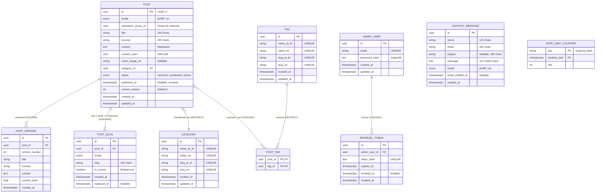

# Data Model Specification: DaviDev

**Feature ID:** `001-davidev-portfolio`  
**Status:** Approved (`/speckit.plan`)  
**Context:** `docs/architecture.md`, `specs/001-davidev-portfolio/plan.md`  
**Constitution:** `.specify/memory/constitution.md`  

---

## 1. Modelo Conceitual e Agregados DDD

O sistema é delimitado em um único Bounded Context (**Conteúdo Editorial**) subdividido em três módulos lógicos:
1.  **Editorial (Core Domain):** Post, PostVersion, PostSlug, Category, Tag.
2.  **Acesso (Supporting Domain):** AdminUser, RefreshToken.
3.  **Contato (Generic Domain):** ContactMessage.



---

## 2. Value Objects e Invariantes

| Value Object | Regras e Invariantes | Uso no Domínio |
|---|---|---|
| **Slug** | Formato minúsculo com hífens: `^[a-z0-9]+(-[a-z0-9]+)*$`. Comprimento entre 1 e 160 caracteres. Imutável. | `PostSlug`, `Category`, `Tag` |
| **Locale** | Restrito a `pt-BR` ou `en`. Idioma padrão do sistema é `pt-BR`. | `Post`, `PostSlug`, `ContactMessage` |
| **Email** | Formato RFC 5322 válido, comprimento $\le 254$ caracteres. Normalizado em lowercase no construtor. | `AdminUser`, `ContactMessage` |
| **MarkdownContent** | Corpo em texto Markdown acompanhado obrigatoriamente de seu hash SHA-256 (`content_hash`). Comparações de versão utilizam o hash. | `Post`, `PostVersion` |

---

## 3. Schema Drizzle ORM (TypeScript)

Abaixo está a definição prescritiva em TypeScript para o `packages/infrastructure/schema.ts`:

```typescript
import { pgTable, uuid, varchar, text, timestamp, boolean, integer, char, primaryKey, uniqueIndex, index, pgEnum } from 'drizzle-orm/pg-core';
import { relations } from 'drizzle-orm';

// Enums
export const postStatusEnum = pgEnum('post_status', ['rascunho', 'publicado', 'lixeira']);
export const postLocaleEnum = pgEnum('post_locale', ['pt-BR', 'en']);

// 1. Admin User
export const adminUsers = pgTable('admin_user', {
  id: uuid('id').primaryKey(),
  email: varchar('email', { length: 254 }).notNull().unique(),
  passwordHash: text('password_hash').notNull(),
  createdAt: timestamp('created_at', { withTimezone: true }).defaultNow().notNull(),
  updatedAt: timestamp('updated_at', { withTimezone: true }).defaultNow().notNull(),
});

// 2. Refresh Token
export const refreshTokens = pgTable('refresh_token', {
  id: uuid('id').primaryKey(),
  adminUserId: uuid('admin_user_id').notNull().references(() => adminUsers.id, { onDelete: 'cascade' }),
  tokenHash: text('token_hash').notNull().unique(),
  expiresAt: timestamp('expires_at', { withTimezone: true }).notNull(),
  revokedAt: timestamp('revoked_at', { withTimezone: true }),
  createdAt: timestamp('created_at', { withTimezone: true }).defaultNow().notNull(),
}, (t) => [
  index('idx_refresh_token_expires_at').on(t.expiresAt),
]);

// 3. Category
export const categories = pgTable('category', {
  id: uuid('id').primaryKey(),
  namePtBr: varchar('name_pt_br', { length: 60 }).notNull().unique(),
  nameEn: varchar('name_en', { length: 60 }).notNull().unique(),
  slugPtBr: varchar('slug_pt_br', { length: 60 }).notNull().unique(),
  slugEn: varchar('slug_en', { length: 60 }).notNull().unique(),
  createdAt: timestamp('created_at', { withTimezone: true }).defaultNow().notNull(),
  updatedAt: timestamp('updated_at', { withTimezone: true }).defaultNow().notNull(),
});

// 4. Tag
export const tags = pgTable('tag', {
  id: uuid('id').primaryKey(),
  namePtBr: varchar('name_pt_br', { length: 40 }).notNull().unique(),
  nameEn: varchar('name_en', { length: 40 }).notNull().unique(),
  slugPtBr: varchar('slug_pt_br', { length: 40 }).notNull().unique(),
  slugEn: varchar('slug_en', { length: 40 }).notNull().unique(),
  createdAt: timestamp('created_at', { withTimezone: true }).defaultNow().notNull(),
  updatedAt: timestamp('updated_at', { withTimezone: true }).defaultNow().notNull(),
});

// 5. Post
export const posts = pgTable('post', {
  id: uuid('id').primaryKey(),
  locale: postLocaleEnum('locale').notNull(),
  translationGroupId: uuid('translation_group_id').notNull(),
  title: varchar('title', { length: 160 }).notNull(),
  excerpt: varchar('excerpt', { length: 320 }).notNull(),
  content: text('content').notNull(),
  contentHash: char('content_hash', { length: 64 }).notNull(),
  coverImageUrl: text('cover_image_url'),
  categoryId: uuid('category_id').notNull().references(() => categories.id, { onDelete: 'restrict' }),
  status: postStatusEnum('status').default('rascunho').notNull(),
  publishedAt: timestamp('published_at', { withTimezone: true }),
  currentVersion: integer('current_version').default(1).notNull(),
  createdAt: timestamp('created_at', { withTimezone: true }).defaultNow().notNull(),
  updatedAt: timestamp('updated_at', { withTimezone: true }).defaultNow().notNull(),
}, (t) => [
  uniqueIndex('uq_post_translation_locale').on(t.translationGroupId, t.locale),
  index('idx_post_public_listing').on(t.status, t.locale, t.publishedAt),
  index('idx_post_category').on(t.categoryId),
  index('idx_post_translation_group').on(t.translationGroupId),
]);

// 6. Post Slug (Atual e Históricos)
export const postSlugs = pgTable('post_slug', {
  id: uuid('id').primaryKey(),
  postId: uuid('post_id').notNull().references(() => posts.id, { onDelete: 'cascade' }),
  locale: postLocaleEnum('locale').notNull(),
  slug: varchar('slug', { length: 160 }).notNull(),
  isCurrent: boolean('is_current').default(true).notNull(),
  createdAt: timestamp('created_at', { withTimezone: true }).defaultNow().notNull(),
  replacedAt: timestamp('replaced_at', { withTimezone: true }),
}, (t) => [
  uniqueIndex('uq_post_slug_locale').on(t.slug, t.locale),
  uniqueIndex('uq_post_slug_current').on(t.postId, t.locale).where(t.isCurrent),
]);

// 7. Post Version (Apenas Conteúdo Textual)
export const postVersions = pgTable('post_version', {
  id: uuid('id').primaryKey(),
  postId: uuid('post_id').notNull().references(() => posts.id, { onDelete: 'cascade' }),
  versionNumber: integer('version_number').notNull(),
  title: varchar('title', { length: 160 }).notNull(),
  excerpt: varchar('excerpt', { length: 320 }).notNull(),
  content: text('content').notNull(),
  contentHash: char('content_hash', { length: 64 }).notNull(),
  createdAt: timestamp('created_at', { withTimezone: true }).defaultNow().notNull(),
}, (t) => [
  uniqueIndex('uq_post_version_number').on(t.postId, t.versionNumber),
]);

// 8. Post Tag (N:N)
export const postTags = pgTable('post_tag', {
  postId: uuid('post_id').notNull().references(() => posts.id, { onDelete: 'cascade' }),
  tagId: uuid('tag_id').notNull().references(() => tags.id, { onDelete: 'restrict' }),
}, (t) => [
  primaryKey({ columns: [t.postId, t.tagId], name: 'pk_post_tag' }),
  index('idx_post_tag_tag').on(t.tagId),
]);

// 9. Contact Message
export const contactMessages = pgTable('contact_message', {
  id: uuid('id').primaryKey(),
  name: varchar('name', { length: 120 }).notNull(),
  email: varchar('email', { length: 254 }).notNull(),
  subject: varchar('subject', { length: 160 }),
  message: text('message').notNull(),
  locale: postLocaleEnum('locale').notNull(),
  emailNotifiedAt: timestamp('email_notified_at', { withTimezone: true }),
  createdAt: timestamp('created_at', { withTimezone: true }).defaultNow().notNull(),
}, (t) => [
  index('idx_contact_message_created').on(t.createdAt),
]);

// 10. Rate Limit Counter (Atomic Serverless Store)
export const rateLimitCounters = pgTable('rate_limit_counter', {
  key: varchar('key', { length: 200 }).notNull(),
  windowStart: timestamp('window_start', { withTimezone: true }).notNull(),
  hits: integer('hits').notNull(),
}, (t) => [
  primaryKey({ columns: [t.key, t.windowStart], name: 'pk_rate_limit_counter' }),
]);
```

---

## 4. Relações e Integridade Referencial (FKs)

| Tabela Pai | Tabela Filha | Campo FK | Regra `ON DELETE` | Sustentação de Regra de Negócio |
|---|---|---|---|---|
| `admin_user` | `refresh_token` | `admin_user_id` | **CASCADE** | Excluir admin revoga automaticamente todas as sessões. |
| `category` | `post` | `category_id` | **RESTRICT** | Sustenta **BR-009**: Categoria em uso por post não pode ser excluída. |
| `tag` | `post_tag` | `tag_id` | **RESTRICT** | Sustenta **BR-009**: Tag em uso por post não pode ser excluída. |
| `post` | `post_slug` | `post_id` | **CASCADE** | Sustenta **BR-007**: Exclusão definitiva limpa histórico de slugs. |
| `post` | `post_version` | `post_id` | **CASCADE** | Sustenta **BR-007**: Exclusão definitiva cascateia versões. |
| `post` | `post_tag` | `post_id` | **CASCADE** | Exclusão de post desassocia vínculos de tags automaticamente. |

---

## 5. Eventos de Domínio e Reações do Sistema

| Evento de Domínio | Gatilho / Momento | Ação Reativa / Consumidor |
|---|---|---|
| `PostPublished` | Transição de post para `publicado`. | Dispara revalidação ISR de `/blog/[slug]`, listagem `/blog` e `/sitemap.xml`. |
| `PostContentUpdated` | Alteração de texto após publicação com `content_hash` novo. | Cria `PostVersion` e invalida cache ISR da página do artigo. |
| `PostUnpublished` | Post retorna de `publicado` para `rascunho`. | Invalida cache ISR da rota do post (passa a responder 404). |
| `PostMovedToTrash` | Post transiciona para `lixeira`. | Invalida cache da listagem e da página pública. |
| `PostRestored` | Post sai da lixeira para `publicado` ou `rascunho`. | Revalida rotas de acordo com o status restaurado. |
| `PostPermanentlyDeleted` | Exclusão física do post a partir da lixeira. | Invalida sitemap e rotas públicas definitivamente. |
| `PostSlugChanged` | Slug do post é alterado no CMS. | Revalida a rota do novo slug e configura redirecionamento 301 do antigo. |
| `ContactMessageReceived` | Mensagem persistida na tabela `contact_message`. | Dispara envio de notificação via Resend (*best-effort*). |

---

## 6. Estratégia de Migrações (Forward-Only)

1.  **Drizzle Kit CLI:** Todas as modificações de schema geram arquivos em `packages/infrastructure/migrations/NNNN_nome_da_migration.sql`.
2.  **Forward-Only (Sem Down Migrations):** Migrações de reversão (down-migrations) são terminantemente proibidas em produção. Qualquer correção ou rollback é realizado criando uma nova migração subsequente que avança o estado do banco.
3.  **Seed Automatizado:** O seed de inicialização gera exclusivamente o `admin_user` lendo `ADMIN_EMAIL` e `ADMIN_PASSWORD` das variáveis de ambiente e aplicando hash Argon2id no provisionamento.
