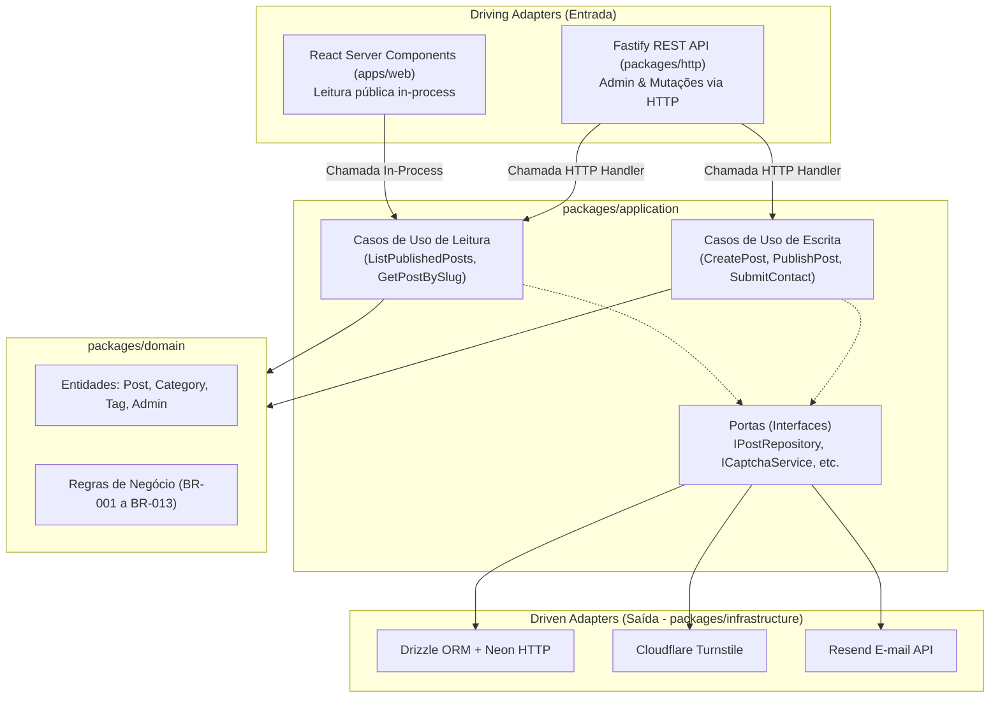

# Technical Implementation Plan: DaviDev Portfolio, Blog & CMS

**Feature ID:** `001-davidev-portfolio`  
**Status:** Approved (`/speckit.plan`)  
**Context:** `docs/architecture.md`, `specs/001-davidev-portfolio/spec.md`  
**Constitution:** `.specify/memory/constitution.md`  

---

## 1. Visão Arquitetural e Estrutura do Monorepo

O sistema adota o padrão **Monolito Modular** sob **Arquitetura Hexagonal (Ports & Adapters)**, estruturado através de `pnpm workspaces` e executado como uma aplicação unificada na Vercel (Next.js App Router + Função Serverless Fastify).

```
davidev/
├── apps/
│   └── web/                         # Next.js 15+ (App Router): Frontend e Host Serverless
│       ├── app/
│       │   ├── [locale]/            # Rotas públicas bilíngues (RSC + ISR)
│       │   │   ├── page.tsx         # Home
│       │   │   ├── sobre/           # Sobre mim
│       │   │   ├── habilidades/     # Habilidades com contexto de uso
│       │   │   ├── conhecimentos/   # Conhecimentos conceituais
│       │   │   ├── experiencias/    # Experiências profissionais
│       │   │   ├── projetos/        # Listagem e [slug]/ detalhe
│       │   │   ├── blog/            # Listagem e [slug]/ artigo
│       │   │   ├── contato/         # Formulário de contato
│       │   │   ├── como-foi-construido/ # Case study de engenharia
│       │   │   └── privacidade/     # Política de Privacidade (LGPD/GDPR)
│       │   ├── admin/               # Painel Administrativo CMS (Client-side interativo)
│       │   └── api/[...path]/       # Rota catch-all delegando ao Fastify Serverless
│       ├── components/              # Componentes UI (shadcn/ui + tokens editoriais)
│       └── lib/
│           └── composition-root.ts  # Injeção de dependência e inicialização de adaptadores
├── packages/
│   ├── domain/                      # Entidades, Value Objects, Domain Events e Regras de Negócio (Zero deps)
│   ├── application/                 # Casos de Uso (Use Cases) e Portas/Interfaces
│   ├── infrastructure/              # Adaptadores: Drizzle ORM, Neon HTTP, Resend, Turnstile, Argon2
│   ├── http/                        # Fastify API: Rotas REST, Zod Schemas, OpenAPI/Swagger
│   └── api-client/                  # Cliente TypeScript gerado via Orval a partir do OpenAPI
├── dependency-cruiser.config.js     # Enforcement estrito das regras de arquitetura (DEP-1 a DEP-7)
└── package.json                     # Monorepo root pnpm
```

---

## 2. Padrão Estruturante: Dois Driving Adapters

Para atender simultaneamente aos requisitos de desempenho (LCP $< 2.5\text{s}$) e dinamismo administrativo, o sistema conecta dois adaptadores de entrada ao mesmo núcleo de casos de uso:



### Regras de Ouro desta Abordagem:
1.  **Sem Hop de Rede no Site Público:** O Next.js não faz `fetch('https://davidev.net.br/api/v1/posts')` para gerar suas páginas estáticas. Ele instancia o caso de uso diretamente via `composition-root.ts`.
2.  **Imunidade a Cold Starts na Leitura:** O leitor anônimo consome páginas cacheadas no CDN da Vercel via ISR.
3.  **Proteção contra Vazamento:** A regra de que rascunhos nunca aparecem ao público (`BR-006`) reside no caso de uso `ListPublishedPosts`, e não no adapter HTTP ou no componente React.

---

## 3. Composição de Dependências (`composition-root.ts`)

A inicialização e ligação das portas com os adaptadores concretos é centralizada em `apps/web/lib/composition-root.ts`:

```typescript
// Exemplo arquitetural do composition root
import { drizzle } from 'drizzle-orm/neon-http';
import { neon } from '@neondatabase/serverless';
import { DrizzlePostRepository } from '@davidev/infrastructure/repositories/drizzle-post-repository';
import { DrizzleContactRepository } from '@davidev/infrastructure/repositories/drizzle-contact-repository';
import { TurnstileCaptchaService } from '@davidev/infrastructure/services/turnstile-captcha-service';
import { ResendEmailNotifier } from '@davidev/infrastructure/services/resend-email-notifier';
import { PostgresRateLimiter } from '@davidev/infrastructure/security/postgres-rate-limiter';
import { ListPublishedPostsUseCase } from '@davidev/application/use-cases/list-published-posts';
import { SubmitContactMessageUseCase } from '@davidev/application/use-cases/submit-contact-message';

// Configuração única do Neon HTTP Driver
const sql = neon(process.env.DATABASE_URL!);
export const db = drizzle(sql);

// Repositórios e Serviços (Driven Adapters)
export const postRepository = new DrizzlePostRepository(db);
export const contactRepository = new DrizzleContactRepository(db);
export const captchaService = new TurnstileCaptchaService(process.env.TURNSTILE_SECRET_KEY!);
export const emailNotifier = new ResendEmailNotifier(process.env.RESEND_API_KEY!);
export const rateLimiter = new PostgresRateLimiter(db);

// Casos de Uso prontos para consumo por RSC ou Fastify
export const listPublishedPostsUseCase = new ListPublishedPostsUseCase(postRepository);
export const submitContactMessageUseCase = new SubmitContactMessageUseCase(
  contactRepository,
  captchaService,
  emailNotifier
);
```

---

## 4. Roteiro de Implementação em Fases (Implementation Roadmap)

O desenvolvimento segue a divisão em 9 fases sequenciais prescritas no Architecture Document:

### Fase 1: Fundação & Infraestrutura Base
*   **Escopo:** Configuração do monorepo pnpm, ESLint, Prettier, `dependency-cruiser` (regras DEP-1 a DEP-7), CI com 10 gates, setup de Tailwind com tokens do design system, biblioteca shadcn/ui base, suporte a i18n (`next-intl` ou middleware próprio) e script anti-FOUC de tema.
*   **Bancos & Adapters:** Drizzle Kit configurado com migrações forward-only e conexão Neon HTTP.
*   **Entregável:** Skeleton do projeto compilando com CI 100% verde.

### Fase 2: Portfólio Institucional & Superfície Pública
*   **Escopo:** Implementação das 9 páginas públicas + Política de Privacidade nos dois idiomas (`pt-BR` e `en`): Home, Sobre, Habilidades, Conhecimentos, Experiências, Projetos (listagem e detalhe), Contato, Como foi construído.
*   **Funcionalidade Crítica:** Formulário de contato funcional com validação Zod, Cloudflare Turnstile, persistência em PostgreSQL e envio de notificação via Resend.
*   **Marco de Negócio:** **Deploy e publicação no domínio `davidev.net.br`** (mitigação do risco de abandono R-01).

### Fase 3: Blog Público & Motor Editorial
*   **Escopo:** Casos de uso de leitura pública (`ListPublishedPosts`, `GetPostBySlug`), ISR com revalidação sob demanda (`revalidateTag`), listagem com filtros e página de leitura com Markdown sanitizado, realce de código sintático e redirecionamento 301 de slugs históricos.
*   **Endpoints:** Endpoints públicos no Fastify `/api/v1/posts` e documentação Swagger ativa em `/api/docs`.

### Fase 4: Painel Administrativo (CMS)
*   **Escopo:** Autenticação JWT completa (`/api/v1/auth/login`, `refresh`, `logout`) com cookies HttpOnly SameSite=Strict e persistência de sessão. CRUD de posts, categorias e tags.
*   **Editor:** Editor Markdown com modos Editor / Preview / Split View utilizando o mesmo componente de renderização da página pública.
*   **Lixeira:** Mover para lixeira, restauração e exclusão definitiva física em cascata.

### Fase 5: Versionamento Editorial
*   **Escopo:** Implementação da entidade `PostVersion` e cálculo de `content_hash` SHA-256. Versionamento automático pós-publicação exclusivamente sob alteração de conteúdo textual (`BR-005`). Exibição pública de data de publicação e data de última atualização.

### Fase 6: Endurecimento de Segurança
*   **Escopo:** Implementação do `PostgresRateLimiter` atômico via `rate_limit_counter`, Content Security Policy (CSP) com nonce, rotação estrita de refresh tokens e testes de concorrência simulando múltiplas instâncias serverless simultâneas.

### Fase 7: Qualidade, Cobertura e Acessibilidade
*   **Escopo:** Bateria de testes de unidade cobrindo $\ge 80\%$ de `domain` e `application`. Testes de integração de repositórios Drizzle. Testes E2E com Playwright nos 7 caminhos críticos. Auditoria automatizada com `axe-core` em light e dark mode.

### Fase 8: Publicação & Go-Live Final
*   **Escopo:** Configuração de DNS definitivo, registros SPF/DKIM/DMARC no Resend, instrumentação de metas customizadas no Plausible, configuração do Vercel Cron diário de manutenção (expurgo de mensagens com $> 24$ meses).

### Fase 9: Case Study Auditável
*   **Escopo:** Publicação do case study completo na página "Como foi construído", incorporando métricas, decisões, diagramas e lições aprendidas durante o processo com agentes de IA.

---

## 5. Matriz de Riscos de Implementação e Mitigações

| Risco Técnico | Causa Raiz | Estratégia de Mitigação no Plano |
|---|---|---|
| **Esgotamento de conexões TCP** | Funções serverless abrindo conexões com Postgres tradicional sob carga. | Uso exclusivo de `@neondatabase/serverless` via protocolo HTTP stateless. Sem pool TCP local. |
| **Burlar rate limiting em serverless** | Contadores em memória evaporam em novas instâncias. | Tabela `rate_limit_counter` com upsert atômico no PostgreSQL (`INSERT ... ON CONFLICT DO UPDATE`). |
| **Vazamento de rascunhos para o público** | Next.js esquecer filtro de status na consulta direta ao banco. | Acesso exclusivo via caso de uso `ListPublishedPosts`, com regra de negócio enforçada no core. |
| **FOUC (Flash de tema claro/escuro)** | Tailwind aplicando classe `.dark` após hidratação do React. | Script inline síncrono no `head` do documento HTML verificando `localStorage` e preferência do SO antes da renderização. |
| **Inconsistência entre Preview e Artigo** | Editor usar biblioteca de Markdown diferente da página pública. | Componente único `<ArticleRenderer markdown={content} />` compartilhado entre `app/[locale]/blog/[slug]` e `app/admin/editor`. |
